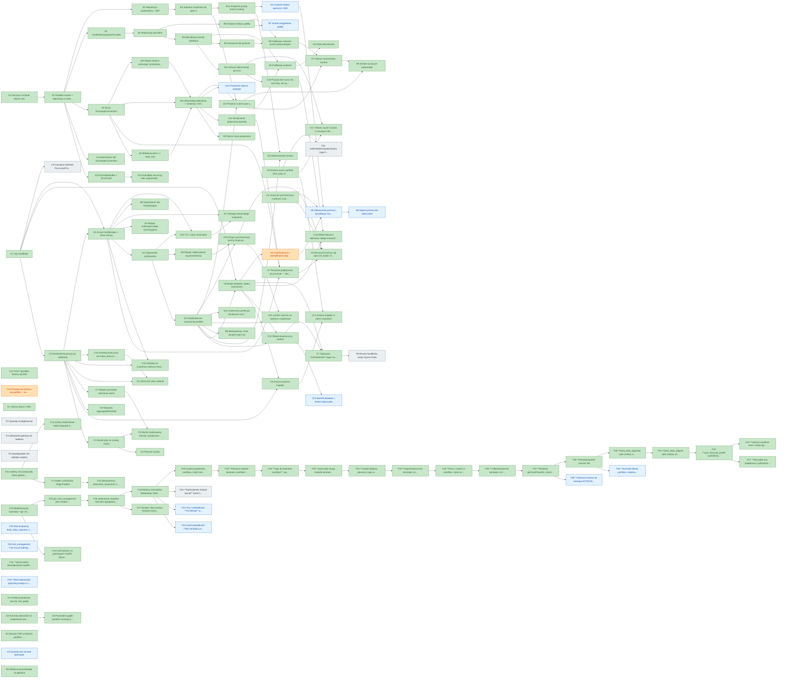

# OKX → Portfolio — tablica zadań

Lista robocza do śledzenia postępu. **Ten plik jest źródłem prawdy o statusach**; uzasadnienia,
diagramy i kontekst są w [analizie](2026-09-18-okx-exchange-backend-integration.md).

Aktualizując status, zmieniaj go **tutaj**, nie w analizie — a potem przelicz tablicę:

```bash
python3 tools/task-board/refresh.py
```

Sekcje **Postęp** i **Gotowe do wzięcia** są **wyprowadzane** z tabel poniżej i nie należy ich
edytować ręcznie. Skrypt sprawdza przy okazji spójność zależności: nieznane id, duplikaty oraz
wpisy w kolumnie „odblokowuje", którym po drugiej stronie nie odpowiada zależność.
Tryb `--check` (bez zapisu) nadaje się do CI.

## Legenda

| priorytet | znaczenie |
|---|---|
| **P0** | blokuje POC |
| **P1** | poprawność liczb |
| **P2** | poprawność długoterminowa |
| **P3** | dług techniczny |

| status | znaczenie |
|---|---|
| `open` | nierozpoczęte |
| `wip` | w toku |
| `blocked` | zablokowane, opisz czym |
| `finished` | zrobione |

## Postęp

| | P0 | P1 | P2 | P3 | razem |
|---|---|---|---|---|---|
| `finished` | 25 | 31 | 32 | 6 | **94** |
| `open` | 0 | 2 | 14 | 7 | **23** |
| **razem** | 25 | 33 | 46 | 13 | **117** |

## Gotowe do wzięcia

Zadania otwarte, których **wszystkie zależności są zrobione**.

| # | prio | zadanie | odblokowuje |
|---|---|---|---|
| **C19** | P1 | Prowizja nie dociera do portfela — koszt zaniżony, zysk zawyżony; prowizja w trzecim aktywie nie zmniejsza stanu. Rozpisane w [zadaniu](2026-10-13-fee-in-cost-basis.md) | — |
| **H2** | P1 | `ContributionId` z identyfikatora depozytu na giełdzie | H5 |
| **A12** | P2 | Producent statusu `ERROR` | — |
| **B7** | P2 | Sonda osiągalności giełdy | — |
| **C13** | P2 | Backfill wkładów z historii depozytów | — |
| **F19** | P2 | Dwa endpointy `bank_data_ingestion` odpowiadają **200 na błąd** (upload CSV, rollback po finalizacji), a testy, które by to złapały, są `@Disabled`; trzeci `@Disabled` opisuje scenariusz, który już nie istnieje — do usunięcia | — |
| **F20** | P2 | `risk_management` **nie ma ani jednego testu** — pięć klas liczących RAG, stop-lossy i kwotę pod ryzykiem; wyszło przy wydzielaniu `vidulum-risk` (krok 09) | — |
| **F22** | P2 | `UserCreatedEvent` **bez kontraktu producenta** — `vidulum-user-api` albo wyjście domeny użytkownika z bootstrapu (krok 05b); zdejmuje dwa odstępstwa ArchUnita | — |
| **F23** | P2 | Trzy `*UnifiedEvent` **na rekordy** plus `UserId` w payloadach (krok 05c); zdejmuje 7 odstępstw i ostatni `group_id7` | — |
| **F26** | P2 | **Kontrakt klienta cashflow: ostatnia metoda portu i drugi ręczny klient.** `vidulum-cashflow-api` ma pięć metod i działający adapter HTTP, a na porcie ingestion został `getCashFlowInfo` **z jednym wołającym** (`StageTransactions`) — po F37 trzech pozostałych zeszło na szkielet. Zostaje z powodu strukturalnego: **scala stan cashflow ze statusami miesięcy z modułu prognoz**, a te są modelem odczytu utrzymywanym asynchronicznie ze zdarzeń Kafki i mają sześć statusów przeciw trzem w agregacie. Czyli **`cashflow-forecast-api`, nie ta**. Osobno: **recurring-rules ma drugi, niezależny ręczny klient** (`CashFlowHttpClient`, 5 metod, własny `CashFlowInfo`, parsowanie cudzego JSON-a jako `Map<String, Object>` z `@SuppressWarnings`) — `validateCategoryExists` szkielet już odpowiada, trzy pozostałe to realne zapisy. Plus odzyskanie 7 typów cashflow ze shared-kernela, czyli największy kawałek F24. Decyzja o HTTP podjęta; część zdarzeniowa pokrywa się z F23 | — |
| **F35** | P2 | **Brak blokowania optymistycznego w całym projekcie.** `@Version` nie występuje ani raz, a `DomainCashFlowRepositoryImpl.save` **podmienia cały dokument** — dwie równoległe operacje na tym samym cash flow gubią jedną z nich, cicho. Wyszło przy F34: straż idempotencji w agregacie nie może być odporna na wyścig, dopóki tego nie ma. Dotyczy **każdej** operacji na cash flow, nie tylko importu: rollover, kategorie, potwierdzanie transakcji. Zakres: `@Version` na encjach agregatów + obsługa `OptimisticLockingFailureException` w handlerach, albo świadoma decyzja, że last-write-wins jest akceptowalne i zapisanie jej gdzieś | — |
| **F38** | P2 | **Odmowa importu do miesiąca `ATTESTED` nie jest pokryta żadnym testem.** Reguła „miesiąc zaatestowany jest tylko do odczytu" żyje w `StageTransactionsCommandHandler`, ale `TestCashFlowServiceClient.generateMonthStatuses` **wymyśla statusy z heurystyki** i przyznaje w komentarzu, że nie umie `ATTESTED` ani `IMPORTED` („For test purposes, assume ROLLED_OVER for past months"). Jedyne wystąpienia `ATTESTED` w `src/test` to ten komentarz i dwa generatory, których surefire nie uruchamia. Wyszło przy F37; **nie zależy od decyzji o `cashflow-forecast-api`** — test da się napisać dziś, podstawiając statusy wprost | — |
| **G4** | P2 | `Quantity` bez kontroli jednostek | — |
| **H4** | P2 | Czytanie historii operacji z OKX | H5 |
| **F2** | P3 | `Quantity` na `BigDecimal` | — |
| **F21** | P3 | `GetPortfolioValuationQuery` i jego handler **bez ani jednego nadawcy** — pierwsza metoda kontraktu `vidulum-pnl` albo do usunięcia | — |
| **F24** | P3 | **Odchudzenie shared-kernel** (krok 07) — dziś rozdaje Springa, Mongo, Kafkę i JWT tranzytywnie wszystkim, także kontraktom | — |
| **F3** | P3 | Usunięcie sentineli `Price.one`/`Price.zero` | — |
| **F4** | P3 | `websocket-gateway` do reaktora | — |
| **F5** | P3 | `/quote/publish` nie waliduje wejścia | — |
| **F8** | P3 | Reszta handlerów wciąż trzyma `Clock` | — |

## Zadania według ścieżek

### A — Fundamenty modułu

| # | prio | status | zadanie | zależy od | odblokowuje |
|---|---|---|---|---|---|
| **A1** | P0 | **finished** | Decyzja o module Maven `okx` | — | A2 |
| **A2** | P0 | **finished** | Szkielet modułu + rejestracja w reaktorze | A1 | A3, A5, A4, B1, E2 |
| **A10** | P0 | **finished** | Moduł `vidulum-exchange` i przeniesienie modelu połączenia | A5 | A8 |
| **A3** | P1 | **finished** | `ErrorHttpHandler` + `ErrorCode` | A2 | — |
| **A5** | P0 | **finished** | Encja `ExchangeConnection` | A2 | A6, A7, A8, A10 |
| **A6** | P0 | **finished** | Walidacja `perm == read_only` | A5 | A8 |
| **A8** | P0 | **finished** | Onboarding połączenia — komendy i endpointy | A5, A6, A10 | E4, A9, A11, A12 |
| **A9** | P1 | **finished** | Odczyt stanu połączenia | A8 | — |
| **A4** | P1 | **finished** | `DataCleaner` dla `ExchangeConnection` | A2 | — |
| **A11** | P0 | **finished** | Rozłączenie połączenia (`revoke`) | A8 | A7 |
| **A13** | P2 | **finished** | Kod błędu recurring-rules odpowiadał na każdy brakujący parametr | A3 | — |
| **A12** | P2 | `open` | Producent statusu `ERROR` | A8 | — |
| **A7** | P1 | **finished** | Ponowne podłączenie po przerwie — dostarczone przez H1 i H3 | A5, A11, D1 | H3 |

### B — Broker i notowania

| # | prio | status | zadanie | zależy od | odblokowuje |
|---|---|---|---|---|---|
| **B1** | P0 | **finished** | `OkxBrokerQuotationProvider` | A2 | B2 |
| **B2** | P0 | **finished** | Rejestracja providera | B1 | B3, B6 |
| **B3** | P0 | **finished** | Weryfikacja ścieżki publikacji | B2 | B5, B4, E5 |
| **B5** | P0 | **finished** | Notowania dla gotówki | B3 | E8 |
| **B6** | P1 | **finished** | Endpoint statusu giełdy | B2 | E8, B7 |
| **B4** | P2 | **finished** | Łańcuch denominacji do PLN | B3 | C16, C17 |
| **B7** | P2 | `open` | Sonda osiągalności giełdy | B6 | — |

### C — Model Portfolio i Asset

| # | prio | status | zadanie | zależy od | odblokowuje |
|---|---|---|---|---|---|
| **C1** | P0 | **finished** | Typ `CostBasis` | — | C2, C9, D1, F3 |
| **C2** | P0 | **finished** | Rozdzielenie pozycji po `subName` | C1 | C3, C5, C6, C7, C8, D1 |
| **C10** | P0 | **finished** | Gotówka ze snapshotu trafia do `transferred-in`, nie do `none` | C2, D1 | — |
| **C3** | P1 | **finished** | Wynik tylko ze znanej części | C2 | C4 |
| **C4** | P1 | **finished** | Pokrycie wyniku | C3 | — |
| **C5** | P1 | **finished** | Zmiana wartości majątku | C2, C9 | C14 |
| **C6** | P1 | **finished** | Naprawa `AggregatedPortfolio` | C2 | — |
| **C7** | P2 | **finished** | Reguła sprzedaży nieznanej części | C2 | F6 |
| **C9** | P1 | **finished** | Model wkładów i jeden mechanizm | C1, D3 | C5, C12, F7 |
| **C8** | P2 | **finished** | „Nieznane" jako zadanie | C2, C15 | — |
| **C12** | P1 | **finished** | Wkład otwarcia przy `confirm` | C9, D3 | C13, F7 |
| **C13** | P2 | `open` | Backfill wkładów z historii depozytów | C12 | — |
| **C14** | P2 | **finished** | Zmiana majątku w oknie czasowym | C5, F9 | — |
| **C15** | P1 | **finished** | `AssetSummaryJson` nie mówi, która to pozycja | C2 | — |
| **C16** | P1 | **finished** | Pozycja bez kursu ma być luką, nie wyjątkiem na cały portfel | B4 | C18 |
| **C17** | P1 | **finished** | Historia wycen liczona w zaszytym dolarze | F9, B4 | — |
| **C18** | P1 | **finished** | Wkład otwarcia odmawia całego onboardingu, gdy jednej pozycji nikt nie notuje | C16, C9 | — |
| **C19** | P1 | `open` | Prowizja nie dociera do portfela — koszt zaniżony, zysk zawyżony; prowizja w trzecim aktywie nie zmniejsza stanu. Rozpisane w [zadaniu](2026-10-13-fee-in-cost-basis.md) | — | — |
| **C11** | P2 | **finished** | `POST /portfolio` kończy się 500 | — | — |

### D — PortfolioSpec

| # | prio | status | zadanie | zależy od | odblokowuje |
|---|---|---|---|---|---|
| **D1** | P0 | **finished** | Encja `PortfolioSpec` + silnik różnicy | C1, C2 | D2, D4, D7, D10, D9, A7 |
| **D2** | P0 | **finished** | Odpowiedzi użytkownika | D1 | D3, D6 |
| **D3** | P0 | **finished** | Zatwierdzenie i utworzenie portfela | D2 | C9, C12, D5, D8, D11, D12, D13, E4 |
| **D4** | P0 | **finished** | Reguły automatycznego rozstrzygania | D1 | — |
| **D5** | P1 | **finished** | Odwzorowanie locków | D3, E10 | — |
| **D6** | P1 | **finished** | Reguły nadpisywania wg proweniencji | D2 | D13 |
| **D7** | P2 | **finished** | Obsługa zestarzałego snapshotu | D1, D10 | — |
| **D8** | P2 | **finished** | Idempotencja i brak pustych spec-ów | D3 | — |
| **D10** | P1 | **finished** | TTL i stany terminalne | D1, D2 | — |
| **D11** | P1 | **finished** | `confirm` zawsze na świeżym snapshocie | D3, D13 | — |
| **D9** | P1 | **finished** | `DataCleaner` dla `PortfolioSpec` | D1 | — |
| **D12** | P0 | **finished** | Osierocony portfel po nieudanym `confirm` połączenia | D3 | — |
| **D13** | P1 | **finished** | Druga synchronizacja tworzy drugi portfel | D3, D6 | D11 |

### E — POC w Node

| # | prio | status | zadanie | zależy od | odblokowuje |
|---|---|---|---|---|---|
| **E1** | P0 | **finished** | Odczyt stanu z OKX | — | — |
| **E2** | P0 | **finished** | Rejestracja użytkownika + JWT | A2 | E3 |
| **E3** | P0 | **finished** | Zebranie snapshotu do spec-u | E2 | E4, E10 |
| **E8** | P0 | **finished** | Publikacja notowań przed onboardingiem | B5, B6 | E7 |
| **E4** | P0 | **finished** | Przejście ścieżki spec-u | A8, D3, E3 | E5, E7, E9 |
| **E5** | P1 | **finished** | Publikacja notowań | B3, E4 | E6 |
| **E6** | P1 | **finished** | Pętla odświeżania | E5 | — |
| **E7** | P1 | **finished** | Odczyt i prezentacja wyceny | E4, E8 | E9 |
| **E9** | P1 | **finished** | Smoke na żywym backendzie | E4, E7 | — |
| **E10** | P1 | **finished** | Snapshot pomija konto Funding | E3 | — |

### G — Portfel prowadzony ręcznie

| # | prio | status | zadanie | zależy od | odblokowuje |
|---|---|---|---|---|---|
| **G1** | P0 | **finished** | Portfel prowadzony ręcznie, bez giełdy | — | — |
| **G2** | P1 | **finished** | Kontrola własności na endpointach portfela i transakcji | — | G6 |
| **G3** | P1 | **finished** | Zaszyte `USD` w kliencie portfela i `Order.getTotal()` | — | — |
| **G5** | P2 | **finished** | Wpłata kasuje blokadę na gotówce | — | — |
| **G4** | P2 | `open` | `Quantity` bez kontroli jednostek | — | — |
| **G6** | P2 | **finished** | Pozostałe wyjątki portfela zwracają 500 zamiast swoich kodów | G2 | — |

### H — Synchronizacja po przerwie

Rozwinięte w [osobnej analizie](2026-10-11-okx-reconnect-reconciliation.md): przepływ danych,
co dzieje się z portfelem operacja po operacji i czego robić nie wolno. Kolejność jest sztywna —
każde następne zadanie psuje dane bez poprzedniego.

| # | prio | status | zadanie | zależy od | odblokowuje |
|---|---|---|---|---|---|
| **H1** | P1 | **finished** | Znacznik synchronizacji o jednym znaczeniu | — | H3, H5 |
| **H2** | P1 | `open` | `ContributionId` z identyfikatora depozytu na giełdzie | C9 | H5 |
| **H3** | P1 | **finished** | Reconnect kończy się spec-em wobec niepustego stanu znanego | A7, H1, D13 | — |
| **H4** | P2 | `open` | Czytanie historii operacji z OKX | E10 | H5 |
| **H5** | P2 | `open` | Odtworzenie przerwy i weryfikacja snapshotem | H1, H2, H4 | H6 |
| **H6** | P2 | `open` | Raport przerwy dla właściciela | H5 | — |

### F — Dług techniczny

| # | prio | status | zadanie | zależy od | odblokowuje |
|---|---|---|---|---|---|
| **F1** | P2 | **finished** | Indeks unikalności `OriginTradeId` | F11 | F10 |
| **F10** | P2 | **finished** | Idempotencja listenerów: dwukrotne *zastosowanie* zapisanej transakcji | F1 | — |
| **F11** | P2 | **finished** | Indeksy nie przeżywały startu aplikacji | — | F1, F12 |
| **F5** | P3 | `open` | `/quote/publish` nie waliduje wejścia | — | — |
| **F6** | P2 | **finished** | Wynik zrealizowany zniknął z podsumowania | C3, C7 | — |
| **F2** | P3 | `open` | `Quantity` na `BigDecimal` | — | — |
| **F3** | P3 | `open` | Usunięcie sentineli `Price.one`/`Price.zero` | C1 | — |
| **F4** | P3 | `open` | `websocket-gateway` do reaktora | — | — |
| **F7** | P3 | **finished** | Typowane `ContributionId` i zegar na krawędzi | C9, C12 | F8 |
| **F8** | P3 | `open` | Reszta handlerów wciąż trzyma `Clock` | F7 | — |
| **F9** | P2 | **finished** | Historia wycen portfela (PnL) jako źródło punktu odniesienia | — | C14, C17 |
| **F12** | P2 | **finished** | Szósty `DataCleaner` nadal dropował kolekcję — F11 poprawiło pięć, `RecurringRuleDataCleaner` w zagnieżdżonym module przeoczony; przy okazji checklista w `CLAUDE.md` przestała zalecać `dropCollection` | F11 | — |
| **F13** | P3 | **finished** | Modularyzacja: kontrakty `*-api` i implementacje jako osobne artefakty Mavena — portfolio, trading, quotation i exchange wyszły z `vidulum-wealth`; **tylko `vidulum-app` kompiluje się przeciw implementacjom**, reszta widzi wyłącznie kontrakty. Kroki 02–06c w [projekcie](2026-10-12-module-contracts-api-impl-split.md); otwarte zostały 01 (ArchUnit), 05b, 05c, 07 | — | F14, F15 |
| **F14** | P2 | **finished** | Cykl beanów na gatewayach CQRS: `@Lazy` w ośmiu miejscach odkładał go za proxy, zamiast usuwać — przez co start aplikacji przestał dowodzić, że graf beanów się spina. `CqrsGatewayConfiguration` rejestruje handlery po utworzeniu singletonów, więc gateway nie ma zależności; cztery kopie definicji beanów zastąpione jedną, a `IllegalArgumentException` bez komunikatu dostał nazwę komendy. Krok 08 w [projekcie](2026-10-12-module-contracts-api-impl-split.md) | F13 | — |
| **F15** | P3 | **finished** | `pnl` i `risk_management` jako osobne artefakty Mavena, **bez modułów `-api`** — oba są liśćmi, kontrakt miałby zero konsumentów. `vidulum-wealth` zostaje bez `src/main` i zmienia nazwę na **`vidulum-wealth-tests`**; przy okazji usunięta martwa zależność `vidulum-okx` → `vidulum-wealth` i `application.yml` z sekretem JWT zszedł z classpathu produkcyjnego. Krok 09 w [projekcie](2026-10-12-module-contracts-api-impl-split.md) | F13 | F16 |
| **F16** | P3 | **finished** | Jedenaście modułów pod dwa agregatory: `market/` (quotation, exchange, okx) i `wealth/` (portfolio, trading, pnl, risk) — korzeń z 17 wpisów do ośmiu. Krawędź `market → wealth` nie istnieje (zmierzone: zero importów), `wealth → market` idzie tylko przez `*-api`. Agregatory, nie rodzice, więc zero zmian w zależnościach; `-pl` w dokumentacji przepisane na odporną formę `:artifactId`. Krok 10 w [projekcie](2026-10-12-module-contracts-api-impl-split.md) | F15 | F17, F18 |
| **F17** | P3 | **finished** | `lombok` i dwa startery testowe wyciągnięte do `<dependencies>` korzenia — 38 deklaracji mniej w 15 pomach, wszystkie cztery kontrakty mają teraz **po jednej zależności**. Pomysł „agregator grupy jako rodzic” odrzucony po pomiarze: wspólny zbiór całej grupy to jedna zależność, a zbiór implementacji zawiera `*-api`, czyli Maven odrzuciłby `vidulum-portfolio-api` zależne od siebie. Krok 11a w [projekcie](2026-10-12-module-contracts-api-impl-split.md) | F16 | — |
| **F18** | P2 | **finished** | Markery kontraktów (`ModuleApi`, `ModuleSpi`, `ModuleEventHandler`, `IntegrationEvent`) i **ArchUnit, który je czyta** — osiem reguł w `ModuleBoundariesArchTest`. Reguła „nikt nie sięga do `app`/`domain`/`infrastructure` innego modułu” jest zielona bez odstępstw: granica pilnowana dotąd grepem pilnuje się sama. Znalezione od razu: `PortfolioAccess` publiczny bez powodu. Trzy listy odstępstw w tym teście są miarą dla F22, F23 i F24. Krok 12 w [projekcie](2026-10-12-module-contracts-api-impl-split.md) | F16 | F22, F23, F24, F25 |
| **F19** | P2 | `open` | Dwa endpointy `bank_data_ingestion` odpowiadają **200 na błąd** (upload CSV, rollback po finalizacji), a testy, które by to złapały, są `@Disabled`; trzeci `@Disabled` opisuje scenariusz, który już nie istnieje — do usunięcia | — | — |
| **F20** | P2 | `open` | `risk_management` **nie ma ani jednego testu** — pięć klas liczących RAG, stop-lossy i kwotę pod ryzykiem; wyszło przy wydzielaniu `vidulum-risk` (krok 09) | — | — |
| **F21** | P3 | `open` | `GetPortfolioValuationQuery` i jego handler **bez ani jednego nadawcy** — pierwsza metoda kontraktu `vidulum-pnl` albo do usunięcia | F9 | — |
| **F22** | P2 | `open` | `UserCreatedEvent` **bez kontraktu producenta** — `vidulum-user-api` albo wyjście domeny użytkownika z bootstrapu (krok 05b); zdejmuje dwa odstępstwa ArchUnita | F18 | — |
| **F23** | P2 | `open` | Trzy `*UnifiedEvent` **na rekordy** plus `UserId` w payloadach (krok 05c); zdejmuje 7 odstępstw i ostatni `group_id7` | F18 | — |
| **F24** | P3 | `open` | **Odchudzenie shared-kernel** (krok 07) — dziś rozdaje Springa, Mongo, Kafkę i JWT tranzytywnie wszystkim, także kontraktom | F18 | — |
| **F25** | P2 | **finished** | Granice poddomen cashflow, część tania: `CashFlowDataCleaner` czyścił **10 kolekcji z czterech poddomen** → cztery cleanery, po jednym na poddomenę (reguła z kroku 03, pominięta wtedy w cashflow); `cashflow` i `recurring_rules` dołączone do reguły `assertSealed`; `recurring_rules` przestał trafiać do aplikacji **tranzytywnie** i jest deklarowany przez bootstrap; nowy `BootstrapWiresEveryModuleTest` pilnuje, że każdy moduł implementacyjny **jest** w kontekście. Krok 13 w [analizie](2026-10-16-cashflow-module-boundaries.md) | F18 | F28 |
| **F26** | P2 | `open` | **Kontrakt klienta cashflow: ostatnia metoda portu i drugi ręczny klient.** `vidulum-cashflow-api` ma pięć metod i działający adapter HTTP, a na porcie ingestion został `getCashFlowInfo` **z jednym wołającym** (`StageTransactions`) — po F37 trzech pozostałych zeszło na szkielet. Zostaje z powodu strukturalnego: **scala stan cashflow ze statusami miesięcy z modułu prognoz**, a te są modelem odczytu utrzymywanym asynchronicznie ze zdarzeń Kafki i mają sześć statusów przeciw trzem w agregacie. Czyli **`cashflow-forecast-api`, nie ta**. Osobno: **recurring-rules ma drugi, niezależny ręczny klient** (`CashFlowHttpClient`, 5 metod, własny `CashFlowInfo`, parsowanie cudzego JSON-a jako `Map<String, Object>` z `@SuppressWarnings`) — `validateCategoryExists` szkielet już odpowiada, trzy pozostałe to realne zapisy. Plus odzyskanie 7 typów cashflow ze shared-kernela, czyli największy kawałek F24. Decyzja o HTTP podjęta; część zdarzeniowa pokrywa się z F23 | F39 | — |
| **F27** | P3 | **finished** | **Wszystkie trzy poddomeny wydzielone**: `bank_data_ingestion` (F40), `bank_data_adapter` (F41), `user_financial_profile` (F42). `vidulum-cashflow` to już tylko agregat i jego read model. Odczyt przez `DomainCashFlowRepository` **już zdjęty** (F28); z domeny cashflow został `Type` w 39 plikach, w tym w czterech encjach Mongo | F42 | — |
| **F28** | P2 | **finished** | **Pierwsza metoda kontraktu cashflow** (`skeletonOf`) i **jeden wyjątek zamiast trzech**: usunięte `CashFlowDoesNotExistsException` (41 plików), zagnieżdżony w porcie `RuntimeException` i klasa z recurring-rules, razem z pięcioma blokami `try/catch`, które tłumaczyły niezmapowany typ. `GetStagingPreviewQueryHandler` przestaje ładować agregat po dwa pola (−38/+25). **Przy okazji: `RevalidateStaging` i `ForceUncategorized` odpowiadały 500 zamiast 404** na nieistniejący cashflow. Krok 14 w [analizie](2026-10-16-cashflow-module-boundaries.md) | F25 | F29 |
| **F29** | P2 | **finished** | **`Type` do kontraktu cashflow**: najszerzej współdzielony typ (95 plików, w tym **4 encje Mongo**) przeniesiony z `cashflow.domain` do `cashflow-api`. Dane nietknięte — enum zapisuje się nazwą stałej, bez `_class`. **`bank_data_ingestion` zszedł z listy odstępstw `assertSealed`**: 121 plików widzi teraz z cashflow wyłącznie `cashflow.api`. Krok 15 w [analizie](2026-10-16-cashflow-module-boundaries.md) | F28 | F30 |
| **F30** | P2 | **finished** | **`exists` jako druga metoda kontraktu** — trzy miejsca przestają kupować boolean za dwa żądania HTTP z pełnym payloadem. `AiCategorize` schodzi z czterech żądań do jednego `skeletonOf` i **przestaje wstrzykiwać port**; `exists` usunięte z `CashFlowServiceClient` i pięciu implementacji. Krok 16 w [analizie](2026-10-16-cashflow-module-boundaries.md) | F29 | F32 |
| **F31** | P1 | **finished** | **`JsonContent` rekonfigurował współdzielony `ObjectMapper` przy każdym odczycie** — `findAndRegisterModules()` w `to()`, wołanym przez **dwa listenery Kafki** z topicu `cash_flow`. Dwa tryby: wyścig na konfiguracji oraz discovery przez `ServiceLoader` z **context classloaderem wątku**, które trwale rejestruje mniej modułów dla wszystkich. Konfiguracja przeniesiona do inicjalizatora statycznego. **Dowód przyczynowy: brak** — 5 błędów w jednym przebiegu, ale suita powtórzona na starym kodzie przeszła; uzasadnienie jest mechanizmem, nie pomiarem. Sekcja 12 w [analizie](2026-10-16-cashflow-module-boundaries.md) | — | — |
| **F32** | P2 | **finished** | **`createCategory`: pierwszy zapis w kontrakcie, i dwa transporty zamiast jednego.** `isImport` **w sygnaturze** — dotąd klient HTTP wbijał `?isImport=true` w URL, więc jedyny wołający, który importem nie był (`accept-ai`), dostawał uprawnienia importu po cichu i żaden call site nie mówił, czym jest. Dwie wzajemnie wyłączne implementacje za `vidulum.cashflow.api.transport` (domyślnie `in-process`) — **i to jest zmiana zachowania produkcji**: `matchIfMissing=true` na nieustawionej właściwości sprawiało, że monolit zakładał kategorie wołając **własne endpointy po loopbacku, raz na kategorię**; nie wyszło to nigdy, bo każdy test integracyjny tę właściwość wyłączał i podstawiał dubler. Adapter HTTP trafia do `vidulum-cashflow`, bo wiedza o URL-ach należy do właściciela endpointów. `CategoryAlreadyExistsException` do `api/error` — **znowu dwie klasy o tym samym, jedna bez `ErrorCode`**. Odchudzone: martwy `HttpTestCashFlowServiceClient` usunięty cały, dwa dublery bez metody, `AcceptAiSuggestions` **odłączony od portu w całości**; 29 klas testowych przeszło z atrapy na kod produkcyjny. Krok 17 w [analizie](2026-10-16-cashflow-module-boundaries.md) | F30 | F33 |
| **F33** | P2 | **finished** | **`importHistorical` do kontraktu: prawdziwe typy i jedna reguła dat.** Port był jedynym miejscem, które psuło dane — oba końce trzymały `Money` i `ZonedDateTime`, a pośrednik schodził na `double`/`LocalDate`, po czym klient HTTP odtwarzał `atStartOfDay(ZoneId.systemDefault())`. Zmierzone: **godzina i strefa ginęły całkowicie** (zapisany moment zależał od strefy serwera — przy granicy miesiąca przenosi transakcję do innego miesiąca), **kwota traciła skalę, nie wartość** (`1234.50`→`1234.5`; **moja pierwsza analiza mówiła o utracie precyzji i była przesadzona** — sabotaż na `1234.57` przeszedł, bo ta wartość przetrwała round trip). Reguła dat **istniała dwa razy** i już się rozjechała: pięć typowanych wyjątków w `ImportHistoricalCashChangeCommandHandler` i te same pięć warunków jako `String.format` w `StageTransactionsCommandHandler`. Teraz jedna implementacja — `ImportWindow` w kontrakcie, **wartość a nie metoda**, bo `CashFlowSkeletonView` już nosi wszystkie trzy wejścia, więc 402 wiersze walidują się lokalnie po jednym `skeletonOf`. Pięć wyjątków do `api/error`; `ImportWindowTest` to **pierwszy test jednostkowy tej reguły w ogóle** (10 testów, dwa przypinają precedencję, od której zależy `ErrorCode` endpointu). Port: 3 metody → 2. **Pominięte świadomie:** `dueDate` jako kopia `paidDate` (sprawdzone, że nic nie psuje) i `bankTransactionId` (punkt 4, osobny koszt — brak idempotencji zostaje). Krok 18 w [analizie](2026-10-16-cashflow-module-boundaries.md) | F32 | F34 |
| **F34** | P2 | **finished** | **Klucz z banku w cashflow: import przestaje dublować, a martwy kod zaczyna działać.** Powtórzenie importu tworzyło 402 nowe transakcje obok 402 istniejących, bo `businessIdGenerator` mintował nowy id przy każdym wywołaniu, a `bankTransactionId` **nie przechodził do cashflow wcale** (0 referencji, 0 pól w `CashChangeSnapshot`). **Korekta mojej analizy: wzorzec `originTradeId` z F1 tu nie przenosi się** — trade to jeden dokument, a transakcje cashflow to **osadzona tablica**, więc unikalny indeks multikey jest spełniony trywialnie i nie chroni przed niczym; straż musi być w agregacie (`CashFlow.findImported`). **Druga naprawa w tej samej cenie:** detekcja duplikatów w stagingu nie mogła się nigdy wykonać — w produkcji `extractTransactionIds` zwracał `new HashSet<>()` („for now"), a dubler testowy wypełniał zbiór **`CashChangeId`-ami z innej przestrzeni nazw**, więc suita wyglądała na pokrywającą tę funkcję. **Usterka znaleziona po drodze:** `CashFlow.from` miał **drugą, ręcznie przepisaną kopię** `CashChange.from`, więc pole ginęło przy każdym odczycie z bazy — pierwszy przebieg testu idempotencji to pokazał; teraz deleguje. Reguła all-args z `CLAUDE.md` zatrzymała kompilację w **39 miejscach**. **Czego nie daje:** gwarancji w bazie (wariant B = własna kolekcja, osobne zadanie) ani odporności na wyścig — **`@Version` nie występuje w całym projekcie**, a zapis podmienia cały dokument. Krok 19 w [analizie](2026-10-16-cashflow-module-boundaries.md) | F33 | F36 |
| **F36** | P2 | **finished** | **`rollbackImport` do kontraktu: liczby, które agregat policzył i wyrzucił.** `RollbackImportCommandHandler` liczył usunięte transakcje i kategorie, wkładał je do zdarzenia — i zwracał **snapshot po rollbacku**, w którym `cashChanges` jest puste, więc liczb nie dało się odczytać. Trzech konsumentów wymyśliło trzy odpowiedzi: **endpoint zwracał zahardcodowane `0`** (czyli frontend był informowany, że nic nie usunięto), klient HTTP liczył **odejmowaniem przez pięć żądań** (i z wyścigiem), a **dubler testowy nie wykonywał rollbacku wcale** — zwracał liczbę transakcji nadal obecnych oraz `deleteCategories ? 0 : 0`. Dlatego `shouldRollbackImport` przechodził **z niewłaściwego powodu**, a `shouldEmitRollbackEvent` miał zaszyte oczekiwanie `categoriesDeleted = 0` **kodujące usterkę dublera** — po podłączeniu prawdziwego rollbacku upadł i pokazał prawdę (`1`). Handler zwraca teraz liczniki; jedna zmiana typu naprawia cztery rzeczy: kłamiący endpoint, 5 żądań → 1, wyścig i dubler. Usunięte martwe pole `RollbackResult.cashFlowInfoAfter` (deklarowane, nigdy nieczytane). Przy okazji `RollbackImportJobCommandHandler` **odłączony od portu całkowicie** — brał `getCashFlowInfo` wyłącznie po `isInSetupMode()`. **Port: 2 metody → 1.** Krok 20 w [analizie](2026-10-16-cashflow-module-boundaries.md) | F34 | F37 |
| **F37** | P2 | **finished** | **Rozbicie `getCashFlowInfo`, części 1 i 2: trzech z czterech wołających odłączonych od portu.** Cztery metody pomocnicze `CashFlowInfo` nie były danymi, tylko **operacjami na danych, które szkielet już nosi** — przeniesione na `CashFlowSkeletonView` jako `findCategoryIgnoringCase` (dwa warianty), `parentOf` i `typedCategoryNames`, wszystkie na `CategoryName` zamiast `String`. **To polityka, nie dane:** krok 14 uczynił szkielet typowanym, bo „nazwa z wyciągu nie jest kategorią, dopóki ktoś tego nie powie" — `findCategoryIgnoringCase` jest tym momentem, więc należy do właściciela kategorii. Plus jedna nowa metoda `importedSourceIds` (osobna, nie pole szkieletu — 402 identyfikatory zniszczyłyby własność „tyle samo dla cash flow z czteroletnią historią"). `StartImportJob` schodzi z portu **bez ani jednej nowej metody**; `ForceUncategorized` i `RevalidateStaging` ze szkieletem + `importedSourceIds`. **Korekta kroku 18: reguła dat istniała CZTERY razy, nie dwa** — znalazłem dwie dalsze kopie, z różnym brzmieniem dla tego samego warunku (`"must be before activePeriod"` vs `"is not before activePeriod"`); teraz w ingestion jest zero. **Znalezisko:** odmowa importu do miesiąca `ATTESTED` **nie jest pokryta żadnym testem**, bo dubler wymyśla statusy miesięcy z heurystyki i sam przyznaje, że nie umie `ATTESTED` — czwarty taki przypadek w tej serii. Krok 21 w [analizie](2026-10-16-cashflow-module-boundaries.md) | F36 | F39 |
| **F39** | P2 | **finished** | **`alreadyImported` zamiast `Set<String>`: `duplicateOf` przestaje wskazywać na samo siebie.** `DuplicateInfoJson.duplicateOf` ma javadoc „ID of the existing transaction this is a duplicate of", a wszystkie trzy call sites wypełniały je **identyfikatorem badanego wiersza** — pole obiecujące odpowiedź, zawierające pytanie. Nie przez niedbalstwo: `importedSourceIds` zwracało zbiór identyfikatorów, więc `CashChangeId` istniejącej transakcji nigdy nie przechodził przez granicę. Teraz `ImportedTransactions` (nazwany typ **z indeksem**, bo na `Set<rekord>` `contains` wymaga całego rekordu i każdy konsument budowałby indeks sam) z elementem `ImportedTransaction(sourceId, cashChangeId, paidDate, money, categoryName)` — trzy ostatnie pola, żeby człowiek mógł **ocenić** zgłoszony duplikat, bo dwie wizyty w tym samym sklepie tego samego dnia na tę samą kwotę to realny przypadek. `TransactionValidation.duplicate` bierze `CashChangeId`, bez czego dane stanęłyby na granicy. **Dowód negatywny wyszedł mocniejszy niż planowany:** przywrócona tautologia nie zawodzi asercji, tylko **wywala się na typie** (`InvalidCashChangeIdFormatException: Invalid CashChange ID format: 'txn-001'`) — stary błąd przestał być reprezentowalny. Odpadło martwe `CashFlowInfo.existingTransactionIds` wraz z `extractTransactionIds` i wypełnianiem w dwóch dublerach. Krok 22 w [analizie](2026-10-16-cashflow-module-boundaries.md) | F37 | F26 |
| **F40** | P2 | **finished** | **`bank_data_ingestion` jako osobny artefakt — granica pilnowana kompilatorem, nie testem.** Pytanie wyszło od wydzielenia `cashflow`+prognoz, ale pomiar pokazał, że **tamto ma warunek wstępny, a to nie**: `CashFlowIntegrationTest` leży w pakiecie `cashflow` i wiąże dubler portu ingestion, czyli domknąłby cykl w reaktorze. Ingestion natomiast ma **75 importów z cashflow i wszystkie przez `cashflow.api`** (wynik kroku 15) — jedyną blokadą był **jeden enum**, `TransactionClassification`. **Założyłem dla niego moduł `bank-data-adapter-api` i to było przeinżynierowanie** — nie zadałem przed zrobieniem pytania, *jak* ta wartość przechodzi granicę. Odpowiedź: **te moduły nigdy nie wymieniają typu Javy, wymieniają kolumnę CSV** (adapter dopisuje `,classification,…`, ingestion czyta ją przez `fromString`). Projekt już to zakładał — `fromString` oddaje `UNKNOWN` dla nieznanego słowa, czyli producent może znać słowa, których konsument nie zna. Moduł usunięty, **każda strona ma własny enum**, a kontraktem jest kolumna; pilnuje tego `TransactionClassificationVocabularyTest` (dowód negatywny: stała dopisana po jednej stronie wywala 2 z 3 testów). Efekt lepszy niż pierwotny: **ingestion zależy wyłącznie od shared-kernela i dwóch kontraktów, od adaptera wcale**. **`-api` dla ingestion nie powstał i to jest decyzja:** ani jeden plik produkcyjny w repo go nie importuje, czyli ten sam przypadek co `vidulum-pnl`/`vidulum-risk`. Testy: **5 plików (104 testy) jedzie i wykonuje się w 0,4 s** bez Springa; 8 plików zostaje u rodzica, bo potrzebują implementacji albo wspólnej bazy — acykliczne **tylko dlatego, że ingestion zależy od kontraktu, nie od implementacji**, dokładnie jak `recurring-rules`. **Dowód negatywny mocniejszy niż planowany:** import z `bank_data_ingestion.app` dodany do `cashflow.app` **nie kompiluje się** — Maven daje ingestion wyłącznie przy `test` scope, więc granicy nie da się złamać przypadkiem; `assertSealed` dla obu modułów dopisane jako druga linia. **Czego nie daje:** niezależnego wdrożenia — `vidulum-app` nadal montuje wszystko w jeden kontekst. Krok 23 w [analizie](2026-10-16-cashflow-module-boundaries.md) | F39 | F41 |
| **F41** | P2 | **finished** | **`bank_data_adapter` jako osobny artefakt — najtańsze wydzielenie z serii.** Po F40, w którym `TransactionClassification` przestał być wspólnym typem, adapter jest **całkowicie odizolowany**: zero importów w obie strony wobec cashflow, prognoz, profilu i ingestion; jedyna zależność to shared-kernel (27 typów). Zero blokad, pom zbudował się od pierwszego razu. Testy: **13 plików / 111 testów jedzie**, 2 zostają u rodzica wyłącznie przez wspólną bazę `CashFlowIntegrationTest` (najlepszy stosunek dotąd — ingestion miał 8:5); `test-jar` konieczny, bo oba zostające używają aktorów z listy „jadą". **Niuans, którego importy nie pokazały:** adapter ma **trzeci ręcznie pisany klient HTTP** (`BankDataIngestionClient`, z komentarzem „Matches BankDataIngestionDto.StageTransactionsResponse structure") — ten sam anty-wzorzec co dwa poprzednie, i **kierunek odwrotny do intuicji: adapter woła ingestion**. Gada po URL-u, więc przeżył granicę bez zmiany — zapisane, nie rozwiązane. `assertSealed("bank_data_adapter", …)` z F40 jest teraz strukturalna. **Po tym kroku zostaje tylko `user_financial_profile`** (3 typy z `cashflow.domain`). Krok 24 w [analizie](2026-10-16-cashflow-module-boundaries.md) | F40 | F42 |
| **F42** | P2 | **finished** | **`user_financial_profile` wydzielony — `vidulum-cashflow` to już tylko agregat i jego read model.** Blokadą było 5 importów `cashflow.domain` (3 typy). **Pierwsze podejście zawinąłem:** przeniosłem sześć rekordów bankowych do `cashflow-api` i kompilator pokazał, że przegapiłem siódmy, a **`IbanNumber` ciągnie `org.iban4j`** — kontrakt dostałby zależność od biblioteki zewnętrznej, wbrew regule „`*-api` ma dokładnie jedną zależność". Zwalidowany `BankAccount` to domena, nie słownik. **Prawdą okazało się, że profil nigdy nie używał tego typu jako obiektu wartości** — wszystkie 7 miejsc natychmiast spłaszczają go do dwóch stringów, a encja i tak trzyma Stringi. Przy okazji wyszło, że `UserFinancialProfileEntity` **rewalidował IBAN przez iban4j przy każdym odczycie z Mongo** — konto, którego zapisany numer iban4j odrzuciłby dziś, czyniło **cały profil nieczytelnym**. Teraz profil ma trzy własne rzeczy: `OwnedAccountNumber` (nośnik, bez walidacji przy odczycie), `OwnedAccountNumber.fromIban` (z walidacją, bo profil **ma własne drzwi** — endpoint przyjmujący IBAN-y od człowieka; `iban4j` we własnym pomie = dwa zamki, nie duplikat) i `CashFlowCreated` — **własny widok payloadu z topiku**, 5 zagnieżdżonych rekordów nazywających 3 wartości z payloadu niosącego kilkanaście. Dotąd deserializował `CashFlowEvent.CashFlowCreatedEvent`, czyli klasę z **domeny** producenta. **Lista odstępstw `assertSealed("cashflow")` schudła z trzech do jednego** — zostaje tylko `cashflow_forecast_processor`, i ma zostać. Krok 25 w [analizie](2026-10-16-cashflow-module-boundaries.md) | F41 | F43 |
| **F43** | P2 | **finished** | **`vidulum-cashflow-tests`: moduł agregatu przestaje być składowiskiem cudzych testów integracyjnych.** Po F40–F42 `vidulum-cashflow` był **dwiema rzeczami naraz** i miał **8 zależności `test` scope** (4 moduły + 4 `test-jar`) na artefakty, które z niego wyszły — czyli `./mvnw test -pl :vidulum-cashflow` wymagał zbudowania ich wszystkich, co podkopywało sens tamtych kroków. Te testy nie mogły pojechać ze swoimi modułami, bo **każdy z nich zależy wyłącznie od kontraktów, nigdy od `vidulum-cashflow`** — i to trzyma reaktor acyklicznym. Przeniesione **37 plików**, zostało **12** (czysto jednostkowe + `TestIds` i dwa `InMemory*Repository`, oddane przez `test-jar`). **Rzecz, która przesądziła o kształcie:** `@SpringBootTest` nie nazywa aplikacji — Spring skanuje w górę od pakietu testu, więc `CashFlowTestApplication` **musiała pojechać z testami**. Wynik: `vidulum-cashflow` ma **zero zależności test-scope**, bez Testcontainerów w pomie, i robi **91 testów w 5 sekundach** zamiast ~500 w ~4 minuty. Ten sam model co `vidulum-wealth-tests`. **Przy okazji:** mój klasyfikator uznał `CashFlowAggregateTest` za wymagający Testcontainerów, bo ma komentarz „Pure unit test — no Testcontainers" — szukanie wzorców bez usuwania komentarzy mierzy prozę, nie kod. Krok 26 w [analizie](2026-10-16-cashflow-module-boundaries.md) | F42 | — |
| **F38** | P2 | `open` | **Odmowa importu do miesiąca `ATTESTED` nie jest pokryta żadnym testem.** Reguła „miesiąc zaatestowany jest tylko do odczytu" żyje w `StageTransactionsCommandHandler`, ale `TestCashFlowServiceClient.generateMonthStatuses` **wymyśla statusy z heurystyki** i przyznaje w komentarzu, że nie umie `ATTESTED` ani `IMPORTED` („For test purposes, assume ROLLED_OVER for past months"). Jedyne wystąpienia `ATTESTED` w `src/test` to ten komentarz i dwa generatory, których surefire nie uruchamia. Wyszło przy F37; **nie zależy od decyzji o `cashflow-forecast-api`** — test da się napisać dziś, podstawiając statusy wprost | F37 | — |
| **F35** | P2 | `open` | **Brak blokowania optymistycznego w całym projekcie.** `@Version` nie występuje ani raz, a `DomainCashFlowRepositoryImpl.save` **podmienia cały dokument** — dwie równoległe operacje na tym samym cash flow gubią jedną z nich, cicho. Wyszło przy F34: straż idempotencji w agregacie nie może być odporna na wyścig, dopóki tego nie ma. Dotyczy **każdej** operacji na cash flow, nie tylko importu: rollover, kategorie, potwierdzanie transakcji. Zakres: `@Version` na encjach agregatów + obsługa `OptimisticLockingFailureException` w handlerach, albo świadoma decyzja, że last-write-wins jest akceptowalne i zapisanie jej gdzieś | — | — |

## Graf zależności



Kolory odpowiadają priorytetom: czerwony **P0**, pomarańczowy **P1**, niebieski **P2**,
szary **P3**, zielony — zrobione.
