# OKX → Portfolio — tablica zadań

Lista robocza do śledzenia postępu. **Ten plik jest źródłem prawdy o statusach**; uzasadnienia,
diagramy i kontekst są w [analizie](2026-09-18-okx-exchange-backend-integration.md).

Aktualizując status, zmieniaj go **tutaj**, nie w analizie — a potem przelicz tablicę:

```bash
python3 tools/task-board/refresh.py
```

Sekcje **Postęp** i **Gotowe do wzięcia** są **wyprowadzane** z tabel poniżej i nie należy ich
edytować ręcznie. Skrypt sprawdza przy okazji spójność zależności: nieznane id, duplikaty oraz
wpisy w kolumnie „odblokowuje", którym po drugiej stronie nie odpowiada zależność.
Tryb `--check` (bez zapisu) nadaje się do CI.

## Legenda

| priorytet | znaczenie |
|---|---|
| **P0** | blokuje POC |
| **P1** | poprawność liczb |
| **P2** | poprawność długoterminowa |
| **P3** | dług techniczny |

| status | znaczenie |
|---|---|
| `open` | nierozpoczęte |
| `wip` | w toku |
| `blocked` | zablokowane, opisz czym |
| `finished` | zrobione |

## Postęp

| | P0 | P1 | P2 | P3 | razem |
|---|---|---|---|---|---|
| `finished` | 25 | 31 | 49 | 9 | **114** |
| `open` | 0 | 2 | 14 | 11 | **27** |
| **razem** | 25 | 33 | 63 | 20 | **141** |

## Gotowe do wzięcia

Zadania otwarte, których **wszystkie zależności są zrobione**.

| # | prio | zadanie | odblokowuje |
|---|---|---|---|
| **C19** | P1 | Prowizja nie dociera do portfela — koszt zaniżony, zysk zawyżony; prowizja w trzecim aktywie nie zmniejsza stanu. Rozpisane w [zadaniu](2026-10-13-fee-in-cost-basis.md) | — |
| **H2** | P1 | `ContributionId` z identyfikatora depozytu na giełdzie | H5 |
| **A12** | P2 | Producent statusu `ERROR` | — |
| **B7** | P2 | Sonda osiągalności giełdy | — |
| **C13** | P2 | Backfill wkładów z historii depozytów | — |
| **F19** | P2 | Dwa endpointy `bank_data_ingestion` odpowiadają **200 na błąd** (upload CSV, rollback po finalizacji), a testy, które by to złapały, są `@Disabled`; trzeci `@Disabled` opisuje scenariusz, który już nie istnieje — do usunięcia | — |
| **F20** | P2 | `risk_management` **nie ma ani jednego testu** — pięć klas liczących RAG, stop-lossy i kwotę pod ryzykiem; wyszło przy wydzielaniu `vidulum-risk` (krok 09) | — |
| **F22** | P2 | `UserCreatedEvent` **bez kontraktu producenta** — `vidulum-user-api` albo wyjście domeny użytkownika z bootstrapu (krok 05b); zdejmuje dwa odstępstwa ArchUnita | — |
| **F23** | P2 | Trzy `*UnifiedEvent` **na rekordy** plus `UserId` w payloadach (krok 05c); zdejmuje 7 odstępstw i ostatni `group_id7` | — |
| **F46** | P2 | **Brak statementu prognozy jest nieodróżnialny od miesiąca zamkniętego.** Staging w trybie OPEN pyta `CashFlowForecastApi` o statusy miesięcy i odrzuca wiersz, gdy miesiąca nie ma — a model odczytu budowany jest **asynchronicznie ze zdarzeń Kafki**, więc „jeszcze nie zbudowany", „zdarzenie poszło do kosza" i „miesiąc naprawdę zamknięty" dają ten sam komunikat: *outside the CashFlow forecast range*. Stan odziedziczony, nie nowy: `HttpCashFlowServiceClient.fetchMonthStatuses` łapał **każdy** wyjątek i zwracał pustą mapę, czyli nieosiągalny endpoint prognoz wyglądał dokładnie tak samo. **Dowód, że to kąsa:** przy F45 test integracyjny czekał 10 sekund na statement, którego nie było — projekcja padła na NPE opisanym w F45, zdarzenie zostało porzucone po dziewięciu próbach i **żaden zapis nie zgłosił problemu**. Dwie rzeczy do rozstrzygnięcia: czy brak statementu ma odmawiać, czy wstrzymywać (odpowiedź tymczasowa vs ostateczna), i jak zauważyć porzucone zdarzenie — to drugie pokrywa się z [kolejką zdarzeń martwych](TODO-kafka-dead-letter-queue.md). Powiązane z F35: bez wersjonowania nie da się też powiedzieć, czy model odczytu jest tylko spóźniony | — |
| **F48** | P2 | **`bank-data-adapter` woła `bank-data-ingestion` po loopbacku HTTP, pod zaszytym portem, i nikt tego nie testuje.** `BankDataIngestionClient` składa `baseUrl + "/api/v1/bank-data-ingestion/cf=" + cashFlowId + "/upload"`, gdzie `baseUrl` to `@Value("${bank-data-ingestion.base-url:http://localhost:8080}")` — a **tej właściwości nie ustawia żaden `yml` ani żaden test**, więc zawsze działa wartość domyślna. W jednej JVM to aplikacja wołająca samą siebie: ta sama klasa defektu co self-call w `createCategory` (F32) i co statusy miesięcy (F45). **Gorsze w jednym aspekcie:** port jest zaszyty, więc w deploymencie na innym porcie krok 4 udokumentowanego przepływu importu (`POST /api/v1/bank-data-adapter/{id}/import` → `AiBankCsvController:131` → `sendToIngestion`) przestaje działać w całości. Pokrycie: `BankDataIngestionClientDtoTest` sprawdza deserializację pięciu odpowiedzi, ale **z JSON-a napisanego ręcznie po stronie adaptera** — po przemianowaniu pola w ingestion ten test nadal przechodzi; samego skoku HTTP nie dotyka żaden test, a ten endpoint nie jest uderzony nigdzie. Adapter nie ma w pomie nic poza shared-kernelem, więc o ingestion nie wie w czasie kompilacji. Zakres: port w ingestion albo wspólny kontrakt + test na skok; wyszło przy analizie granic grupy po F47 | — |
| **F57** | P2 | **Pozostałe agregaty bez wersji, i nikt jeszcze nie ponawia.** F35 założyło `@Version` na `CashFlowEntity`; `PortfolioEntity`, `OrderEntity`, `TradeEntity`, `PortfolioSpecEntity`, `ExchangeConnectionEntity`, `RecurringRuleEntity` i encje stagingu nadal podmieniają cały dokument bez warunku. Najpilniejszy jest **portfolio**: blokowanie jednostek pod zlecenie to klasyczne wczytaj-zmień-zapisz, a `TradeConfirmedToPortfolio` pisze do niego ze zdarzenia, równolegle z akcjami użytkownika. **Druga połowa zadania jest ciekawsza od pierwszej:** przegrany zapis był cichym zwycięstwem, teraz jest widocznym błędem - co w zadaniu cyklicznym (`MonthlyRolloverScheduler`, `RecurringRuleAutoResumeScheduler`) oznacza, że tura pracy przepada z logiem, zamiast przejść po ponownym odczycie. Który handler ponawia, a który oddaje 409, to decyzja **na operację**: dopisanie jest bezpieczne do ponowienia, bo nie zależy od starego stanu; potwierdzenie transakcji już nie. Zakres: wersje na pozostałych encjach plus polityka ponowień tam, gdzie piszą zadania cykliczne | — |
| **G4** | P2 | `Quantity` bez kontroli jednostek | — |
| **H4** | P2 | Czytanie historii operacji z OKX | H5 |
| **F2** | P3 | `Quantity` na `BigDecimal` | — |
| **F21** | P3 | `GetPortfolioValuationQuery` i jego handler **bez ani jednego nadawcy** — pierwsza metoda kontraktu `vidulum-pnl` albo do usunięcia | — |
| **F24** | P3 | **Odchudzenie shared-kernel** (krok 07) — dziś rozdaje Springa, Mongo, Kafkę i JWT tranzytywnie wszystkim, także kontraktom. **Plus siedem typów, które są cashflow, nie wspólne**, przejęte z F26 po jego domknięciu: `CashFlowId`, `CashChangeId`, `CategoryName`, `BankAccountId`, `BankName` i dwa wyjątki formatu id. Mieszkają w `common`, więc dowolny moduł może trzymać `CashChangeId`, nie zależąc od cashflow - dziś poza grupą cashflow występują **wyłącznie** w trzech kopiach testowego `TestIds`, czyli wycieku produkcyjnego nie ma i jest to porządek, nie defekt. `Money` zostaje: ten jest naprawdę wspólny | — |
| **F3** | P3 | Usunięcie sentineli `Price.one`/`Price.zero` | — |
| **F4** | P3 | `websocket-gateway` do reaktora | — |
| **F49** | P3 | **`bank_data_adapter.rest` leży poza strażą `assertSealed`.** Reguła zabrania sięgania do `app`, `domain` i `infrastructure` — i tyle. Wszystkie pozostałe moduły trzymają kontrolery w `app`, a adapter ma **czwarty pakiet `rest/`** z trzema kontrolerami (`AiBankCsvController`, `MappingRulesController`, `UnifiedCsvImportController`), więc te klasy są importowalne z dowolnego modułu i `ModuleBoundariesArchTest` tego nie zauważy. Jeden taki import już jest — `UnifiedCsvImportIntegrationTest` konstruuje `UnifiedCsvImportController` — dziś nieszkodliwy, bo to test w module do tego przeznaczonym, ale dziura w regule nie zgłosi się sama. Zakres: przenieść `rest` do `app` (spójnie z resztą) albo dopisać ten pakiet do listy internals w `assertSealed`; drugie jest tańsze, pierwsze usuwa niespójność. Wyszło przy [audycie granic grupy](2026-10-16-cashflow-module-boundaries.md) po F47 (sekcja 26) | — |
| **F5** | P3 | `/quote/publish` nie waliduje wejścia | — |
| **F50** | P3 | **`cashflow` deklaruje zależność, której nie używa.** `vidulum-user-financial-profile-api` w `compile` scope i **zero importów** w `src/main` i `src/test`; jedyna wzmianka o tamtym module to komentarz w `CreateCashFlowWithHistoryCommandHandler`, że *on* słucha topicu `cash_flow`. Pom mówi, że cashflow o coś pyta profil — nie pyta. Łamie regułę z CLAUDE.md, że pom modułu wymienia tylko zależności, które coś o nim mówią, i jest tą samą pomyłką co tranzytywne `vidulum-recurring-rules`, dla której powstał `BootstrapWiresEveryModuleTest`. Jedna linia do usunięcia plus przebudowa, żeby potwierdzić. Wyszło przy [audycie granic grupy](2026-10-16-cashflow-module-boundaries.md) po F47 (sekcja 26) | — |
| **F56** | P3 | **Rozdzielanie zdarzeń w `CashFlowEventListener` jest poza zasięgiem kompilatora.** `CashFlowEvent` jest `sealed`, więc dodanie zdarzenia **nie kompiluje się**, dopóki `CashFlowAggregateProjector` i `CashFlowForecastProcessor` go nie obsłużą - i to jest cała wartość tej hierarchii. Ale listener mapuje typ po **stringu** z metadanych wiadomości, z `default -> throw`, więc brakujący `case` przechodzi kompilację i objawia się dopiero w czasie działania, dokładnie tym trybem awarii z CLAUDE.md: zdarzenie ponowione dziewięć razy i porzucone, a zapis, który je wyprodukował, odpowiedział 2xx. Zdarzyło się przy F55 i wyszło jako timeout w teście projekcji. Zakres: wyprowadzić mapowanie z jednego źródła - rejestr `Map<String, Class<? extends CashFlowEvent>>` budowany z `permits` albo typowanie polimorficzne Jacksona - tak, żeby nowe zdarzenie nie dało się dodać bez obsłużenia. Dziś straż to **jeden test na zdarzenie**, czyli dyscyplina, nie mechanizm | — |
| **F67** | P3 | **`bank-data-ingestion` na sekcje, i słownictwo przestaje nazywać dostawcę.** Po F66 moduł ma 104 pliki i ~11 100 linii, a **sekcje już w nim są** - widać je po właścicielu danych: `intake` (plik → wiersze kanoniczne, zero storage), `staging` (~1 900 linii, sesja + wiersze), `mappings` (~300), `importing` (~1 000, właściciel wszystkich sześciu zdarzeń modułu), `classification` (~560, woła kontrakt). **Ale przeszkodą dla podmiany klasyfikatora nie jest podział, a słownictwo:** kontrakt jest już neutralny, natomiast technologia wyciekła w **trwały schemat dokumentu** (`aiTokensUsed`, `aiEstimatedCost` na `StagingSessionEntity`), w **maszynę stanów** (`StagingSessionStatus.AI_SUGGESTIONS_READY`) i w DTO (30 wzmianek) - czyli statyczny klasyfikator **by działał**, a każdy log i status **kłamałby**. Kolejność: (1) przemianowanie na zdolność, nie dostawcę (`ai_categorize` → `classify`, `AiCategorizationStatus` → `ClassificationStatus`, pola kosztu AI **z sesji wylatują**) - przy okazji znosi zaległość z F66, bo telemetria przestaje być obowiązkiem kontraktu; (2) **test kontraktu** w `bank-data-ai-categorization-api`, bez którego nowy klasyfikator skompiluje się, ale nikt nie sprawdzi, czy zachowuje się jak trzeba; (3) przełącznik `vidulum.categorization.engine` = `ai` albo `static` plus asercja w `BootstrapWiresEveryModuleTest`, że bean jest dokładnie jeden; (4) sekcje jako pakiety z testem architektonicznym, którego **najważniejszą regułą jest „nic nie zależy od `classification`"** - dziś złamaną dokładnie raz, w `ForceUncategorizedCommandHandler:260`. **Szósta sekcja, której nie było w pierwszym szkicu: `canonical`** - wiersza kanonicznego (`BankCsvRow`, `OriginalTransactionData`, `PaymentMethod`, `TransactionClassification`) nie da się przypisać do jednego właściciela, bo `intake` go produkuje, `staging` przechowuje, `classification` czyta; ten sam argument, który dał `ImportWindow` miejsce w kontrakcie. **Największa praktyczna wygrana:** `BankDataIngestionRestController` (1 195 linii, 18 endpointów) i `BankDataIngestionDto` (867) to **19% modułu w dwóch plikach** - rozpad na pięć kontrolerów wzdłuż sekcji. **Odrzucone: podział na moduły Mavena** - dane są wspólne (`start_import` czyta wiersze i sesję), handlery wołają handlery wprost (`accept_ai` wstrzykuje dwa inne), a F66 zadziałało tylko dlatego, że silnik miał jednego wołającego i własne dane. **Rozstrzygnięte przez właściciela kodu: przemianowanie NIE obejmuje URL-i** - `/ai-categorize` i `/accept-ai` zostają, co świadomie rozjeżdża adres z nazwą komendy i jest zapisane. **POSTĘP (2026-10-22):** zrobione 2 z 4 punktów wariantu 2, każdy z wymuszoną regułą i dowodem negatywnym. **`canonical/`** — cztery typy wiersza kanonicznego (`BankCsvRow`, `OriginalTransactionData`, `PaymentMethod`, `TransactionClassification`) przeniesione; `CanonicalRowIsSelfContainedTest` pilnuje, że pakiet nie zależy od `app`/`domain`/`infrastructure`, nie zna modułu kategoryzacji i nie tworzy cykli; sabotaż (pole `StagingSessionId` w `OriginalTransactionData`) wywala **2 z 3** reguł, w tym detektor cyklu. ArchUnit wszedł do pomu ingestion, bo reguła dotyczy **wnętrza** modułu i ma biec z jego testami w 1,4 s, nie na końcu reaktora. **`intake/`** — `CsvParserService` plus jego test; reguła „nie zna stagingu, mapowań, importu ani klasyfikacji", sabotaż wywala ją komunikatem *„a parser that knows about staging sessions is no longer a parser"*. **Dwie korekty planu, obie z czytania kodu, nie z rozumowania:** (a) strzałka `canonical ← classification` z pierwotnego rysunku **była błędna** - ta sekcja nie czyta wiersza kanonicznego wcale, bo po F66 mapuje `StagedTransaction` na `TransactionToCategorize` i przekazuje klasyfikację jako słowo, czyli zależy od **stagingu**; (b) **`upload_csv` należy do stagingu, nie do `intake`**, bo `UploadCsvResult` zawiera w sobie `StageTransactionsResult`, a celem komendy jest pozostawienie sesji - trzymanie się planu zrobiłoby z pierwszej reguły kłamstwo. Oba fakty zapisane w dokumencie i w `package-info` sekcji. **Znalezisko po drodze:** `UploadCsvCommandHandler` wstrzykuje `StageTransactionsCommandHandler` wprost z komentarzem *„to avoid circular dependency"* - a ten powód **już nie istnieje**, odkąd `CqrsGatewayConfiguration` buduje gateway bez zależności. Przebiegi: moduł **31**/31, cashflow-tests **435**/0, bootstrap **52**/0. **`classification/`** — dwa foldery komend do `classification/commands/`, płasko, bo ta sekcja nie ma własnej domeny ani infrastruktury. **Trzecia korekta planu z rzędu, znów z kodu, nie z nazw:** `AiCategorizationStatus` i pięć pól kosztu **zostają w stagingu**, bo ten status pisze się przez metody samej sesji, a `skipAiCategorization()` woła **stagingowy** `ForceUncategorizedCommandHandler` — stan maszyny należy do tego, kto go trzyma; gdyby przyszedł tutaj, `staging` zależałby od klasyfikacji i reguła liścia byłaby fałszywa od pierwszego dnia. Reguła **`nothingDependsOnClassification` wymuszona**, sabotaż wywala **dwie** reguły (liść i detektor cykli). **Rozdzielenie kontrolera** — `BankDataIngestionRestController` (1 196 linii, 18 endpointów) na cztery pliki po sekcjach: 178 mapowania, 477 staging, 266 klasyfikacja, 286 import, każdy z **wyliczonymi** importami i tylko używanymi gatewayami (`classification` nie ma `QueryGateway`, bo oba endpointy to komendy). **Mierzalna nagroda: zwolnienie z reguły cykli zniknęło** — cykl `app ↔ classification` brał się z tego, że jedna klasa budowała komendy wszystkich sekcji, więc po rozcięciu reguła przechodzi sama; zapisane w teście jako „to nie mniej linii, a jedno miejsce mniej, w którym moduł ma prawo przeczyć własnemu układowi". `BankDataIngestionDto` (867 linii) **świadomie wspólny** w `app/` — jest liściem, żadnej reguły nie łamie. Przebiegi: moduł **32**/32 (5 reguł, **zero zwolnień**), cashflow-tests **435**/0, bootstrap **52**/0. **Cztery moje błędy w tych krokach, bo zmieniają sposób czytania moich zapowiedzi:** (1) zapowiedziałem, że testy HTTP nie zostaną dotknięte — **nieprawda dla rozdzielenia kontrolera**: `BankDataIngestionControllerTest` wstrzykuje kontroler po nazwie klasy i woła go 64 razy; tamto zdanie dotyczyło F66 i nie przenosi się. (2) Parser kluczował metody po nazwie i zgubił jedno z dwóch przeciążeń `toStagingSummaryJson` — złapał kompilator. (3) Sabotaż dodał **pole** do klasy z Lombokiem, co zmieniło konstruktor i wywaliło kompilację **przed** ArchUnitem; dwa razy czytałem brak wyjścia jako brak reakcji reguły. (4) Wpis o `classification` **nigdy nie trafił na tablicę** przy pierwszej próbie: to zdanie występuje w pliku dwa razy, a `replace(..., 1)` trafił w **kopię w sekcji generowanej**, którą `refresh.py` nadpisał z wiersza — skrypt zgłaszał sukces edycji artefaktu. **Na tej tablicy źródłem jest wiersz tabeli, nie pierwsze trafienie.** **Informacja, której przedtem nie dało się odczytać:** jeden przepływ w tym teście dotyka **trzech sekcji** (20 wywołań importu, 23 stagingu, 17 mapowań) — teraz widać to w deklaracjach pól. **`mappings/`** (3 komendy, 1 zapytanie, 5 typów domeny, 3 pliki infrastruktury) i **`importing/`** (3 komendy, 2 zapytania, 12 typów domeny wraz ze **wszystkimi zdarzeniami modułu**, 4 pliki infrastruktury z konfigiem Kafki) wyniesione w całości. Moduł **34**/34, **7 reguł** architektonicznych, **zero zwolnień**. **Efekt uboczny, najlepsza wiadomość z tego kroku:** po wyniesieniu obu sekcji w `domain/` i `infrastructure/` zostało **dokładnie to, co należy do stagingu** — ostatnia sekcja to już nie analiza, a przemianowanie resztek. **Reguła wymusiła trzy decyzje, których nie planowałem:** (1) **trzy cleanery, nie jeden** — dopóki cleaner modułowy nazywał encje mapowań i importu, `infrastructure` zależało od obu sekcji, a handlery stagingu od `infrastructure`, czyli cykl; każda sekcja ma własny, zgodnie z precedensem z F66. (2) **Osiem typów DTO mapowań musiało wyjść** do `mappings/MappingsDto` (17 odwołań w kontrolerze, 72 w testach), bo `mappings → app(DTO)` plus `app(handlery stagingu) → mappings` dawało ostatni cykl — ale **resztę DTO zostawiłem wspólną i to jest zmierzone**: `importing` i `classification` też z niej czytają, lecz nic w `app` od nich nie zależy, więc tam cyklu nie ma. Rozważałem przeniesienie całego DTO na poziom modułu i **odrzuciłem** — pakiet główny nie jest sliceem, więc byłoby to ominięcie reguły, nie rozwiązanie. (3) **`BankDataIngestionConfig` poszedł na poziom modułu**, bo jego cztery wartości należą do **różnych** sekcji (TTL stagingu, okno rollbacku, rozmiar partii importu) — dzielenie czteropolowego holdera na dwa `@Configuration` byłoby ceremonią, a trzymanie go w `app` kazało `importing` sięgać po rozmiar partii do kodu stagingu. **Nowe reguły:** `mappings` jest liściem (nie zna niczego w module), `importing` **może** czytać staging (zadanie importu jest kluczowane sesją, `start_import` ładuje jej wiersze), ale **nie zna klasyfikatora** — bo to jest część mająca być wymienialna. **Moje błędy:** trzy razy warunek dodawania importów był za ciasny (raz pominął wildcard, bo plik miał już jeden import z tego pakietu; raz dodał pakietowi import samego siebie; raz regex nie trafił w import w cleanerze, więc **usunąłem linię czyszczenia, a import został** i cykl trwał dalej) — każdy złapany kompilatorem albo regułą, żaden przeze mnie z góry. Zostało: `staging/` (przemianowanie resztek) oraz punkty 1-3 kolejności: przemianowanie na zdolność, test kontraktu, przełącznik implementacji. [Analiza z przypisaniem wszystkich 104 plików](2026-10-22-bank-data-ingestion-sections.md) | — |
| **F8** | P3 | Reszta handlerów wciąż trzyma `Clock` | — |

## Zadania według ścieżek

### A — Fundamenty modułu

| # | prio | status | zadanie | zależy od | odblokowuje |
|---|---|---|---|---|---|
| **A1** | P0 | **finished** | Decyzja o module Maven `okx` | — | A2 |
| **A2** | P0 | **finished** | Szkielet modułu + rejestracja w reaktorze | A1 | A3, A5, A4, B1, E2 |
| **A10** | P0 | **finished** | Moduł `vidulum-exchange` i przeniesienie modelu połączenia | A5 | A8 |
| **A3** | P1 | **finished** | `ErrorHttpHandler` + `ErrorCode` | A2 | — |
| **A5** | P0 | **finished** | Encja `ExchangeConnection` | A2 | A6, A7, A8, A10 |
| **A6** | P0 | **finished** | Walidacja `perm == read_only` | A5 | A8 |
| **A8** | P0 | **finished** | Onboarding połączenia — komendy i endpointy | A5, A6, A10 | E4, A9, A11, A12 |
| **A9** | P1 | **finished** | Odczyt stanu połączenia | A8 | — |
| **A4** | P1 | **finished** | `DataCleaner` dla `ExchangeConnection` | A2 | — |
| **A11** | P0 | **finished** | Rozłączenie połączenia (`revoke`) | A8 | A7 |
| **A13** | P2 | **finished** | Kod błędu recurring-rules odpowiadał na każdy brakujący parametr | A3 | — |
| **A12** | P2 | `open` | Producent statusu `ERROR` | A8 | — |
| **A7** | P1 | **finished** | Ponowne podłączenie po przerwie — dostarczone przez H1 i H3 | A5, A11, D1 | H3 |

### B — Broker i notowania

| # | prio | status | zadanie | zależy od | odblokowuje |
|---|---|---|---|---|---|
| **B1** | P0 | **finished** | `OkxBrokerQuotationProvider` | A2 | B2 |
| **B2** | P0 | **finished** | Rejestracja providera | B1 | B3, B6 |
| **B3** | P0 | **finished** | Weryfikacja ścieżki publikacji | B2 | B5, B4, E5 |
| **B5** | P0 | **finished** | Notowania dla gotówki | B3 | E8 |
| **B6** | P1 | **finished** | Endpoint statusu giełdy | B2 | E8, B7 |
| **B4** | P2 | **finished** | Łańcuch denominacji do PLN | B3 | C16, C17 |
| **B7** | P2 | `open` | Sonda osiągalności giełdy | B6 | — |

### C — Model Portfolio i Asset

| # | prio | status | zadanie | zależy od | odblokowuje |
|---|---|---|---|---|---|
| **C1** | P0 | **finished** | Typ `CostBasis` | — | C2, C9, D1, F3 |
| **C2** | P0 | **finished** | Rozdzielenie pozycji po `subName` | C1 | C3, C5, C6, C7, C8, D1 |
| **C10** | P0 | **finished** | Gotówka ze snapshotu trafia do `transferred-in`, nie do `none` | C2, D1 | — |
| **C3** | P1 | **finished** | Wynik tylko ze znanej części | C2 | C4 |
| **C4** | P1 | **finished** | Pokrycie wyniku | C3 | — |
| **C5** | P1 | **finished** | Zmiana wartości majątku | C2, C9 | C14 |
| **C6** | P1 | **finished** | Naprawa `AggregatedPortfolio` | C2 | — |
| **C7** | P2 | **finished** | Reguła sprzedaży nieznanej części | C2 | F6 |
| **C9** | P1 | **finished** | Model wkładów i jeden mechanizm | C1, D3 | C5, C12, F7 |
| **C8** | P2 | **finished** | „Nieznane" jako zadanie | C2, C15 | — |
| **C12** | P1 | **finished** | Wkład otwarcia przy `confirm` | C9, D3 | C13, F7 |
| **C13** | P2 | `open` | Backfill wkładów z historii depozytów | C12 | — |
| **C14** | P2 | **finished** | Zmiana majątku w oknie czasowym | C5, F9 | — |
| **C15** | P1 | **finished** | `AssetSummaryJson` nie mówi, która to pozycja | C2 | — |
| **C16** | P1 | **finished** | Pozycja bez kursu ma być luką, nie wyjątkiem na cały portfel | B4 | C18 |
| **C17** | P1 | **finished** | Historia wycen liczona w zaszytym dolarze | F9, B4 | — |
| **C18** | P1 | **finished** | Wkład otwarcia odmawia całego onboardingu, gdy jednej pozycji nikt nie notuje | C16, C9 | — |
| **C19** | P1 | `open` | Prowizja nie dociera do portfela — koszt zaniżony, zysk zawyżony; prowizja w trzecim aktywie nie zmniejsza stanu. Rozpisane w [zadaniu](2026-10-13-fee-in-cost-basis.md) | — | — |
| **C11** | P2 | **finished** | `POST /portfolio` kończy się 500 | — | — |

### D — PortfolioSpec

| # | prio | status | zadanie | zależy od | odblokowuje |
|---|---|---|---|---|---|
| **D1** | P0 | **finished** | Encja `PortfolioSpec` + silnik różnicy | C1, C2 | D2, D4, D7, D10, D9, A7 |
| **D2** | P0 | **finished** | Odpowiedzi użytkownika | D1 | D3, D6 |
| **D3** | P0 | **finished** | Zatwierdzenie i utworzenie portfela | D2 | C9, C12, D5, D8, D11, D12, D13, E4 |
| **D4** | P0 | **finished** | Reguły automatycznego rozstrzygania | D1 | — |
| **D5** | P1 | **finished** | Odwzorowanie locków | D3, E10 | — |
| **D6** | P1 | **finished** | Reguły nadpisywania wg proweniencji | D2 | D13 |
| **D7** | P2 | **finished** | Obsługa zestarzałego snapshotu | D1, D10 | — |
| **D8** | P2 | **finished** | Idempotencja i brak pustych spec-ów | D3 | — |
| **D10** | P1 | **finished** | TTL i stany terminalne | D1, D2 | — |
| **D11** | P1 | **finished** | `confirm` zawsze na świeżym snapshocie | D3, D13 | — |
| **D9** | P1 | **finished** | `DataCleaner` dla `PortfolioSpec` | D1 | — |
| **D12** | P0 | **finished** | Osierocony portfel po nieudanym `confirm` połączenia | D3 | — |
| **D13** | P1 | **finished** | Druga synchronizacja tworzy drugi portfel | D3, D6 | D11 |

### E — POC w Node

| # | prio | status | zadanie | zależy od | odblokowuje |
|---|---|---|---|---|---|
| **E1** | P0 | **finished** | Odczyt stanu z OKX | — | — |
| **E2** | P0 | **finished** | Rejestracja użytkownika + JWT | A2 | E3 |
| **E3** | P0 | **finished** | Zebranie snapshotu do spec-u | E2 | E4, E10 |
| **E8** | P0 | **finished** | Publikacja notowań przed onboardingiem | B5, B6 | E7 |
| **E4** | P0 | **finished** | Przejście ścieżki spec-u | A8, D3, E3 | E5, E7, E9 |
| **E5** | P1 | **finished** | Publikacja notowań | B3, E4 | E6 |
| **E6** | P1 | **finished** | Pętla odświeżania | E5 | — |
| **E7** | P1 | **finished** | Odczyt i prezentacja wyceny | E4, E8 | E9 |
| **E9** | P1 | **finished** | Smoke na żywym backendzie | E4, E7 | — |
| **E10** | P1 | **finished** | Snapshot pomija konto Funding | E3 | — |

### G — Portfel prowadzony ręcznie

| # | prio | status | zadanie | zależy od | odblokowuje |
|---|---|---|---|---|---|
| **G1** | P0 | **finished** | Portfel prowadzony ręcznie, bez giełdy | — | — |
| **G2** | P1 | **finished** | Kontrola własności na endpointach portfela i transakcji | — | G6 |
| **G3** | P1 | **finished** | Zaszyte `USD` w kliencie portfela i `Order.getTotal()` | — | — |
| **G5** | P2 | **finished** | Wpłata kasuje blokadę na gotówce | — | — |
| **G4** | P2 | `open` | `Quantity` bez kontroli jednostek | — | — |
| **G6** | P2 | **finished** | Pozostałe wyjątki portfela zwracają 500 zamiast swoich kodów | G2 | — |

### H — Synchronizacja po przerwie

Rozwinięte w [osobnej analizie](2026-10-11-okx-reconnect-reconciliation.md): przepływ danych,
co dzieje się z portfelem operacja po operacji i czego robić nie wolno. Kolejność jest sztywna —
każde następne zadanie psuje dane bez poprzedniego.

| # | prio | status | zadanie | zależy od | odblokowuje |
|---|---|---|---|---|---|
| **H1** | P1 | **finished** | Znacznik synchronizacji o jednym znaczeniu | — | H3, H5 |
| **H2** | P1 | `open` | `ContributionId` z identyfikatora depozytu na giełdzie | C9 | H5 |
| **H3** | P1 | **finished** | Reconnect kończy się spec-em wobec niepustego stanu znanego | A7, H1, D13 | — |
| **H4** | P2 | `open` | Czytanie historii operacji z OKX | E10 | H5 |
| **H5** | P2 | `open` | Odtworzenie przerwy i weryfikacja snapshotem | H1, H2, H4 | H6 |
| **H6** | P2 | `open` | Raport przerwy dla właściciela | H5 | — |

### F — Dług techniczny

| # | prio | status | zadanie | zależy od | odblokowuje |
|---|---|---|---|---|---|
| **F1** | P2 | **finished** | Indeks unikalności `OriginTradeId` | F11 | F10 |
| **F10** | P2 | **finished** | Idempotencja listenerów: dwukrotne *zastosowanie* zapisanej transakcji | F1 | — |
| **F11** | P2 | **finished** | Indeksy nie przeżywały startu aplikacji | — | F1, F12 |
| **F5** | P3 | `open` | `/quote/publish` nie waliduje wejścia | — | — |
| **F6** | P2 | **finished** | Wynik zrealizowany zniknął z podsumowania | C3, C7 | — |
| **F2** | P3 | `open` | `Quantity` na `BigDecimal` | — | — |
| **F3** | P3 | `open` | Usunięcie sentineli `Price.one`/`Price.zero` | C1 | — |
| **F4** | P3 | `open` | `websocket-gateway` do reaktora | — | — |
| **F7** | P3 | **finished** | Typowane `ContributionId` i zegar na krawędzi | C9, C12 | F8 |
| **F8** | P3 | `open` | Reszta handlerów wciąż trzyma `Clock` | F7 | — |
| **F9** | P2 | **finished** | Historia wycen portfela (PnL) jako źródło punktu odniesienia | — | C14, C17 |
| **F12** | P2 | **finished** | Szósty `DataCleaner` nadal dropował kolekcję — F11 poprawiło pięć, `RecurringRuleDataCleaner` w zagnieżdżonym module przeoczony; przy okazji checklista w `CLAUDE.md` przestała zalecać `dropCollection` | F11 | — |
| **F13** | P3 | **finished** | Modularyzacja: kontrakty `*-api` i implementacje jako osobne artefakty Mavena — portfolio, trading, quotation i exchange wyszły z `vidulum-wealth`; **tylko `vidulum-app` kompiluje się przeciw implementacjom**, reszta widzi wyłącznie kontrakty. Kroki 02–06c w [projekcie](2026-10-12-module-contracts-api-impl-split.md); otwarte zostały 01 (ArchUnit), 05b, 05c, 07 | — | F14, F15 |
| **F14** | P2 | **finished** | Cykl beanów na gatewayach CQRS: `@Lazy` w ośmiu miejscach odkładał go za proxy, zamiast usuwać — przez co start aplikacji przestał dowodzić, że graf beanów się spina. `CqrsGatewayConfiguration` rejestruje handlery po utworzeniu singletonów, więc gateway nie ma zależności; cztery kopie definicji beanów zastąpione jedną, a `IllegalArgumentException` bez komunikatu dostał nazwę komendy. Krok 08 w [projekcie](2026-10-12-module-contracts-api-impl-split.md) | F13 | — |
| **F15** | P3 | **finished** | `pnl` i `risk_management` jako osobne artefakty Mavena, **bez modułów `-api`** — oba są liśćmi, kontrakt miałby zero konsumentów. `vidulum-wealth` zostaje bez `src/main` i zmienia nazwę na **`vidulum-wealth-tests`**; przy okazji usunięta martwa zależność `vidulum-okx` → `vidulum-wealth` i `application.yml` z sekretem JWT zszedł z classpathu produkcyjnego. Krok 09 w [projekcie](2026-10-12-module-contracts-api-impl-split.md) | F13 | F16 |
| **F16** | P3 | **finished** | Jedenaście modułów pod dwa agregatory: `market/` (quotation, exchange, okx) i `wealth/` (portfolio, trading, pnl, risk) — korzeń z 17 wpisów do ośmiu. Krawędź `market → wealth` nie istnieje (zmierzone: zero importów), `wealth → market` idzie tylko przez `*-api`. Agregatory, nie rodzice, więc zero zmian w zależnościach; `-pl` w dokumentacji przepisane na odporną formę `:artifactId`. Krok 10 w [projekcie](2026-10-12-module-contracts-api-impl-split.md) | F15 | F17, F18 |
| **F17** | P3 | **finished** | `lombok` i dwa startery testowe wyciągnięte do `<dependencies>` korzenia — 38 deklaracji mniej w 15 pomach, wszystkie cztery kontrakty mają teraz **po jednej zależności**. Pomysł „agregator grupy jako rodzic” odrzucony po pomiarze: wspólny zbiór całej grupy to jedna zależność, a zbiór implementacji zawiera `*-api`, czyli Maven odrzuciłby `vidulum-portfolio-api` zależne od siebie. Krok 11a w [projekcie](2026-10-12-module-contracts-api-impl-split.md) | F16 | — |
| **F18** | P2 | **finished** | Markery kontraktów (`ModuleApi`, `ModuleSpi`, `ModuleEventHandler`, `IntegrationEvent`) i **ArchUnit, który je czyta** — osiem reguł w `ModuleBoundariesArchTest`. Reguła „nikt nie sięga do `app`/`domain`/`infrastructure` innego modułu” jest zielona bez odstępstw: granica pilnowana dotąd grepem pilnuje się sama. Znalezione od razu: `PortfolioAccess` publiczny bez powodu. Trzy listy odstępstw w tym teście są miarą dla F22, F23 i F24. Krok 12 w [projekcie](2026-10-12-module-contracts-api-impl-split.md) | F16 | F22, F23, F24, F25 |
| **F19** | P2 | `open` | Dwa endpointy `bank_data_ingestion` odpowiadają **200 na błąd** (upload CSV, rollback po finalizacji), a testy, które by to złapały, są `@Disabled`; trzeci `@Disabled` opisuje scenariusz, który już nie istnieje — do usunięcia | — | — |
| **F20** | P2 | `open` | `risk_management` **nie ma ani jednego testu** — pięć klas liczących RAG, stop-lossy i kwotę pod ryzykiem; wyszło przy wydzielaniu `vidulum-risk` (krok 09) | — | — |
| **F21** | P3 | `open` | `GetPortfolioValuationQuery` i jego handler **bez ani jednego nadawcy** — pierwsza metoda kontraktu `vidulum-pnl` albo do usunięcia | F9 | — |
| **F22** | P2 | `open` | `UserCreatedEvent` **bez kontraktu producenta** — `vidulum-user-api` albo wyjście domeny użytkownika z bootstrapu (krok 05b); zdejmuje dwa odstępstwa ArchUnita | F18 | — |
| **F23** | P2 | `open` | Trzy `*UnifiedEvent` **na rekordy** plus `UserId` w payloadach (krok 05c); zdejmuje 7 odstępstw i ostatni `group_id7` | F18 | — |
| **F24** | P3 | `open` | **Odchudzenie shared-kernel** (krok 07) — dziś rozdaje Springa, Mongo, Kafkę i JWT tranzytywnie wszystkim, także kontraktom. **Plus siedem typów, które są cashflow, nie wspólne**, przejęte z F26 po jego domknięciu: `CashFlowId`, `CashChangeId`, `CategoryName`, `BankAccountId`, `BankName` i dwa wyjątki formatu id. Mieszkają w `common`, więc dowolny moduł może trzymać `CashChangeId`, nie zależąc od cashflow - dziś poza grupą cashflow występują **wyłącznie** w trzech kopiach testowego `TestIds`, czyli wycieku produkcyjnego nie ma i jest to porządek, nie defekt. `Money` zostaje: ten jest naprawdę wspólny | F18 | — |
| **F25** | P2 | **finished** | Granice poddomen cashflow, część tania: `CashFlowDataCleaner` czyścił **10 kolekcji z czterech poddomen** → cztery cleanery, po jednym na poddomenę (reguła z kroku 03, pominięta wtedy w cashflow); `cashflow` i `recurring_rules` dołączone do reguły `assertSealed`; `recurring_rules` przestał trafiać do aplikacji **tranzytywnie** i jest deklarowany przez bootstrap; nowy `BootstrapWiresEveryModuleTest` pilnuje, że każdy moduł implementacyjny **jest** w kontekście. Krok 13 w [analizie](2026-10-16-cashflow-module-boundaries.md) | F18 | F28 |
| **F26** | P2 | **finished** | **Kontrakt klienta cashflow: ręcznie pisanych klientów już nie ma.** Zadanie powstało, gdy dwa moduły rozmawiały z cashflow przez porty, które **same sobie zadeklarowały** - a to znaczy, że cashflow nie mógł zmienić własnego payloadu, nie psując konsumenta, którego nie widzi. Droga: **F32** (`createCategory` i self-call po loopbacku), **F37/F39** (szkielet i `alreadyImported`), **F45** (statusy miesięcy do drugiego kontraktu), **F47** (port ingestion przestaje istnieć), **F51** (dwa odczyty recurring-rules), **F58** (`createExpectedCashChange` → `appendExpected`), **F59** (`batchDelete` → `deleteExpected` plus martwy `batchUpdate`), **F60** (`getCashChangeStatuses` → `countCashChangesByStatus`). Po drodze **pięć metod odeszło przez utratę wołającego, nie przez przepisanie** - i każda miała własny test, który ją w tym życiu trzymał. Zostaje jedna rzecz z pierwotnego opisu, **odzyskanie 7 typów cashflow ze shared-kernela**, i jest ona tematem **F24**, nie tego zadania - trzymanie F26 otwartym dla cudzego przedmiotu mówiłoby, że klienci wciąż istnieją | F39, F47, F51, F58, F59, F60 | — |
| **F27** | P3 | **finished** | **Wszystkie trzy poddomeny wydzielone**: `bank_data_ingestion` (F40), `bank_data_adapter` (F41), `user_financial_profile` (F42). `cashflow` to już tylko agregat i jego read model. Odczyt przez `DomainCashFlowRepository` **już zdjęty** (F28); z domeny cashflow został `Type` w 39 plikach, w tym w czterech encjach Mongo | F42 | — |
| **F28** | P2 | **finished** | **Pierwsza metoda kontraktu cashflow** (`skeletonOf`) i **jeden wyjątek zamiast trzech**: usunięte `CashFlowDoesNotExistsException` (41 plików), zagnieżdżony w porcie `RuntimeException` i klasa z recurring-rules, razem z pięcioma blokami `try/catch`, które tłumaczyły niezmapowany typ. `GetStagingPreviewQueryHandler` przestaje ładować agregat po dwa pola (−38/+25). **Przy okazji: `RevalidateStaging` i `ForceUncategorized` odpowiadały 500 zamiast 404** na nieistniejący cashflow. Krok 14 w [analizie](2026-10-16-cashflow-module-boundaries.md) | F25 | F29 |
| **F29** | P2 | **finished** | **`Type` do kontraktu cashflow**: najszerzej współdzielony typ (95 plików, w tym **4 encje Mongo**) przeniesiony z `cashflow.domain` do `cashflow-api`. Dane nietknięte — enum zapisuje się nazwą stałej, bez `_class`. **`bank_data_ingestion` zszedł z listy odstępstw `assertSealed`**: 121 plików widzi teraz z cashflow wyłącznie `cashflow.api`. Krok 15 w [analizie](2026-10-16-cashflow-module-boundaries.md) | F28 | F30 |
| **F30** | P2 | **finished** | **`exists` jako druga metoda kontraktu** — trzy miejsca przestają kupować boolean za dwa żądania HTTP z pełnym payloadem. `AiCategorize` schodzi z czterech żądań do jednego `skeletonOf` i **przestaje wstrzykiwać port**; `exists` usunięte z `CashFlowServiceClient` i pięciu implementacji. Krok 16 w [analizie](2026-10-16-cashflow-module-boundaries.md) | F29 | F32 |
| **F31** | P1 | **finished** | **`JsonContent` rekonfigurował współdzielony `ObjectMapper` przy każdym odczycie** — `findAndRegisterModules()` w `to()`, wołanym przez **dwa listenery Kafki** z topicu `cash_flow`. Dwa tryby: wyścig na konfiguracji oraz discovery przez `ServiceLoader` z **context classloaderem wątku**, które trwale rejestruje mniej modułów dla wszystkich. Konfiguracja przeniesiona do inicjalizatora statycznego. **Dowód przyczynowy: brak** — 5 błędów w jednym przebiegu, ale suita powtórzona na starym kodzie przeszła; uzasadnienie jest mechanizmem, nie pomiarem. Sekcja 12 w [analizie](2026-10-16-cashflow-module-boundaries.md) | — | — |
| **F32** | P2 | **finished** | **`createCategory`: pierwszy zapis w kontrakcie, i dwa transporty zamiast jednego.** `isImport` **w sygnaturze** — dotąd klient HTTP wbijał `?isImport=true` w URL, więc jedyny wołający, który importem nie był (`accept-ai`), dostawał uprawnienia importu po cichu i żaden call site nie mówił, czym jest. Dwie wzajemnie wyłączne implementacje za `vidulum.cashflow.api.transport` (domyślnie `in-process`) — **i to jest zmiana zachowania produkcji**: `matchIfMissing=true` na nieustawionej właściwości sprawiało, że monolit zakładał kategorie wołając **własne endpointy po loopbacku, raz na kategorię**; nie wyszło to nigdy, bo każdy test integracyjny tę właściwość wyłączał i podstawiał dubler. Adapter HTTP trafia do `cashflow`, bo wiedza o URL-ach należy do właściciela endpointów. `CategoryAlreadyExistsException` do `api/error` — **znowu dwie klasy o tym samym, jedna bez `ErrorCode`**. Odchudzone: martwy `HttpTestCashFlowServiceClient` usunięty cały, dwa dublery bez metody, `AcceptAiSuggestions` **odłączony od portu w całości**; 29 klas testowych przeszło z atrapy na kod produkcyjny. Krok 17 w [analizie](2026-10-16-cashflow-module-boundaries.md) | F30 | F33 |
| **F33** | P2 | **finished** | **`importHistorical` do kontraktu: prawdziwe typy i jedna reguła dat.** Port był jedynym miejscem, które psuło dane — oba końce trzymały `Money` i `ZonedDateTime`, a pośrednik schodził na `double`/`LocalDate`, po czym klient HTTP odtwarzał `atStartOfDay(ZoneId.systemDefault())`. Zmierzone: **godzina i strefa ginęły całkowicie** (zapisany moment zależał od strefy serwera — przy granicy miesiąca przenosi transakcję do innego miesiąca), **kwota traciła skalę, nie wartość** (`1234.50`→`1234.5`; **moja pierwsza analiza mówiła o utracie precyzji i była przesadzona** — sabotaż na `1234.57` przeszedł, bo ta wartość przetrwała round trip). Reguła dat **istniała dwa razy** i już się rozjechała: pięć typowanych wyjątków w `ImportHistoricalCashChangeCommandHandler` i te same pięć warunków jako `String.format` w `StageTransactionsCommandHandler`. Teraz jedna implementacja — `ImportWindow` w kontrakcie, **wartość a nie metoda**, bo `CashFlowSkeletonView` już nosi wszystkie trzy wejścia, więc 402 wiersze walidują się lokalnie po jednym `skeletonOf`. Pięć wyjątków do `api/error`; `ImportWindowTest` to **pierwszy test jednostkowy tej reguły w ogóle** (10 testów, dwa przypinają precedencję, od której zależy `ErrorCode` endpointu). Port: 3 metody → 2. **Pominięte świadomie:** `dueDate` jako kopia `paidDate` (sprawdzone, że nic nie psuje) i `bankTransactionId` (punkt 4, osobny koszt — brak idempotencji zostaje). Krok 18 w [analizie](2026-10-16-cashflow-module-boundaries.md) | F32 | F34 |
| **F34** | P2 | **finished** | **Klucz z banku w cashflow: import przestaje dublować, a martwy kod zaczyna działać.** Powtórzenie importu tworzyło 402 nowe transakcje obok 402 istniejących, bo `businessIdGenerator` mintował nowy id przy każdym wywołaniu, a `bankTransactionId` **nie przechodził do cashflow wcale** (0 referencji, 0 pól w `CashChangeSnapshot`). **Korekta mojej analizy: wzorzec `originTradeId` z F1 tu nie przenosi się** — trade to jeden dokument, a transakcje cashflow to **osadzona tablica**, więc unikalny indeks multikey jest spełniony trywialnie i nie chroni przed niczym; straż musi być w agregacie (`CashFlow.findImported`). **Druga naprawa w tej samej cenie:** detekcja duplikatów w stagingu nie mogła się nigdy wykonać — w produkcji `extractTransactionIds` zwracał `new HashSet<>()` („for now"), a dubler testowy wypełniał zbiór **`CashChangeId`-ami z innej przestrzeni nazw**, więc suita wyglądała na pokrywającą tę funkcję. **Usterka znaleziona po drodze:** `CashFlow.from` miał **drugą, ręcznie przepisaną kopię** `CashChange.from`, więc pole ginęło przy każdym odczycie z bazy — pierwszy przebieg testu idempotencji to pokazał; teraz deleguje. Reguła all-args z `CLAUDE.md` zatrzymała kompilację w **39 miejscach**. **Czego nie daje:** gwarancji w bazie (wariant B = własna kolekcja, osobne zadanie) ani odporności na wyścig — **`@Version` nie występuje w całym projekcie**, a zapis podmienia cały dokument. Krok 19 w [analizie](2026-10-16-cashflow-module-boundaries.md) | F33 | F36 |
| **F36** | P2 | **finished** | **`rollbackImport` do kontraktu: liczby, które agregat policzył i wyrzucił.** `RollbackImportCommandHandler` liczył usunięte transakcje i kategorie, wkładał je do zdarzenia — i zwracał **snapshot po rollbacku**, w którym `cashChanges` jest puste, więc liczb nie dało się odczytać. Trzech konsumentów wymyśliło trzy odpowiedzi: **endpoint zwracał zahardcodowane `0`** (czyli frontend był informowany, że nic nie usunięto), klient HTTP liczył **odejmowaniem przez pięć żądań** (i z wyścigiem), a **dubler testowy nie wykonywał rollbacku wcale** — zwracał liczbę transakcji nadal obecnych oraz `deleteCategories ? 0 : 0`. Dlatego `shouldRollbackImport` przechodził **z niewłaściwego powodu**, a `shouldEmitRollbackEvent` miał zaszyte oczekiwanie `categoriesDeleted = 0` **kodujące usterkę dublera** — po podłączeniu prawdziwego rollbacku upadł i pokazał prawdę (`1`). Handler zwraca teraz liczniki; jedna zmiana typu naprawia cztery rzeczy: kłamiący endpoint, 5 żądań → 1, wyścig i dubler. Usunięte martwe pole `RollbackResult.cashFlowInfoAfter` (deklarowane, nigdy nieczytane). Przy okazji `RollbackImportJobCommandHandler` **odłączony od portu całkowicie** — brał `getCashFlowInfo` wyłącznie po `isInSetupMode()`. **Port: 2 metody → 1.** Krok 20 w [analizie](2026-10-16-cashflow-module-boundaries.md) | F34 | F37 |
| **F37** | P2 | **finished** | **Rozbicie `getCashFlowInfo`, części 1 i 2: trzech z czterech wołających odłączonych od portu.** Cztery metody pomocnicze `CashFlowInfo` nie były danymi, tylko **operacjami na danych, które szkielet już nosi** — przeniesione na `CashFlowSkeletonView` jako `findCategoryIgnoringCase` (dwa warianty), `parentOf` i `typedCategoryNames`, wszystkie na `CategoryName` zamiast `String`. **To polityka, nie dane:** krok 14 uczynił szkielet typowanym, bo „nazwa z wyciągu nie jest kategorią, dopóki ktoś tego nie powie" — `findCategoryIgnoringCase` jest tym momentem, więc należy do właściciela kategorii. Plus jedna nowa metoda `importedSourceIds` (osobna, nie pole szkieletu — 402 identyfikatory zniszczyłyby własność „tyle samo dla cash flow z czteroletnią historią"). `StartImportJob` schodzi z portu **bez ani jednej nowej metody**; `ForceUncategorized` i `RevalidateStaging` ze szkieletem + `importedSourceIds`. **Korekta kroku 18: reguła dat istniała CZTERY razy, nie dwa** — znalazłem dwie dalsze kopie, z różnym brzmieniem dla tego samego warunku (`"must be before activePeriod"` vs `"is not before activePeriod"`); teraz w ingestion jest zero. **Znalezisko:** odmowa importu do miesiąca `ATTESTED` **nie jest pokryta żadnym testem**, bo dubler wymyśla statusy miesięcy z heurystyki i sam przyznaje, że nie umie `ATTESTED` — czwarty taki przypadek w tej serii. Krok 21 w [analizie](2026-10-16-cashflow-module-boundaries.md) | F36 | F39 |
| **F39** | P2 | **finished** | **`alreadyImported` zamiast `Set<String>`: `duplicateOf` przestaje wskazywać na samo siebie.** `DuplicateInfoJson.duplicateOf` ma javadoc „ID of the existing transaction this is a duplicate of", a wszystkie trzy call sites wypełniały je **identyfikatorem badanego wiersza** — pole obiecujące odpowiedź, zawierające pytanie. Nie przez niedbalstwo: `importedSourceIds` zwracało zbiór identyfikatorów, więc `CashChangeId` istniejącej transakcji nigdy nie przechodził przez granicę. Teraz `ImportedTransactions` (nazwany typ **z indeksem**, bo na `Set<rekord>` `contains` wymaga całego rekordu i każdy konsument budowałby indeks sam) z elementem `ImportedTransaction(sourceId, cashChangeId, paidDate, money, categoryName)` — trzy ostatnie pola, żeby człowiek mógł **ocenić** zgłoszony duplikat, bo dwie wizyty w tym samym sklepie tego samego dnia na tę samą kwotę to realny przypadek. `TransactionValidation.duplicate` bierze `CashChangeId`, bez czego dane stanęłyby na granicy. **Dowód negatywny wyszedł mocniejszy niż planowany:** przywrócona tautologia nie zawodzi asercji, tylko **wywala się na typie** (`InvalidCashChangeIdFormatException: Invalid CashChange ID format: 'txn-001'`) — stary błąd przestał być reprezentowalny. Odpadło martwe `CashFlowInfo.existingTransactionIds` wraz z `extractTransactionIds` i wypełnianiem w dwóch dublerach. Krok 22 w [analizie](2026-10-16-cashflow-module-boundaries.md) | F37 | F26 |
| **F40** | P2 | **finished** | **`bank_data_ingestion` jako osobny artefakt — granica pilnowana kompilatorem, nie testem.** Pytanie wyszło od wydzielenia `cashflow`+prognoz, ale pomiar pokazał, że **tamto ma warunek wstępny, a to nie**: `CashFlowIntegrationTest` leży w pakiecie `cashflow` i wiąże dubler portu ingestion, czyli domknąłby cykl w reaktorze. Ingestion natomiast ma **75 importów z cashflow i wszystkie przez `cashflow.api`** (wynik kroku 15) — jedyną blokadą był **jeden enum**, `TransactionClassification`. **Założyłem dla niego moduł `bank-data-adapter-api` i to było przeinżynierowanie** — nie zadałem przed zrobieniem pytania, *jak* ta wartość przechodzi granicę. Odpowiedź: **te moduły nigdy nie wymieniają typu Javy, wymieniają kolumnę CSV** (adapter dopisuje `,classification,…`, ingestion czyta ją przez `fromString`). Projekt już to zakładał — `fromString` oddaje `UNKNOWN` dla nieznanego słowa, czyli producent może znać słowa, których konsument nie zna. Moduł usunięty, **każda strona ma własny enum**, a kontraktem jest kolumna; pilnuje tego `TransactionClassificationVocabularyTest` (dowód negatywny: stała dopisana po jednej stronie wywala 2 z 3 testów). Efekt lepszy niż pierwotny: **ingestion zależy wyłącznie od shared-kernela i dwóch kontraktów, od adaptera wcale**. **`-api` dla ingestion nie powstał i to jest decyzja:** ani jeden plik produkcyjny w repo go nie importuje, czyli ten sam przypadek co `vidulum-pnl`/`vidulum-risk`. Testy: **5 plików (104 testy) jedzie i wykonuje się w 0,4 s** bez Springa; 8 plików zostaje u rodzica, bo potrzebują implementacji albo wspólnej bazy — acykliczne **tylko dlatego, że ingestion zależy od kontraktu, nie od implementacji**, dokładnie jak `recurring-rules`. **Dowód negatywny mocniejszy niż planowany:** import z `bank_data_ingestion.app` dodany do `cashflow.app` **nie kompiluje się** — Maven daje ingestion wyłącznie przy `test` scope, więc granicy nie da się złamać przypadkiem; `assertSealed` dla obu modułów dopisane jako druga linia. **Czego nie daje:** niezależnego wdrożenia — `vidulum-app` nadal montuje wszystko w jeden kontekst. Krok 23 w [analizie](2026-10-16-cashflow-module-boundaries.md) | F39 | F41 |
| **F41** | P2 | **finished** | **`bank_data_adapter` jako osobny artefakt — najtańsze wydzielenie z serii.** Po F40, w którym `TransactionClassification` przestał być wspólnym typem, adapter jest **całkowicie odizolowany**: zero importów w obie strony wobec cashflow, prognoz, profilu i ingestion; jedyna zależność to shared-kernel (27 typów). Zero blokad, pom zbudował się od pierwszego razu. Testy: **13 plików / 111 testów jedzie**, 2 zostają u rodzica wyłącznie przez wspólną bazę `CashFlowIntegrationTest` (najlepszy stosunek dotąd — ingestion miał 8:5); `test-jar` konieczny, bo oba zostające używają aktorów z listy „jadą". **Niuans, którego importy nie pokazały:** adapter ma **trzeci ręcznie pisany klient HTTP** (`BankDataIngestionClient`, z komentarzem „Matches BankDataIngestionDto.StageTransactionsResponse structure") — ten sam anty-wzorzec co dwa poprzednie, i **kierunek odwrotny do intuicji: adapter woła ingestion**. Gada po URL-u, więc przeżył granicę bez zmiany — zapisane, nie rozwiązane. `assertSealed("bank_data_adapter", …)` z F40 jest teraz strukturalna. **Po tym kroku zostaje tylko `user_financial_profile`** (3 typy z `cashflow.domain`). Krok 24 w [analizie](2026-10-16-cashflow-module-boundaries.md) | F40 | F42 |
| **F42** | P2 | **finished** | **`user_financial_profile` wydzielony — `cashflow` to już tylko agregat i jego read model.** Blokadą było 5 importów `cashflow.domain` (3 typy). **Pierwsze podejście zawinąłem:** przeniosłem sześć rekordów bankowych do `cashflow-api` i kompilator pokazał, że przegapiłem siódmy, a **`IbanNumber` ciągnie `org.iban4j`** — kontrakt dostałby zależność od biblioteki zewnętrznej, wbrew regule „`*-api` ma dokładnie jedną zależność". Zwalidowany `BankAccount` to domena, nie słownik. **Prawdą okazało się, że profil nigdy nie używał tego typu jako obiektu wartości** — wszystkie 7 miejsc natychmiast spłaszczają go do dwóch stringów, a encja i tak trzyma Stringi. Przy okazji wyszło, że `UserFinancialProfileEntity` **rewalidował IBAN przez iban4j przy każdym odczycie z Mongo** — konto, którego zapisany numer iban4j odrzuciłby dziś, czyniło **cały profil nieczytelnym**. Teraz profil ma trzy własne rzeczy: `OwnedAccountNumber` (nośnik, bez walidacji przy odczycie), `OwnedAccountNumber.fromIban` (z walidacją, bo profil **ma własne drzwi** — endpoint przyjmujący IBAN-y od człowieka; `iban4j` we własnym pomie = dwa zamki, nie duplikat) i `CashFlowCreated` — **własny widok payloadu z topiku**, 5 zagnieżdżonych rekordów nazywających 3 wartości z payloadu niosącego kilkanaście. Dotąd deserializował `CashFlowEvent.CashFlowCreatedEvent`, czyli klasę z **domeny** producenta. **Lista odstępstw `assertSealed("cashflow")` schudła z trzech do jednego** — zostaje tylko `cashflow_forecast_processor`, i ma zostać. Krok 25 w [analizie](2026-10-16-cashflow-module-boundaries.md) | F41 | F43 |
| **F43** | P2 | **finished** | **`vidulum-cashflow-tests`: moduł agregatu przestaje być składowiskiem cudzych testów integracyjnych.** Po F40–F42 `cashflow` był **dwiema rzeczami naraz** i miał **8 zależności `test` scope** (4 moduły + 4 `test-jar`) na artefakty, które z niego wyszły — czyli `./mvnw test -pl :vidulum-cashflow` wymagał zbudowania ich wszystkich, co podkopywało sens tamtych kroków. Te testy nie mogły pojechać ze swoimi modułami, bo **każdy z nich zależy wyłącznie od kontraktów, nigdy od `cashflow`** — i to trzyma reaktor acyklicznym. Przeniesione **37 plików**, zostało **12** (czysto jednostkowe + `TestIds` i dwa `InMemory*Repository`, oddane przez `test-jar`). **Rzecz, która przesądziła o kształcie:** `@SpringBootTest` nie nazywa aplikacji — Spring skanuje w górę od pakietu testu, więc `CashFlowTestApplication` **musiała pojechać z testami**. Wynik: `cashflow` ma **zero zależności test-scope**, bez Testcontainerów w pomie, i robi **91 testów w 5 sekundach** zamiast ~500 w ~4 minuty. Ten sam model co `vidulum-wealth-tests`. **Przy okazji:** mój klasyfikator uznał `CashFlowAggregateTest` za wymagający Testcontainerów, bo ma komentarz „Pure unit test — no Testcontainers" — szukanie wzorców bez usuwania komentarzy mierzy prozę, nie kod. Krok 26 w [analizie](2026-10-16-cashflow-module-boundaries.md) | F42 | F44 |
| **F44** | P3 | **finished** | **`vidulum-app-cashflow` jako agregator — nazwa i struktura przestają kłamać.** Po F40–F43 `cashflow` był artefaktem, który **nazywał rodzinę, a zawierał jej najmniejszą część**: agregat plus read model, z sześcioma modułami zagnieżdżonymi w swoim folderze. Teraz `vidulum-app-cashflow` to **`pom` z samym `<modules>`**, bez źródeł i zależności, a `cashflow` to `jar` wyłącznie z `cashflow` + `cashflow_forecast_processor`. Wpisów w korzeniu reaktora: **siedem → jeden**. Wzorzec identyczny z `market/` i `wealth/` od kroku 10: **agregator, nie rodzic** — dzieci dziedziczą z poma korzennego, więc folder nie przecieka do żadnego `artifactId`. Grupa buduje się samodzielnie: `./mvnw test -f vidulum-app-cashflow/pom.xml`. Opis agregatora zapisuje w jednym miejscu dwie reguły, które dotąd trzeba było wyczytać z siedmiu pomów: **`cashflow` nie jest zależnością nikogo w grupie** (wszyscy przez kontrakty) i **żaden moduł nie ma `test` scope na inny**. Krok 27 w [analizie](2026-10-16-cashflow-module-boundaries.md) | F43 | F45 |
| **F45** | P2 | **finished** | **`CashFlowForecastApi`: statusy miesięcy przestają jechać pod podpisem cashflow — i przestają jechać po HTTP do samego siebie.** Ostatnia metoda portu ingestion, `getCashFlowInfo`, miała **jednego wołającego** i scalała dwa moduły pod jednym podpisem: `HttpCashFlowServiceClient` robił pod nią **dwa żądania** — `/cash-flow/cf={id}` i `/cash-flow-forecast/cf={id}/month-statuses`. A ten port ma **jedną implementację produkcyjną i jest ona HTTP**, więc w jednej JVM staging statementu był żądaniem aplikacji **do własnego endpointu po loopbacku** — ta sama klasa defektu co self-call w `createCategory` (F32). Z jedenastu rzeczy, które `StageTransactions` bierze z `CashFlowInfo`, **dziewięć było już w `CashFlowSkeletonView`**; brakowało dwóch i obie dotyczyły miesięcy. **Drugi kontrakt w tym samym artefakcie, nie metoda na `CashFlowModuleApi`** — i decyduje o tym implementacja, nie nazwa: `CashFlowModuleApiImpl` trzyma `DomainCashFlowRepository`, więc musiałby sięgnąć po repozytorium prognoz, czyli **pierwszy import `cashflow` → `cashflow_forecast_processor`**; dziś ta krawędź ma zero wystąpień. **Wartość, nie predykat**, jak `ImportWindow` (F31): reguła jest pytana raz na wiersz, a plik testowy ma 402 wiersze. Dwa słowniki statusów są celowe — kontrakt nie może wystawiać typu modelu odczytu — a w ryzach trzyma je **wyczerpujący `switch`**: nowy status nie kompiluje się, dopóki kontrakt go nie nazwie. Co zostało u konsumenta: **same słowa**, bo trzy zdania o wierszu wyciągu to sprawa stagingu. Odpadło: `CashFlowInfo.MonthStatus` (szósta kopia tych stałych), dwie metody i pole, `fetchMonthStatuses` (286 → 199 linii) oraz martwe od F39 `extractTransactionIds`. Krok 28 w [analizie](2026-10-16-cashflow-module-boundaries.md) **Przy okazji wyszedł defekt, który zielony test przypinał.** `CashFlowModuleApiImpl` przepuszczał `null` jako `parentCategoryName` wprost do `CreateCategoryCommand`, a domena zapisuje „brak rodzica" jako `CategoryName.NOT_DEFINED` — kontroler REST konwertował od zawsze, implementacja kontraktu nie. Skutek: kategoria najwyższego poziomu utworzona przez kontrakt emitowała zdarzenie z `null`, `CategoryCreatedEventHandler` robi na nim `equals`, **projekcja prognozy padała na NPE, dziewięć razy ponawiała i zdarzenie leciało do kosza** — a każdy zapis dalej odpowiadał 2xx. Nic nie było czerwone, bo żaden test nie czytał prognozy po kategorii utworzonej tą drogą; dopiero gdy staging zaczął ją czytać, wyszło na jaw. Regres z F32, naprawiony w jednym miejscu. Asercja w `CashFlowSkeletonComponentTest` **wymagała** tego `null` — czyli test trzymał defekt w miejscu. | F44 | F38, F46, F47 |
| **F47** | P2 | **finished** | **Port ingestion przestaje istnieć — a większość jego typu była już martwa.** Po F45 na `CashFlowServiceClient` została jedna metoda pytająca jeden moduł; wszystkie **dziewięć** użyć `CashFlowInfo` w `StageTransactions` miało odpowiednik w `CashFlowSkeletonView`, a zmiany typów wyszły **na plus**: handler robił `new CategoryName(nazwa)` po lookupie i `...categoryName().name()` przed szukaniem w `Set<String>`, czyli rozpakowywał to, co kontrakt oddaje gotowe. Zniknął też prywatny `importWindowOf` — 14 linii ręcznego `status → phase`, skoro szkielet ma `importWindow()`. **Właściwe odkrycie:** `fromCashFlowInfo`, `getAllTypedCategoryKeys` + `TypedCategoryKey`, `countCategories`, `isInSetupMode`, `isInClosedMode` i `cashChangesCount` miały **zero wołających w produkcji**, a `ExistingCategoryStructure.from(CashFlowSkeletonView)` istniała od dawna i to z niej korzysta `AiCategorizeCommandHandler` — więc **318 linii testów stało pod fabryką bez wołającego, gdy ta z produkcji nie miała ani jednego testu**. Pokrycie usiadło na martwym bliźniaku; przeniesione na `from(skeleton)`, dwa przypadki odpadły jako pokryte w `CashFlowSkeletonViewTest`. Usunięte: `CashFlowInfo` (210), `CashFlowServiceClient` (63), `HttpCashFlowServiceClient` (199), dwa `TestCashFlowServiceClient` (190), `HttpCashFlowServiceClientIntegrationTest`, trzy zagnieżdżone `@TestConfiguration` istniejące tylko dla dublera — **~700 linii netto**. `CashFlowServiceClientConfig` budowała dwa klienty HTTP; został jeden (`@HttpExchange`, gdzie proxy **jest** implementacją, nie jednym z dwóch transportów), więc nazywa się `UserFinancialProfileClientConfig`, bez dwóch nigdy nieczytanych `@Value` na timeouty. Klucze `vidulum.cashflow-service.*` zostają mimo mylącej nazwy: trzy bazy testowe je ustawiają, więc to zmiana osobna. Krok 29 w [analizie](2026-10-16-cashflow-module-boundaries.md) | F45 | F26, F51 |
| **F51** | P2 | **finished** | **Dwa odczyty recurring-rules przestają parsować cudzy JSON — i odmowa, którą przenosiłem, dostała w końcu test.** Moduł **ma** `cashflow-api` na ścieżce klas i bierze z niego jedną klasę wyjątku, a `getCashFlowInfo` czytało całe cash flow z `Map<String, Object>`, nazywając **cztery pola JSON-a cashflow literałami** (`inflowCategories`, `categoryName`, `name`, `subCategories`) pod rzutowaniami `@SuppressWarnings` — producent mógł przemianować którekolwiek i **nic by się nie przestało kompilować**, a wynikowy `ClassCastException` wpadał w `catch (Exception e)` i był zgłaszany jako *błąd komunikacji*, czyli diagnoza wskazywała sieć, nie kontrakt. `validateCategoryExists` wołało to po **jeden boolean**, płacąc żądaniem po całe cash flow z każdą transakcją — po loopbacku. Oba są teraz `skeletonOf()` + `inflowCategoryNames()`/`outflowCategoryNames()`, i **semantyka jest identyczna, sprawdzona nie założona**: `namesOf` spłaszcza podkategorie jak tamten rekurencyjny spacer, a `CategoryName` jest rekordem, więc `contains` to to samo porównanie pełnym łańcuchem. Wyszukiwanie ignorujące wielkość litery **zmieniłoby** to, co walidacja przyjmuje, więc zostało osobną decyzją. `validateCategoryExists` **nie miało wołającego w produkcji** — trzeci raz ten sam wzorzec w tej serii, po `fromCashFlowInfo` (F47) i `extractTransactionIds` (F39). **Rzecz, która zdecydowała o zakresie:** odmowa serwisu nie miała testu *nigdzie* — ani jednostkowo, ani w 57 testach integracyjnych reguł, które 404 sprawdzają tylko dla samych reguł — więc przenosząc ją, nie miałem czym udowodnić, że ją zachowałem; stąd `RecurringRuleCategoryValidationTest` (5 przypadków, w tym kategoria istniejąca **tylko po drugiej stronie**, w obie strony). Dowód negatywny: podmiana na `allCategoryNames()` wywala dokładnie ten jeden test. Krok 30 w [analizie](2026-10-16-cashflow-module-boundaries.md) | F47 | F26, F52 |
| **F52** | P3 | **finished** | **Dwie komendy recurring-rules dostają własne handlery, w kształcie cashflow.** `RecurringRuleService` miał **dwanaście metod `handle` w 736 liniach**, więc czytelnik szukający, co robi utworzenie reguły, znajdował to pośród jedenastu innych, a wszystko, czego którakolwiek potrzebowała, było polem tej samej klasy. `CreateRuleCommand` i `UpdateRuleCommand` - te dwie, które pytają kontrakt cashflow - wyszły do `app/commands/create` i `app/commands/update`: **folder na komendę, komenda i handler obok siebie, trasowanie przez `CommandGateway`**. Serwis: **535 linii** i **zero** odwołań do `CashFlowModuleApi`. Dwóch kolaboratorów wydzielonych, bo logika była wspólna: `RecurringRuleExecutor` (`generate` miało sześciu wołających, `clear` siedmiu - dwie strony jednej roboty na tych samych zależnościach) i `CashFlowCategoryValidator` (jedyne miejsce w module rozmawiające z `CashFlowModuleApi`, jedno żądanie na komendę). Oba publiczne, bo `package-private` w Javie nie jest hierarchiczne, a handlery siedzą w podpakiecie; `assertSealed` i tak trzyma `recurring_rules.app..` zamknięte dla innych modułów. **Decyzja do nazwania:** `CommandHandler.handle(T)` bierze komendę i nic więcej, więc `authToken` wszedł **do rekordu komendy** - to nie poprawa, a przeniesienie, zapisane wprost w javadocu i znikające razem z F26. Testy rozpadły się za logiką na `CashFlowCategoryValidatorTest` (prawdziwy walidator nad zaślepionym kontraktem - zamockowany nie testowałby spłaszczania ani kierunków) i `CreateRuleCommandHandlerTest`, który przypina **kolejność**: komenda z jednocześnie złą kategorią i odwróconym zakresem dat zawodzi na kategorii, co wcześniej było tylko kolejnością linii i nie miało testu. Rejestracja potwierdzona w logu, nie założona. Sześć komend nadal leży płasko - mieszanka jest uczciwym stanem migracji i jest tak opisana przy polu `commandGateway`. Krok 31 w [analizie](2026-10-16-cashflow-module-boundaries.md) | F51 | — |
| **F53** | P2 | **finished** | **Brak `@Valid` na zagnieżdżonym `PatternDto` oddawał 500 za niekompletne żądanie.** `CreateRuleRequest` miał adnotacje jakarta na polach własnych i kontroler miał `@Valid`, ale pole `pattern` tylko `@NotNull` - a **bean validation nie wchodzi w zagnieżdżony obiekt, dopóki się jej nie każe**. `PatternDto.toPattern()` robi `switch (type)`, więc brak typu kończył się `NullPointerException` przy budowaniu komendy, czyli **500 za request, o którym widać, że jest niekompletny**. Teraz `@NotNull` na `PatternDto.type` plus `@Valid` na polu, i odpowiedzią jest 400 z `VALIDATION_ERROR` oraz `fieldErrors` nazywającym `pattern.type`. Zakresu **nie** rozszerzyłem na zakresy per typ ani na `startDate`/`endDate`: pierwsze sprawdza domena (`MonthlyPattern` rzuca przy konstrukcji), drugie handler (`InvalidDateRangeException`), a trzecia kopia reguły to dokładnie to, co ta seria usuwa - jest na to osobny test. `CreateRuleRequestValidationTest` (6) na prawdziwym walidatorze jakarta, bez Springa i bez Dockera, bo adnotacje są własnością rekordu; dwa testy w `RecurringRulesHttpIntegrationTest` pokrywają to, co widać tylko po HTTP - status, `ErrorCode` i przeżycie nazw pól przez serializację. **Dowód negatywny na obu poziomach:** bez `@Valid` test jednostkowy przestaje widzieć naruszenie `pattern.type`, a test po HTTP oddaje `expected: 400 BAD_REQUEST but was: 500 INTERNAL_SERVER_ERROR` — czyli defekt był realny, nie teoretyczny | F52 | F54 |
| **F54** | P3 | **finished** | **Ta sama luka w `UpdateRuleRequest`, zamknięta tym samym sposobem.** Pole `pattern` nosiło `@NotNull` i **ani jednego `@Valid`** w całym pliku, więc `PUT` reguły z patternem bez typu nadal kończył się `NullPointerException` w `PatternDto.toPattern()`. **Dowód negatywny potwierdził, że to nie teoria:** po zdjęciu `@Valid` test po HTTP oddaje `expected: 400 BAD_REQUEST but was: 500 INTERNAL_SERVER_ERROR` - tak samo jak przy create w F53. `UpdateRuleRequestValidationTest` (5) na prawdziwym walidatorze jakarta, osobny od create, bo **adnotacje należą do klasy**: zdjęta stąd nie zostałaby zauważona przez test tamtej. Jeden przypadek pilnuje różnicy między nimi - update nie nazywa ani użytkownika, ani cash flow, bo `UpdateRuleCommandHandler` czyta cash flow z zapisanej reguły, więc **edycją nie da się przenieść reguły między cash flowami**. Plus jeden test po HTTP na status, `ErrorCode` i nazwy pól | F53 | — |
| **F55** | P2 | **finished** | **Dopisywanie cash changes hurtem: atomowo i z jedną rezerwacją identyfikatorów.** Tworzenie było pojedyncze na wszystkich trzech poziomach - kontrakt, REST i agregat - choć usuwanie i aktualizacja miały warianty wsadowe od dawna. Reguła dzienna płaciła **365 żądań, 365 load+save agregatu, 365 `findAndModify` po identyfikator, 365 zdarzeń i 365 zapisów projekcji**; teraz po jednym z każdego. **Część 1, shared-kernel:** `generateCashChangeIds(int)` rezerwuje zakres jednym `$inc`, a `generateCashChangeId()` **deleguje do niej** - jedna kopia arytmetyki. Warunek zimnego startu to `value - count < initialValue`, nie `value <= initialValue`: świeża sekwencja odpowiada `count`, a sekwencja pod progiem wydałaby zakres **schodzący pod próg**, czyli id łamiące własny format; dla `count == 1` oba warunki są równoważne, co pozwala ścieżce pojedynczej przejść bez zmiany zachowania. **Część 2, cashflow:** komenda, zdarzenie zbiorcze, `apply`, handler projekcji, endpoint i **oba transporty kontraktu**. Atomowość odwraca decyzję `BatchDelete` świadomie - tam pominięcie jest normalnym wynikiem sprzątania po regule, tu zła data to błąd wołającego, a ciche pominięcie to brakująca pozycja w prognozie; walidacja idzie **przed** rezerwacją id, żeby odrzucona partia nie robiła dziur w sekwencji. **Dwie duplikacje niedopuszczone:** `ExpectedCashChangeRules` (trzy walidacje były prywatne w pojedynczym handlerze - dwie kopie „czy wolno dopisać" rozjechałyby się tak, że partia przyjmuje to, czego pojedynczy append odmawia) i `ExpectedCashChangeProjector` (~60 linii arytmetyki statystyk). Pojedynczy handler: 115 → 71 linii, 96 testów bez zmiany. **Co złapał test, a nie kompilator:** `CashFlowEvent` jest `sealed`, więc kompilator wskazał dwa `switch`-e, ale trzeci - w `CashFlowEventListener` - przełącza **po stringu** z `default -> throw`; brak `case` objawił się jako timeout w teście projekcji, czyli dokładnie ten test był jedynym, co mogło to wykryć (patrz F56). Pokrycie: 7 + 3 + 7 + 1 + 3 + 3 testów na sześciu poziomach, z dowodami negatywnymi dla warunku zakresu i dla atomowości. Krok 32 w [analizie](2026-10-16-cashflow-module-boundaries.md) | — | F56, F58 |
| **F56** | P3 | `open` | **Rozdzielanie zdarzeń w `CashFlowEventListener` jest poza zasięgiem kompilatora.** `CashFlowEvent` jest `sealed`, więc dodanie zdarzenia **nie kompiluje się**, dopóki `CashFlowAggregateProjector` i `CashFlowForecastProcessor` go nie obsłużą - i to jest cała wartość tej hierarchii. Ale listener mapuje typ po **stringu** z metadanych wiadomości, z `default -> throw`, więc brakujący `case` przechodzi kompilację i objawia się dopiero w czasie działania, dokładnie tym trybem awarii z CLAUDE.md: zdarzenie ponowione dziewięć razy i porzucone, a zapis, który je wyprodukował, odpowiedział 2xx. Zdarzyło się przy F55 i wyszło jako timeout w teście projekcji. Zakres: wyprowadzić mapowanie z jednego źródła - rejestr `Map<String, Class<? extends CashFlowEvent>>` budowany z `permits` albo typowanie polimorficzne Jacksona - tak, żeby nowe zdarzenie nie dało się dodać bez obsłużenia. Dziś straż to **jeden test na zdarzenie**, czyli dyscyplina, nie mechanizm | F55 | — |
| **F48** | P2 | `open` | **`bank-data-adapter` woła `bank-data-ingestion` po loopbacku HTTP, pod zaszytym portem, i nikt tego nie testuje.** `BankDataIngestionClient` składa `baseUrl + "/api/v1/bank-data-ingestion/cf=" + cashFlowId + "/upload"`, gdzie `baseUrl` to `@Value("${bank-data-ingestion.base-url:http://localhost:8080}")` — a **tej właściwości nie ustawia żaden `yml` ani żaden test**, więc zawsze działa wartość domyślna. W jednej JVM to aplikacja wołająca samą siebie: ta sama klasa defektu co self-call w `createCategory` (F32) i co statusy miesięcy (F45). **Gorsze w jednym aspekcie:** port jest zaszyty, więc w deploymencie na innym porcie krok 4 udokumentowanego przepływu importu (`POST /api/v1/bank-data-adapter/{id}/import` → `AiBankCsvController:131` → `sendToIngestion`) przestaje działać w całości. Pokrycie: `BankDataIngestionClientDtoTest` sprawdza deserializację pięciu odpowiedzi, ale **z JSON-a napisanego ręcznie po stronie adaptera** — po przemianowaniu pola w ingestion ten test nadal przechodzi; samego skoku HTTP nie dotyka żaden test, a ten endpoint nie jest uderzony nigdzie. Adapter nie ma w pomie nic poza shared-kernelem, więc o ingestion nie wie w czasie kompilacji. Zakres: port w ingestion albo wspólny kontrakt + test na skok; wyszło przy analizie granic grupy po F47 | — | — |
| **F49** | P3 | `open` | **`bank_data_adapter.rest` leży poza strażą `assertSealed`.** Reguła zabrania sięgania do `app`, `domain` i `infrastructure` — i tyle. Wszystkie pozostałe moduły trzymają kontrolery w `app`, a adapter ma **czwarty pakiet `rest/`** z trzema kontrolerami (`AiBankCsvController`, `MappingRulesController`, `UnifiedCsvImportController`), więc te klasy są importowalne z dowolnego modułu i `ModuleBoundariesArchTest` tego nie zauważy. Jeden taki import już jest — `UnifiedCsvImportIntegrationTest` konstruuje `UnifiedCsvImportController` — dziś nieszkodliwy, bo to test w module do tego przeznaczonym, ale dziura w regule nie zgłosi się sama. Zakres: przenieść `rest` do `app` (spójnie z resztą) albo dopisać ten pakiet do listy internals w `assertSealed`; drugie jest tańsze, pierwsze usuwa niespójność. Wyszło przy [audycie granic grupy](2026-10-16-cashflow-module-boundaries.md) po F47 (sekcja 26) | — | — |
| **F50** | P3 | `open` | **`cashflow` deklaruje zależność, której nie używa.** `vidulum-user-financial-profile-api` w `compile` scope i **zero importów** w `src/main` i `src/test`; jedyna wzmianka o tamtym module to komentarz w `CreateCashFlowWithHistoryCommandHandler`, że *on* słucha topicu `cash_flow`. Pom mówi, że cashflow o coś pyta profil — nie pyta. Łamie regułę z CLAUDE.md, że pom modułu wymienia tylko zależności, które coś o nim mówią, i jest tą samą pomyłką co tranzytywne `vidulum-recurring-rules`, dla której powstał `BootstrapWiresEveryModuleTest`. Jedna linia do usunięcia plus przebudowa, żeby potwierdzić. Wyszło przy [audycie granic grupy](2026-10-16-cashflow-module-boundaries.md) po F47 (sekcja 26) | — | — |
| **F46** | P2 | `open` | **Brak statementu prognozy jest nieodróżnialny od miesiąca zamkniętego.** Staging w trybie OPEN pyta `CashFlowForecastApi` o statusy miesięcy i odrzuca wiersz, gdy miesiąca nie ma — a model odczytu budowany jest **asynchronicznie ze zdarzeń Kafki**, więc „jeszcze nie zbudowany", „zdarzenie poszło do kosza" i „miesiąc naprawdę zamknięty" dają ten sam komunikat: *outside the CashFlow forecast range*. Stan odziedziczony, nie nowy: `HttpCashFlowServiceClient.fetchMonthStatuses` łapał **każdy** wyjątek i zwracał pustą mapę, czyli nieosiągalny endpoint prognoz wyglądał dokładnie tak samo. **Dowód, że to kąsa:** przy F45 test integracyjny czekał 10 sekund na statement, którego nie było — projekcja padła na NPE opisanym w F45, zdarzenie zostało porzucone po dziewięciu próbach i **żaden zapis nie zgłosił problemu**. Dwie rzeczy do rozstrzygnięcia: czy brak statementu ma odmawiać, czy wstrzymywać (odpowiedź tymczasowa vs ostateczna), i jak zauważyć porzucone zdarzenie — to drugie pokrywa się z [kolejką zdarzeń martwych](TODO-kafka-dead-letter-queue.md). Powiązane z F35: bez wersjonowania nie da się też powiedzieć, czy model odczytu jest tylko spóźniony | F45 | — |
| **F38** | P2 | **finished** | **Odmowa importu do miesiąca `ATTESTED` nie była nieprzetestowana — była nieosiągalna.** Reguła „miesiąc zaatestowany jest tylko do odczytu" żyje w `StageTransactionsCommandHandler`, a jej jedyne wejście szło przez `TestCashFlowServiceClient.generateMonthStatuses`, który **wymyślał statusy z heurystyki** („past months in OPEN mode are ROLLED_OVER") i w komentarzu przyznawał, że nie umie `ATTESTED` ani `IMPORTED`. Dopóki ten dubler odpowiadał na pytanie o miesiące, odmowa **nie mogła zapalić się w żadnym teście** — co jest mocniejszym zarzutem niż „brak testu". Zamknięte przez F45: kontrakt z jedną metodą czyni z tego wejścia jednolinijkową lambdę. `StagingRefusesClosedMonthsTest` (4 przypadki, każdy z datą **wewnątrz** okna importu — inaczej wiersz byłby nieważny z powodu niemającego nic wspólnego ze statusem i test przechodziłby nie ćwicząc swojej reguły) plus `CashFlowForecastApiComponentTest` (5) i `MonthStatusesTest` (12). **Dowód negatywny:** po przestawieniu `ATTESTED` na `true` w `acceptsImportAt` pada dokładnie asercja o lutym. Heurystyka usunięta z obu dublerów | F37, F45 | — |
| **F35** | P2 | **finished** | **Blokowanie optymistyczne na cash flow: zgubiona aktualizacja przestaje być cicha.** `DomainCashFlowRepositoryImpl.save` **podmieniał cały dokument** bez żadnego warunku, więc dwóch pisarzy, którzy przeczytali ten sam cash flow, zapisywało każdy swoją wersję - drugi wyrzucał pracę pierwszego, **oba oddawały 2xx i oba emitowały swoje zdarzenia**, więc projekcja prognozy dostawała obie partie i rozjeżdżała się z agregatem na stałe. `@Version` na `CashFlowEntity` czyni z każdego zapisu warunkową aktualizację. **Rzecz, która przesądziła o projekcie:** `save` odbudowuje encję ze snapshotu, więc wersja musi podróżować przez cztery punkty (encja → snapshot → agregat → snapshot → encja) - zostawiona w infrastrukturze dotarłaby do Mongo jako `null`, a `null` znaczy „nowy dokument", czyli powrót do nadpisywania. To wkłada infrastrukturę do rekordu domenowego i jest to świadomy koszt: ten rekord **jest kształtem, jaki agregat przyjmuje, żeby zostać zapisanym**, a `lastMessageChecksum` - metadana Kafki - siedzi tam już obok. Osiem miejsc konstruujących snapshot dostało `null`, bo pierwszy zapis musi być wstawieniem; jest na to przypadek testowy. Przegrany dostaje **409** (`ErrorCode.CONCURRENT_MODIFICATION`), nie 500 - bo 409 mówi „przeczytaj jeszcze raz i powtórz", czyli coś, co wołający może zrobić. **Dowód negatywny najwyraźniejszy w całej serii:** po zdjęciu `@Version` padają wszystkie trzy testy współbieżności, a kluczowy z komunikatem *Expecting code to raise a throwable* - drugi zapis przeszedł cicho. Wyścig inscenizowany, nie wątkowy: dwa odczyty i dwa zapisy to dokładnie ta przeplotka, która gubi dane, a inscenizacja czyni test deterministycznym. **Zakres: tylko cash flow** - tam ryzyko jest realne, bo `MonthlyRolloverScheduler` i `RecurringRuleAutoResumeScheduler` piszą w tle; pozostałe agregaty to F57. **Przy okazji pułapka narzędziowa:** `test-compile` bez `clean` zgłosiło BUILD SUCCESS na kodzie, który się nie kompiluje (osiem konstrukcji z o jeden argument za mało) - po zmianie kształtu rekordu `clean` jest obowiązkowy. Krok 33 w [analizie](2026-10-16-cashflow-module-boundaries.md) | — | F57 |
| **F58** | P2 | **finished** | **`RecurringRuleExecutor` przestaje pisać do cashflow po HTTP — i dostaje pierwszy własny test.** `generate` wołało `createExpectedCashChange` **raz na wystąpienie**, czyli 365 razy dla reguły dziennej, każde z własnym wczytaniem agregatu, zapisem całego dokumentu, rezerwacją identyfikatora i wiadomością na topicu. Teraz jedno `cashFlowApi.appendExpected(...)` z F55, i `generate` **stracił parametr `authToken`**. **Właściwa naprawa nie dotyczy szybkości:** pętla nie była atomowa, więc awaria na 200. wystąpieniu zostawiała 199 cash changes w cash flow, a `recordGeneratedCashChanges` nigdy się nie wykonywało - reguła nie znała ich identyfikatorów, a `clear` działa dokładnie z tej listy, czyli **sieroty, których nic nie mogło usunąć**. Zmienił się też rodzaj błędu u wołającego: dawniej każdy wyjątek, także 400 za złą datę, był przebierany w `CashFlowCommunicationException`; teraz przechodzą typowane wyjątki kontraktu z własnymi `ErrorCode`. `clear` **zostaje na HTTP**, bo kontrakt nie ma usuwania wsadowego - ta asymetria w dwóch sygnaturach jest teraz uczciwą miarą tego, co zostało z F26. **Analiza testów przesądziła o zakresie:** executor **nie miał żadnego własnego testu** - pętlę po datach pokrywały wyłącznie testy end-to-end, wymagające serwera, Mongo i Kafki. Jest testowalny tanio dokładnie dlatego, dla czego warto było to zrobić: praca idzie przez kontrakt, który da się zaślepić. `RecurringRuleExecutorTest` (6), a asercja nagłówkowa to **liczba wywołań** - dwanaście wystąpień, jedno wywołanie, `verifyNoInteractions(httpClient)`. Dowód negatywny: przywrócenie pętli per wystąpienie wywala **pięć z sześciu** testów, nagłówkowy z komunikatem *Wanted 1 time*. `createExpectedCashChange` usunięte - **czwarta metoda w tej serii**, która odchodzi przez utratę jedynego wołającego, nie przez przepisanie, i czwarta bez własnego testu. 60/60 testów integracyjnych reguł bez zmiany. Krok 34 w [analizie](2026-10-16-cashflow-module-boundaries.md) | F55 | F26, F59 |
| **F59** | P2 | **finished** | **`deleteExpected` w kontrakcie — i `RecurringRuleExecutor` przestaje w ogóle znać HTTP.** Port `batchDeleteExpectedCashChanges` wyszedł **łatwiej niż dopisywanie**, bo po stronie cashflow komenda, zdarzenie wsadowe i handler projekcji istniały od dawna - brakowało wyłącznie metody kontraktu i dwóch transportów, więc implementacja in-process ma trzy linie. Transport HTTP to **`DELETE` z ciałem**: identyfikatory są tym, co się usuwa, a query string ograniczyłby partię do przypadkowego limitu długości URL-a. **Jedna celowa niesymetria wobec `appendExpected`:** dopisywanie odrzuca całą partię, usuwanie **pomija i liczy** - cash change, który właściciel potwierdził, jest faktem o jego pieniądzach, nie prognozą, więc usunięcie go byłoby niszczeniem danych, których konsument nie posiada; jest to w javadocu kontraktu i przypięte testem. Pole `cashFlowHttpClient` **zniknęło z executora**, a `clear` - jak wcześniej `generate` - stracił `authToken`: obie połowy roboty idą jednym wywołaniem przez kontrakt. **`clear` też nie miał żadnego testu**, dokładnie jak `generate` przed F58; dopisane 3 przypadki (jedno wywołanie ze wszystkimi zapisanymi id, reguła przestaje je śledzić, potwierdzony zostaje w cash flow a reguła go oddaje, pusta lista nie wydaje wywołania) plus 3 na transport HTTP kontraktu. **Przy okazji, na prośbę właściciela kodu, usunięty martwy `batchUpdateExpectedCashChanges`** wraz z `CashChangeUpdates`, `BatchUpdateResult` i piątką własnych testów - **nie miał wołającego i nie miał go od dawna**, czyli piąty raz ten sam wzorzec w serii i pierwszy raz na kodzie, którego nikt właśnie nie dotykał. `CashFlowHttpClientTest` usunięty w całości, bo nie zostało w nim nic. Klient: 328 → **183 linie**, cztery operacje → **jedna**. Dowód negatywny: pętla per identyfikator wywala `withdrawingARulesPredictionsIsOneCallCarryingEveryIdItRecorded` komunikatem *Wanted 1 time*. 60/60 testów integracyjnych reguł bez zmiany. Krok 35 w [analizie](2026-10-16-cashflow-module-boundaries.md) | F58 | F26, F60 |
| **F60** | P2 | **finished** | **`getCashChangeStatuses` na kontrakt — i ręczny klient recurring-rules znika w całości.** Ostatnia operacja klienta ściągała **cały cash flow** przez `GET /cash-flow/cf={id}`, żeby policzyć dwa stany po stronie klienta z `Map<String, Object>`, porównując `"PENDING"` i `"CONFIRMED"` jako literały. Przeczytałem, czego wołający naprawdę potrzebuje: **dwóch liczb** do podglądu usunięcia reguły - nigdy nie używał ani identyfikatorów, ani `sourceRuleId` z odpowiedzi. Kontrakt oddaje więc liczniki, nie mapę: `countCashChangesByStatus` + `CashChangeCountsByStatus(pending, confirmed, other)`, policzone w **`GetCountOfCashChangesByStatusQueryHandler`** - zapytanie z handlerem, nie metoda na agregacie ani na snapshocie, bo nic tu nie jest decydowane, a dwóch wołających (kontrakt i endpoint, który woła jego transport HTTP) potrzebuje jednej kopii arytmetyki. **Trzecie pole dodane świadomie:** cash flow zna **cztery** stany, konsument liczył dwa, więc odrzucony albo zarchiwizowany *znikał* i suma podglądu się nie zgadzała. **Nazwa poprawiona na prośbę właściciela kodu i to nie kosmetyka:** pierwotnie `expectedCashChangesOf` / `ExpectedCashChangesByStatus`, ale potwierdzona transakcja **przestała być oczekiwana**, więc liczenie czterech stanów pod nazwą jednego z nich było sprzecznością - zapisane w javadocu, żeby nikt nie przenazwał z powrotem. `appendExpected` i `deleteExpected` zostały bez zmian, bo tam „expected" jest poprawne. **Znalezisko:** podgląd usunięcia miał asercje `pending() >= 0` i `confirmed() >= 0` - **tautologie**, które przeszłyby z liczbami zahardkodowanymi na zero, czyli ścieżka, którą zmieniałem, nie miała siatki. Wzmocnione do dokładnych wartości plus nowy przypadek: właściciel potwierdza jedną transakcję, `confirmed = 1`, `pending = N−1`, `deletable = N−1`. Usunięte: `CashFlowHttpClient` **w całości**, `CashFlowCommunicationException` (opisywał tryb awarii, jakiego ten moduł już nie ma) i `TestCashFlowHttpClient` z testu integracyjnego - port-aware dubler istniejący tylko po to, by wskazać klienta na losowy port testowy. W `infrastructure/` zostały encja, repozytorium i cleaner: **zero HTTP**. Krok 36 w [analizie](2026-10-16-cashflow-module-boundaries.md) | F59 | F26 |
| **F61** | P2 | **finished** | **`pause`, `resume` i `delete` dostają własne handlery — i wychodzi defekt w auto-wznowieniu.** Trzy ostatnie operacje cyklu życia reguły wyszły z `RecurringRuleService` do `app/commands/{pause,resume,delete}` — folder na komendę, `CommandHandler` obok niej, czyli kształt create i update z F51; kontroler woła `commandGateway.send` we wszystkich pięciu, serwis 530 → **478 linii**. **Znalezisko poza ścieżką zmiany:** `handleAutoResume` ustawiał regułę na `ACTIVE` i **nie generował niczego**, z komentarzem *"we don't have an auth token"* — powód prawdziwy, dopóki zapisy szły po HTTP, ale **zniesiony przez F58/F59**. Reguła wracała do życia w dniu `resumeDate`, a jej transakcje wchodziły do prognozy dopiero po ręcznej edycji; nikt tego nie widział, bo **ta metoda nie miała żadnego testu** — ścieżki `@Scheduled` nikt nie klika. Naprawione dwiema linijkami i przypięte 3 przypadkami, w tym dwoma na to, że przegrany wyścig ze schedulerem jest pominięciem z ostrzeżeniem, nie błędem. To **szósty raz w serii**, kiedy coś znalazło się przez czytanie kodu obok zmiany — i odwrotność poprzednich pięciu: tam brakowało wołającego, tu **wołający jest, a powodu już nie ma**. Każdy z trzech handlerów sprawdza stan **przed** wejściem w agregat, bo agregat odpowiada `IllegalStateException` bez `ErrorCode`, czyli **500 za zwyczajną pomyłkę**; `isNotInstanceOf(IllegalStateException.class)` w trzech testach pilnuje, że to nie przypadek. Kolejność zapisów zachowana z zastąpionych metod i jest zachowaniem: pause `clear`→`save` (wstrzymana reguła z zostawionymi przewidywaniami dalej kształtuje prognozę), resume `save`→`clear`→`generate` (`clear` za idempotencję po awarii między dwoma zapisami pause), delete `clear`→`save` (odchodzą **wyłącznie przewidywania**). Dowód negatywny: odwrócenie kolejności w pause wywala test komunikatem *Verification in order failure*. **`authToken` zniknął z `CreateRuleCommand` i `UpdateRuleCommand`** — handlery go nie czytały, a javadoc obiecywał, że odejdzie razem z HTTP — i z nim pięć `@RequestHeader("Authorization")`, które zamieniały brakujący nagłówek w **400 zamiast 401**. 15 nowych testów. Krok 37 w [analizie](2026-10-16-cashflow-module-boundaries.md) | F60 | — |
| **F62** | P2 | **finished** | **Zegar wychodzi z agregatu, a `RecurringRuleService` traci sześć metod.** Jedenaście metod `RecurringRule` brało `Clock`, choć **każda używała go wyłącznie po to, by zapytać „kiedy teraz" — a zegar w agregacie znaczy, że agregat decyduje, która jest godzina**. Koszt widoczny: `create` czytał zegar **trzy razy** dla jednego momentu, więc `createdAt`, `lastModifiedAt` i stempel na `RuleCreated` mogły się różnić; w `RecurringRuleExecutor.generate` trzy odczyty wyznaczały **okno wystąpień** i stemple, czyli mogły przeskoczyć północ i dać regułę z oknem z jednej doby a stemplem z drugiej. Teraz metody biorą `Instant now`, a wołający czyta raz. **`Instant`, nie `ZonedDateTime`**, bo to jest typ, który ten moduł trzyma od końca do końca (oba pola, snapshot, encja Mongo, `RecurringRuleResponse`) — typ ze strefą trzeba by konwertować na obu końcach bez korzyści dla czytelnika; daty należące do czyjegoś kalendarza zostają `LocalDate`. Tak działa agregat siostrzany: **`CashFlow` nie bierze zegara wcale**. Druga połowa kroku: **sześć wydzieleń** — `GenerateExpectedCashChangesCommand`, `AddAmountChangeCommand` i `RemoveAmountChangeCommand` do `commands/{generate,addamountchange,removeamountchange}`, oraz handlery dla `GetRuleQuery`, `GetRulesByCashFlowQuery` i `GetRulesByUserQuery` płasko w `queries/`. **Folder dla komendy, płasko dla zapytania to nie niekonsekwencja, a konwencja cashflow.** Pakiet `app.commands` **zostaje pusty**, kontroler dostaje `QueryGateway`, serwis **478 → 385 linii**. Trzy reguły, które były jednym `if`-em bez testu, mają teraz javadoc i przypadki: `generate` **odmawia wstrzymanej regule** (przywróciłoby to, co pauza wycofała, a reguła zostałaby PAUSED, znowu kształtując prognozę); zmiana kwoty wchodzi w każdym stanie poza DELETED, ale **prognozę przebudowuje tylko ACTIVE**; `GetRuleQuery` odpowiada **404**, dwa pozostałe **pustą listą** — identyfikator skądś przyszedł, a cash flow bez reguł to zwyczajny cash flow. Dowody negatywne: usunięcie `if (rule.isActive())` wywala test *No interactions wanted here*, `orElseThrow` → `orElse(null)` — *Expecting code to raise a throwable*. 19 nowych testów (75 w module), 61 integracyjnych i 52 bootstrapu bez zmiany. **Znaleziska:** `findGeneratedCashChangeIdForDate` zwraca `null` **bezwarunkowo**, więc `UpcomingTransaction.cashChangeId` jest zawsze null w każdej odpowiedzi — pole dla czytelnika, który nigdy go nie dostanie; oraz `PreviewDeleteImpactQuery.authToken` to **ostatni martwy token** w module (handler czyta tylko `ruleId`), razem z jednym `@RequestHeader`, który został po tym, jak trzy odeszły. Krok 38 w [analizie](2026-10-16-cashflow-module-boundaries.md) | F61 | — |
| **F63** | P2 | **finished** | **Podgląd usunięcia reguły przestaje liczyć własne okno prognozy — i serwis przestaje rozmawiać z cashflow.** `PreviewDeleteImpactQueryHandler` stanął obok swojego zapytania w `app/queries/`; serwis **385 → 248 linii**, a razem z tą metodą odszedł z niego **`CashFlowModuleApi`**, więc `RecurringRuleService` nie rozmawia już z cashflow w ogóle. **Duplikacja, której port nie miał prawa przenieść:** podgląd i `RecurringRuleExecutor` trzymały każdy swoje `FORECAST_MONTHS = 12` i swoją kopię tej samej arytmetyki — a podgląd istnieje po to, żeby powiedzieć, **co executor wygenerował**, więc ich rozjechanie się nie wywaliłoby niczego: podgląd zacząłby raportować wystąpienia, których nikt nie wygenerował. Stąd `ForecastWindow.startingAt(today)` w `domain`, czytane przez oba — ten sam wzorzec co `ImportWindow` (reguła potrzebna dwóm miejscom jest **wartością, nie kopią**), plus 4 testy, w tym luty przestępny i ostatni dzień miesiąca. `from` to **dzisiaj**, nie pierwszy dzień miesiąca, bo reguła nie przewiduje w tył. **Siatka, której ta ścieżka nie miała:** jedynym pokryciem były `pending() >= 0` i `confirmed() >= 0` z testu integracyjnego, czyli tautologie przechodzące z zerami na sztywno (to samo znalezisko co w F60, tylko wtedy wzmocniłem test integracyjny, a sama metoda własnego nadal nie miała). Teraz 7 przypadków z konkretami: 12 wystąpień i 18 000 PLN, zakres 15 I → 15 XII, dwanaście `affectedMonths`; wstrzymana reguła nie ma czego stracić i `dateRange` jest **`null`**, nie zakresem niczego; potwierdzone liczą się jako zostające i **nie są** `deletable`; reguła, która nic nie wygenerowała, **nie pyta cashflow wcale** — stub rzuca `AssertionError`, gdyby zapytała. Zachowanie bajt w bajt: kolejność, próg 10 000 ostro, sortowanie i unikalność miesięcy, teksty komunikatów. **Ostatni martwy token w module zniknął:** pole `authToken` w zapytaniu, ostatni `@RequestHeader("Authorization")` i **cała metoda `extractToken`** — `recurring-rules` nie dotyka już nagłówka autoryzacji w żadnym miejscu. 11 nowych testów (86 w module), 435 w cashflow-tests i 52 w bootstrapie bez zmiany. **Lekcja o pomiarze, nie o kodzie:** pierwszy przebieg padł na dwóch testach niezwiązanych ze zmianą, z czasami 1016 s i 2006 s, bo puściłem kompilację **równolegle** z suite na Testcontainers; w izolacji te same testy 8/8 w 10 s. Takiego logu nie wolno czytać ani jako regresji, ani jako „to pewnie środowisko", dopóki się nie zmierzy. Krok 39 w [analizie](2026-10-16-cashflow-module-boundaries.md) | F62 | — |
| **F64** | P2 | **finished** | **Dashboard i upcoming: para, którą trzymało razem to, że jedna woła drugą.** `GetDashboardQuery` i `GetUpcomingTransactionsQuery` dostały handlery w `app/queries/`; `RecurringRuleService` **248 → 77 linii**, a `RecurringRulesController` **przestał trzymać ten serwis w ogóle** — serwisowi została wyłącznie para schedulera, więc jego jedynym klientem jest `@Scheduled`. **Dlaczego były ostatnie:** `getDashboard` wołał `getUpcomingTransactions` w swoim środku, a handler nie może sięgnąć po gateway, żeby zapytać innego handlera — więc wspólna połowa musiała dostać miejsce i jest nim `UpcomingTransactionsCalculator`, **odpowiednik `RecurringRuleExecutor` po stronie odczytów**; dashboard dokłada mapowanie i stały limit 5, bo jest podsumowaniem. **Zakresy parametrów przeszły z kontrolera do rekordów zapytań:** dwa `if`-y w endpointach znaczyły, że limity obowiązują dla żądań po HTTP i dla nikogo więcej, a `projectionMonths = 0` dochodziło do `YearMonth.plusMonths(-1)` i dawało **okres prognozy kończący się przed początkiem** — jedyną zaporą było to, że endpoint pamiętał o sprawdzeniu. Ten sam wyjątek i `ErrorCode`, więc HTTP bez zmiany; kolejność sprawdzeń zachowana i przypięta testem, bo żądanie łamiące oba limity odpowiada o `upcomingDays`. **Dwa okna, które świadomie nie są jednym:** `ForecastWindow` startuje **dzisiaj** (reguła nie przewiduje w tył), okno dashboardu **pierwszego dnia miesiąca** (karmi liczbę „ile kosztuje ten miesiąc", więc zapytane 20 stycznia nie może liczyć tylko 11 dni) - ta sama arytmetyka, dwa różne pytania, czyli odwrotnie niż w F63; w javadocu, bo po wydzieleniu `ForecastWindow` scalenie wygląda na oczywiste porządki. **Dwie dziwności zachowane celowo** (obie obserwowalne przez endpoint, każda z javadociem i testem, obie do decyzji właściciela): **totals liczą się po `limit`**, czyli opisują stronę, nie okno — dashboard pokazujący 5 z 30 raportuje wpływy tych pięciu; **waluta brana z ostatniego wiersza**, poprawna przy jednej walucie na cash flow i myląca przy wielu. **Zniknęła metoda, której całym ciałem było `return null`** pod komentarzem „simplified implementation" - w jej miejscu jawny `null` z wyjaśnieniem i test mówiący wprost, że `cashChangeId` jest zawsze pusty, bo reguła nie wie, które wystąpienie należy do którego identyfikatora. 22 nowe testy (108 w module), 435 w cashflow-tests i 52 w bootstrapie bez zmiany. **Nierozwiązane:** ten przebieg cashflow-tests zajął 21:56 min zamiast ~4, przy 20,85 s na testach reguł i **bez** niczego równolegle (inaczej niż w F63, gdzie przyczyna była moja) - zapisane jako niewyjaśnione, nie jako norma. Krok 40 w [analizie](2026-10-16-cashflow-module-boundaries.md) | F63 | — |
| **F65** | P2 | **finished** | **Auto-wznowienie schedulera, i koniec `RecurringRuleService`.** Ostatni wołający serwisu nie był endpointem, tylko `@Scheduled`: dostał `AutoResumeRuleCommand` w `app/commands/autoresume/` i `GetRulesDueForAutoResumeQuery` w `app/queries/`, a **klasa `RecurringRuleService` została usunięta** — po czternastu metodach, które z niej wyszły, nie zostało nic do przenoszenia. **Dlaczego osobna komenda, a nie flaga na `ResumeRuleCommand`:** zapisy są te same trzy, ale **nikt nie czeka na odpowiedź** — handler człowieka **odmawia** (nacisnął przycisk i musi usłyszeć, dlaczego nie), handler schedulera **pomija z ostrzeżeniem** (nocna robota, która przegrała wyścig, leci dalej po liście). `boolean` schowałby to pod parametrem, a to nie parametr, tylko inny kontrakt wobec wołającego. **Komenda na regułę, nie jedna na partię**, bo liczniki sukcesów i porażek są sensem tego joba — przypięte testem: wyjątek na drugiej z trzech reguł nie kończy przebiegu, trzecia dostaje swoją komendę. Scheduler dostaje **snapshoty, nie agregaty**, żeby nie mógł pisać przez to, co mu wydano, a datę wznowienia cytuje **z reguły, nie z zegara** (wstrzymana do 28 XII, wznowiona 1 I, obudziła się z powodu tej daty). **Javadoc, który przestał być prawdą, poprawiony w trzech miejscach:** klasa schedulera do dziś twierdziła, że *„cash changes are NOT automatically generated because this scheduler does not have access to user auth tokens (VID-147)"* — opis defektu **naprawionego w F61**; `RecurringRuleExecutor` pisał, że resztka własnego klienta „serves `RecurringRuleService`, and that is the remainder of task F26" — klienta nie ma od F60, serwisu od teraz. Komentarz, który przeżył swój kod, jest gorszy od jego braku, bo czyta się go jak stan rzeczy. **Scheduler nie miał żadnego testu** — ma sześć, w tym dwa na rzeczy nietykane wcześniej: że jedna zła reguła nie kończy nocy i że `triggerManualAutoResume` robi dokładnie to samo co przebieg z crona. 8 nowych testów (116 w module), 435 w cashflow-tests i 52 w bootstrapie bez zmiany — i przebieg wrócił do **3:57 min**, czyli anomalia czasowa z F64 nie powtórzyła się i nie miała związku ze zmianami. Krok 41 w [analizie](2026-10-16-cashflow-module-boundaries.md) | F64 | — |
| **F66** | P2 | **finished** | **Kategoryzacja AI dostaje własny moduł — i przy okazji wychodzi defekt w dopasowywaniu wzorców.** `bank-data-ingestion` miał 120 plików i 15 214 linii, z czego **~4 100 w 16 plikach** było kategoryzacją AI rozsianą po trzech warstwach, a **jedna klasa na 120** dotykała `spring-ai` — ciągnąc tę zależność przez cały moduł razem z CSV, stagingiem i importem. Powstały dwa moduły: `bank-data-ai-categorization-api` (9 plików, bez Springa) i `bank-data-ai-categorization` (silnik + jego pamięć wzorców + seeder + własny `DataCleaner`). **Kontrakt wyprowadzony z wołających, nie z klasy:** `suggestFor` z `AiCategorizeCommandHandler`, `matchLearned` z dwóch handlerów stagingowych, `learn` z `accept_ai_suggestions`, `forget` dla rollbacku. **Celowo nie ma `patternsFor(cashFlowId)`** — wołający, który pobierał wzorce, robił to tylko po to, by dopasowywać nazwy, a oddanie listy zaprosiłoby następnego do odtworzenia reguły (ten sam argument co przy `ImportWindow`). **Znalezisko, które okazało się sednem:** wzorce **powstają** przez `TransactionNameNormalizer` (zdejmuje miasta, ulice, daty, rozpoznaje marki), a **stosowane** były w dwóch kopiach przez `name.toUpperCase().contains(pattern)` — dwie reguły dla jednej relacji, bez testu, który by je porównał. Przy 173 zasianych wzorcach, w tym `BP`, `CCC`, `DOZ`, `AXA`, `MOL`, znaczyło to, że **`DEMOLKA SERWIS` dostawała kategorię paliwa**, cicho. **Moja pierwsza poprawka była zła:** `normalize(name).equals(pattern)` wygląda czyściej i gubi `ZAKŁAD UBEZPIECZEŃ SPOŁECZNYCH ZUS`, bo normalizator rozpoznaje markę **tylko na początku** nazwy — dowiedziałem się tego z trzech padających testów integracyjnych, nie z rozumowania. Wdrożona reguła to **zawieranie po granicy słowa**, sprawdzane `Character.isLetterOrDigit`, a nie regexowym `\b` (te nazwy są pełne Ł, Ż, Ę). **Trzy zwężenia na granicy:** `sessionId` jako `String` zamiast typu domenowego ingestion, `fromCache` na wartościach zamiast dokumentu `PatternMapping`, oraz `classification` jako **słowo**, nie enum — czyli trzeciej kopii słownika nie ma wcale, a nieznane słowo wpada do AI (ta sama tolerancja, co w kontrakcie tekstowym adapter↔ingestion). Wejście `TransactionToCategorize` ma **11 pól zmierzonych greppem** po faktycznych wywołaniach silnika, nie wybranych. **Endpointy i komendy zostały w ingestion**, bo zarządzają stanem sesji stagingowej — przeniesienie zrobiłoby z ingestion dostawcę dla nowego modułu. **Mierzalne dowody szczelności:** `spring-ai` zniknął z pomu ingestion, nowy moduł nie ma `webmvc` ani `kafka`, a **3 277 linii testów HTTP nie zmieniło się ani o znak**. **Prognoza, która się nie potwierdziła na moją korzyść:** zapowiadałem przepisanie dwóch testów integracyjnych (11 przypadków, 928 linii) — przeszły **bez zmiany treści**, zmieniły się tylko importy, co jest najlepszym dowodem, że nowa reguła nie jest kompromisem. Testy: api **9**, nowy moduł **79** (70 przeniesionych + 9 nowego `LearnedPatternMatcherTest`), ingestion **27**, dwa testy wzorców **11/11**, a **pełny reaktor zielony na 28 modułach w 7:57** (cashflow-tests 4:06, wealth-tests 1:10, bootstrap 1:15). **`ModuleBoundariesArchTest` złapał moją klasę:** napisałem `TransactionCategorizationApiImpl` jako `public`, a reguła mówi, że implementacji kontraktu nikt z zewnątrz nie nazywa - pozostałe `*ModuleApiImpl` są pakietowo-prywatne. To była jedyna porażka w całym przebiegu; poprawione i zapisane w javadocu klasy, bo następny człowiek popełni ten sam błąd. Dowód negatywny: przywrócenie `contains` wywala 3 z 9 przypadków komunikatem *„MOL is inside DEMOLKA the way ART is inside PARTNER"*. **Ocena wymienialności, bo o to chodziło w tej robocie:** izolacja techniczna jest zrobiona i mierzalna (16 linii styku w 5 plikach ingestion na 4 100 przeniesionych), ale wymienialność jest **strukturalna, nie behawioralna** - cztery zarzuty do siebie samego: (1) `AiCategorizationResult` zdradza technologię, bo każda implementacja musi oddać `AiCost.tokensUsed` i trzy licznik cache'u, czyli kontrakt nazwany neutralnie zwraca typ nazwany po AI; (2) **brak testu kontraktu** - `LearnedPatternMatcherTest` sprawdza moją klasę, nie kontrakt, więc następna implementacja nie ma czego uruchomić na zachowaniach, na których ingestion polega; (3) podmiana to zmiana pomu i rekompilacja, bo nie ma przełącznika beanów jak `vidulum.cashflow.api.transport`; (4) `matchLearned` zakłada, że następca ma pamięć wzorców - bezstanowy po cichu odbierze stagingowi wstępne mapowanie. **Nie zrobione, zapisane:** test kontraktu w api, rozdzielenie odpowiedzi na część kontraktową i telemetrię, przełącznik implementacji, oraz test end-to-end na politykę „słowo klasyfikacji → polska kategoria", która po przemianowaniu słowa po cichu degraduje do zapytania AI. [Projekt i pomiary](2026-10-22-ai-categorization-module-split.md) | — | — |
| **F67** | P3 | `open` | **`bank-data-ingestion` na sekcje, i słownictwo przestaje nazywać dostawcę.** Po F66 moduł ma 104 pliki i ~11 100 linii, a **sekcje już w nim są** - widać je po właścicielu danych: `intake` (plik → wiersze kanoniczne, zero storage), `staging` (~1 900 linii, sesja + wiersze), `mappings` (~300), `importing` (~1 000, właściciel wszystkich sześciu zdarzeń modułu), `classification` (~560, woła kontrakt). **Ale przeszkodą dla podmiany klasyfikatora nie jest podział, a słownictwo:** kontrakt jest już neutralny, natomiast technologia wyciekła w **trwały schemat dokumentu** (`aiTokensUsed`, `aiEstimatedCost` na `StagingSessionEntity`), w **maszynę stanów** (`StagingSessionStatus.AI_SUGGESTIONS_READY`) i w DTO (30 wzmianek) - czyli statyczny klasyfikator **by działał**, a każdy log i status **kłamałby**. Kolejność: (1) przemianowanie na zdolność, nie dostawcę (`ai_categorize` → `classify`, `AiCategorizationStatus` → `ClassificationStatus`, pola kosztu AI **z sesji wylatują**) - przy okazji znosi zaległość z F66, bo telemetria przestaje być obowiązkiem kontraktu; (2) **test kontraktu** w `bank-data-ai-categorization-api`, bez którego nowy klasyfikator skompiluje się, ale nikt nie sprawdzi, czy zachowuje się jak trzeba; (3) przełącznik `vidulum.categorization.engine` = `ai` albo `static` plus asercja w `BootstrapWiresEveryModuleTest`, że bean jest dokładnie jeden; (4) sekcje jako pakiety z testem architektonicznym, którego **najważniejszą regułą jest „nic nie zależy od `classification`"** - dziś złamaną dokładnie raz, w `ForceUncategorizedCommandHandler:260`. **Szósta sekcja, której nie było w pierwszym szkicu: `canonical`** - wiersza kanonicznego (`BankCsvRow`, `OriginalTransactionData`, `PaymentMethod`, `TransactionClassification`) nie da się przypisać do jednego właściciela, bo `intake` go produkuje, `staging` przechowuje, `classification` czyta; ten sam argument, który dał `ImportWindow` miejsce w kontrakcie. **Największa praktyczna wygrana:** `BankDataIngestionRestController` (1 195 linii, 18 endpointów) i `BankDataIngestionDto` (867) to **19% modułu w dwóch plikach** - rozpad na pięć kontrolerów wzdłuż sekcji. **Odrzucone: podział na moduły Mavena** - dane są wspólne (`start_import` czyta wiersze i sesję), handlery wołają handlery wprost (`accept_ai` wstrzykuje dwa inne), a F66 zadziałało tylko dlatego, że silnik miał jednego wołającego i własne dane. **Rozstrzygnięte przez właściciela kodu: przemianowanie NIE obejmuje URL-i** - `/ai-categorize` i `/accept-ai` zostają, co świadomie rozjeżdża adres z nazwą komendy i jest zapisane. **POSTĘP (2026-10-22):** zrobione 2 z 4 punktów wariantu 2, każdy z wymuszoną regułą i dowodem negatywnym. **`canonical/`** — cztery typy wiersza kanonicznego (`BankCsvRow`, `OriginalTransactionData`, `PaymentMethod`, `TransactionClassification`) przeniesione; `CanonicalRowIsSelfContainedTest` pilnuje, że pakiet nie zależy od `app`/`domain`/`infrastructure`, nie zna modułu kategoryzacji i nie tworzy cykli; sabotaż (pole `StagingSessionId` w `OriginalTransactionData`) wywala **2 z 3** reguł, w tym detektor cyklu. ArchUnit wszedł do pomu ingestion, bo reguła dotyczy **wnętrza** modułu i ma biec z jego testami w 1,4 s, nie na końcu reaktora. **`intake/`** — `CsvParserService` plus jego test; reguła „nie zna stagingu, mapowań, importu ani klasyfikacji", sabotaż wywala ją komunikatem *„a parser that knows about staging sessions is no longer a parser"*. **Dwie korekty planu, obie z czytania kodu, nie z rozumowania:** (a) strzałka `canonical ← classification` z pierwotnego rysunku **była błędna** - ta sekcja nie czyta wiersza kanonicznego wcale, bo po F66 mapuje `StagedTransaction` na `TransactionToCategorize` i przekazuje klasyfikację jako słowo, czyli zależy od **stagingu**; (b) **`upload_csv` należy do stagingu, nie do `intake`**, bo `UploadCsvResult` zawiera w sobie `StageTransactionsResult`, a celem komendy jest pozostawienie sesji - trzymanie się planu zrobiłoby z pierwszej reguły kłamstwo. Oba fakty zapisane w dokumencie i w `package-info` sekcji. **Znalezisko po drodze:** `UploadCsvCommandHandler` wstrzykuje `StageTransactionsCommandHandler` wprost z komentarzem *„to avoid circular dependency"* - a ten powód **już nie istnieje**, odkąd `CqrsGatewayConfiguration` buduje gateway bez zależności. Przebiegi: moduł **31**/31, cashflow-tests **435**/0, bootstrap **52**/0. **`classification/`** — dwa foldery komend do `classification/commands/`, płasko, bo ta sekcja nie ma własnej domeny ani infrastruktury. **Trzecia korekta planu z rzędu, znów z kodu, nie z nazw:** `AiCategorizationStatus` i pięć pól kosztu **zostają w stagingu**, bo ten status pisze się przez metody samej sesji, a `skipAiCategorization()` woła **stagingowy** `ForceUncategorizedCommandHandler` — stan maszyny należy do tego, kto go trzyma; gdyby przyszedł tutaj, `staging` zależałby od klasyfikacji i reguła liścia byłaby fałszywa od pierwszego dnia. Reguła **`nothingDependsOnClassification` wymuszona**, sabotaż wywala **dwie** reguły (liść i detektor cykli). **Rozdzielenie kontrolera** — `BankDataIngestionRestController` (1 196 linii, 18 endpointów) na cztery pliki po sekcjach: 178 mapowania, 477 staging, 266 klasyfikacja, 286 import, każdy z **wyliczonymi** importami i tylko używanymi gatewayami (`classification` nie ma `QueryGateway`, bo oba endpointy to komendy). **Mierzalna nagroda: zwolnienie z reguły cykli zniknęło** — cykl `app ↔ classification` brał się z tego, że jedna klasa budowała komendy wszystkich sekcji, więc po rozcięciu reguła przechodzi sama; zapisane w teście jako „to nie mniej linii, a jedno miejsce mniej, w którym moduł ma prawo przeczyć własnemu układowi". `BankDataIngestionDto` (867 linii) **świadomie wspólny** w `app/` — jest liściem, żadnej reguły nie łamie. Przebiegi: moduł **32**/32 (5 reguł, **zero zwolnień**), cashflow-tests **435**/0, bootstrap **52**/0. **Cztery moje błędy w tych krokach, bo zmieniają sposób czytania moich zapowiedzi:** (1) zapowiedziałem, że testy HTTP nie zostaną dotknięte — **nieprawda dla rozdzielenia kontrolera**: `BankDataIngestionControllerTest` wstrzykuje kontroler po nazwie klasy i woła go 64 razy; tamto zdanie dotyczyło F66 i nie przenosi się. (2) Parser kluczował metody po nazwie i zgubił jedno z dwóch przeciążeń `toStagingSummaryJson` — złapał kompilator. (3) Sabotaż dodał **pole** do klasy z Lombokiem, co zmieniło konstruktor i wywaliło kompilację **przed** ArchUnitem; dwa razy czytałem brak wyjścia jako brak reakcji reguły. (4) Wpis o `classification` **nigdy nie trafił na tablicę** przy pierwszej próbie: to zdanie występuje w pliku dwa razy, a `replace(..., 1)` trafił w **kopię w sekcji generowanej**, którą `refresh.py` nadpisał z wiersza — skrypt zgłaszał sukces edycji artefaktu. **Na tej tablicy źródłem jest wiersz tabeli, nie pierwsze trafienie.** **Informacja, której przedtem nie dało się odczytać:** jeden przepływ w tym teście dotyka **trzech sekcji** (20 wywołań importu, 23 stagingu, 17 mapowań) — teraz widać to w deklaracjach pól. **`mappings/`** (3 komendy, 1 zapytanie, 5 typów domeny, 3 pliki infrastruktury) i **`importing/`** (3 komendy, 2 zapytania, 12 typów domeny wraz ze **wszystkimi zdarzeniami modułu**, 4 pliki infrastruktury z konfigiem Kafki) wyniesione w całości. Moduł **34**/34, **7 reguł** architektonicznych, **zero zwolnień**. **Efekt uboczny, najlepsza wiadomość z tego kroku:** po wyniesieniu obu sekcji w `domain/` i `infrastructure/` zostało **dokładnie to, co należy do stagingu** — ostatnia sekcja to już nie analiza, a przemianowanie resztek. **Reguła wymusiła trzy decyzje, których nie planowałem:** (1) **trzy cleanery, nie jeden** — dopóki cleaner modułowy nazywał encje mapowań i importu, `infrastructure` zależało od obu sekcji, a handlery stagingu od `infrastructure`, czyli cykl; każda sekcja ma własny, zgodnie z precedensem z F66. (2) **Osiem typów DTO mapowań musiało wyjść** do `mappings/MappingsDto` (17 odwołań w kontrolerze, 72 w testach), bo `mappings → app(DTO)` plus `app(handlery stagingu) → mappings` dawało ostatni cykl — ale **resztę DTO zostawiłem wspólną i to jest zmierzone**: `importing` i `classification` też z niej czytają, lecz nic w `app` od nich nie zależy, więc tam cyklu nie ma. Rozważałem przeniesienie całego DTO na poziom modułu i **odrzuciłem** — pakiet główny nie jest sliceem, więc byłoby to ominięcie reguły, nie rozwiązanie. (3) **`BankDataIngestionConfig` poszedł na poziom modułu**, bo jego cztery wartości należą do **różnych** sekcji (TTL stagingu, okno rollbacku, rozmiar partii importu) — dzielenie czteropolowego holdera na dwa `@Configuration` byłoby ceremonią, a trzymanie go w `app` kazało `importing` sięgać po rozmiar partii do kodu stagingu. **Nowe reguły:** `mappings` jest liściem (nie zna niczego w module), `importing` **może** czytać staging (zadanie importu jest kluczowane sesją, `start_import` ładuje jej wiersze), ale **nie zna klasyfikatora** — bo to jest część mająca być wymienialna. **Moje błędy:** trzy razy warunek dodawania importów był za ciasny (raz pominął wildcard, bo plik miał już jeden import z tego pakietu; raz dodał pakietowi import samego siebie; raz regex nie trafił w import w cleanerze, więc **usunąłem linię czyszczenia, a import został** i cykl trwał dalej) — każdy złapany kompilatorem albo regułą, żaden przeze mnie z góry. Zostało: `staging/` (przemianowanie resztek) oraz punkty 1-3 kolejności: przemianowanie na zdolność, test kontraktu, przełącznik implementacji. [Analiza z przypisaniem wszystkich 104 plików](2026-10-22-bank-data-ingestion-sections.md) | F66 | — |
| **F57** | P2 | `open` | **Pozostałe agregaty bez wersji, i nikt jeszcze nie ponawia.** F35 założyło `@Version` na `CashFlowEntity`; `PortfolioEntity`, `OrderEntity`, `TradeEntity`, `PortfolioSpecEntity`, `ExchangeConnectionEntity`, `RecurringRuleEntity` i encje stagingu nadal podmieniają cały dokument bez warunku. Najpilniejszy jest **portfolio**: blokowanie jednostek pod zlecenie to klasyczne wczytaj-zmień-zapisz, a `TradeConfirmedToPortfolio` pisze do niego ze zdarzenia, równolegle z akcjami użytkownika. **Druga połowa zadania jest ciekawsza od pierwszej:** przegrany zapis był cichym zwycięstwem, teraz jest widocznym błędem - co w zadaniu cyklicznym (`MonthlyRolloverScheduler`, `RecurringRuleAutoResumeScheduler`) oznacza, że tura pracy przepada z logiem, zamiast przejść po ponownym odczycie. Który handler ponawia, a który oddaje 409, to decyzja **na operację**: dopisanie jest bezpieczne do ponowienia, bo nie zależy od starego stanu; potwierdzenie transakcji już nie. Zakres: wersje na pozostałych encjach plus polityka ponowień tam, gdzie piszą zadania cykliczne | F35 | — |

## Graf zależności

```mermaid
flowchart LR
    classDef p0 fill:#FFCDD2,stroke:#C62828,color:#B71C1C
    classDef p1 fill:#FFE0B2,stroke:#E65100,color:#BF360C
    classDef p2 fill:#E3F2FD,stroke:#1565C0,color:#0D47A1
    classDef p3 fill:#ECEFF1,stroke:#546E7A,color:#263238
    classDef done fill:#C8E6C9,stroke:#2E7D32,color:#1B5E20

    A1["A1 Decyzja o module Maven okx"]:::done
    A2["A2 Szkielet modułu + rejestracja w reakt…"]:::done
    A3["A3 ErrorHttpHandler + ErrorCode"]:::done
    A4["A4 DataCleaner dla ExchangeConnection"]:::done
    A5["A5 Encja ExchangeConnection"]:::done
    A6["A6 Walidacja perm == read_only"]:::done
    A7["A7 Ponowne podłączenie po przerwie — dos…"]:::done
    A8["A8 Onboarding połączenia — komendy i end…"]:::done
    A9["A9 Odczyt stanu połączenia"]:::done
    A10["A10 Moduł vidulum-exchange i przeniesie…"]:::done
    A11["A11 Rozłączenie połączenia (revoke)"]:::done
    A12["A12 Producent statusu ERROR"]:::p2
    A13["A13 Kod błędu recurring-rules odpowiadał…"]:::done
    B1["B1 OkxBrokerQuotationProvider"]:::done
    B2["B2 Rejestracja providera"]:::done
    B3["B3 Weryfikacja ścieżki publikacji"]:::done
    B4["B4 Łańcuch denominacji do PLN"]:::done
    B5["B5 Notowania dla gotówki"]:::done
    B6["B6 Endpoint statusu giełdy"]:::done
    B7["B7 Sonda osiągalności giełdy"]:::p2
    C1["C1 Typ CostBasis"]:::done
    C2["C2 Rozdzielenie pozycji po subName"]:::done
    C3["C3 Wynik tylko ze znanej części"]:::done
    C4["C4 Pokrycie wyniku"]:::done
    C5["C5 Zmiana wartości majątku"]:::done
    C6["C6 Naprawa AggregatedPortfolio"]:::done
    C7["C7 Reguła sprzedaży nieznanej części"]:::done
    C8["C8 „Nieznane' jako zadanie"]:::done
    C9["C9 Model wkładów i jeden mechanizm"]:::done
    C10["C10 Gotówka ze snapshotu trafia do trans…"]:::done
    C11["C11 POST /portfolio kończy się 500"]:::done
    C12["C12 Wkład otwarcia przy confirm"]:::done
    C13["C13 Backfill wkładów z historii depozytów"]:::p2
    C14["C14 Zmiana majątku w oknie czasowym"]:::done
    C15["C15 AssetSummaryJson nie mówi, która to…"]:::done
    C16["C16 Pozycja bez kursu ma być luką, nie wy…"]:::done
    C17["C17 Historia wycen liczona w zaszytym dol…"]:::done
    C18["C18 Wkład otwarcia odmawia całego onboard…"]:::done
    C19["C19 Prowizja nie dociera do portfela — ko…"]:::p1
    D1["D1 Encja PortfolioSpec + silnik różnicy"]:::done
    D2["D2 Odpowiedzi użytkownika"]:::done
    D3["D3 Zatwierdzenie i utworzenie portfela"]:::done
    D4["D4 Reguły automatycznego rozstrzygania"]:::done
    D5["D5 Odwzorowanie locków"]:::done
    D6["D6 Reguły nadpisywania wg proweniencji"]:::done
    D7["D7 Obsługa zestarzałego snapshotu"]:::done
    D8["D8 Idempotencja i brak pustych spec-ów"]:::done
    D9["D9 DataCleaner dla PortfolioSpec"]:::done
    D10["D10 TTL i stany terminalne"]:::done
    D11["D11 confirm zawsze na świeżym snapshocie"]:::done
    D12["D12 Osierocony portfel po nieudanym conf…"]:::done
    D13["D13 Druga synchronizacja tworzy drugi por…"]:::done
    E1["E1 Odczyt stanu z OKX"]:::done
    E2["E2 Rejestracja użytkownika + JWT"]:::done
    E3["E3 Zebranie snapshotu do spec-u"]:::done
    E4["E4 Przejście ścieżki spec-u"]:::done
    E5["E5 Publikacja notowań"]:::done
    E6["E6 Pętla odświeżania"]:::done
    E7["E7 Odczyt i prezentacja wyceny"]:::done
    E8["E8 Publikacja notowań przed onboardingiem"]:::done
    E9["E9 Smoke na żywym backendzie"]:::done
    E10["E10 Snapshot pomija konto Funding"]:::done
    F1["F1 Indeks unikalności OriginTradeId"]:::done
    F2["F2 Quantity na BigDecimal"]:::p3
    F3["F3 Usunięcie sentineli Price.one/Pric…"]:::p3
    F4["F4 websocket-gateway do reaktora"]:::p3
    F5["F5 /quote/publish nie waliduje wejścia"]:::p3
    F6["F6 Wynik zrealizowany zniknął z podsumow…"]:::done
    F7["F7 Typowane ContributionId i zegar na…"]:::done
    F8["F8 Reszta handlerów wciąż trzyma Clock"]:::p3
    F9["F9 Historia wycen portfela (PnL) jako źr…"]:::done
    F10["F10 Idempotencja listenerów: dwukrotne *z…"]:::done
    F11["F11 Indeksy nie przeżywały startu aplikac…"]:::done
    F12["F12 Szósty DataCleaner nadal dropował k…"]:::done
    F13["F13 Modularyzacja: kontrakty *-api i im…"]:::done
    F14["F14 Cykl beanów na gatewayach CQRS: @Laz…"]:::done
    F15["F15 pnl i risk_management jako osobne…"]:::done
    F16["F16 Jedenaście modułów pod dwa agregatory…"]:::done
    F17["F17 lombok i dwa startery testowe wycią…"]:::done
    F18["F18 Markery kontraktów (ModuleApi, Mod…"]:::done
    F19["F19 Dwa endpointy bank_data_ingestion o…"]:::p2
    F20["F20 risk_management **nie ma ani jedneg…"]:::p2
    F21["F21 GetPortfolioValuationQuery i jego h…"]:::p3
    F22["F22 UserCreatedEvent **bez kontraktu pr…"]:::p2
    F23["F23 Trzy *UnifiedEvent **na rekordy** p…"]:::p2
    F24["F24 **Odchudzenie shared-kernel** (krok 0…"]:::p3
    F25["F25 Granice poddomen cashflow, część tani…"]:::done
    F26["F26 **Kontrakt klienta cashflow: ręcznie…"]:::done
    F27["F27 **Wszystkie trzy poddomeny wydzielone…"]:::done
    F28["F28 **Pierwsza metoda kontraktu cashflow*…"]:::done
    F29["F29 **Type do kontraktu cashflow**: naj…"]:::done
    F30["F30 **exists jako druga metoda kontrakt…"]:::done
    F31["F31 **JsonContent rekonfigurował współd…"]:::done
    F32["F32 **createCategory: pierwszy zapis w…"]:::done
    F33["F33 **importHistorical do kontraktu: pr…"]:::done
    F34["F34 **Klucz z banku w cashflow: import pr…"]:::done
    F35["F35 **Blokowanie optymistyczne na cash fl…"]:::done
    F36["F36 **rollbackImport do kontraktu: licz…"]:::done
    F37["F37 **Rozbicie getCashFlowInfo, części…"]:::done
    F38["F38 **Odmowa importu do miesiąca ATTESTE…"]:::done
    F39["F39 **alreadyImported zamiast Set<Stri…"]:::done
    F40["F40 **bank_data_ingestion jako osobny a…"]:::done
    F41["F41 **bank_data_adapter jako osobny art…"]:::done
    F42["F42 **user_financial_profile wydzielony…"]:::done
    F43["F43 **vidulum-cashflow-tests: moduł agr…"]:::done
    F44["F44 **vidulum-app-cashflow jako agregat…"]:::done
    F45["F45 **CashFlowForecastApi: statusy mies…"]:::done
    F46["F46 **Brak statementu prognozy jest nieod…"]:::p2
    F47["F47 **Port ingestion przestaje istnieć —…"]:::done
    F48["F48 **bank-data-adapter woła bank-data…"]:::p2
    F49["F49 **bank_data_adapter.rest leży poza…"]:::p3
    F50["F50 **cashflow deklaruje zależność, któ…"]:::p3
    F51["F51 **Dwa odczyty recurring-rules przesta…"]:::done
    F52["F52 **Dwie komendy recurring-rules dostaj…"]:::done
    F53["F53 **Brak @Valid na zagnieżdżonym Pat…"]:::done
    F54["F54 **Ta sama luka w UpdateRuleRequest,…"]:::done
    F55["F55 **Dopisywanie cash changes hurtem: at…"]:::done
    F56["F56 **Rozdzielanie zdarzeń w CashFlowEve…"]:::p3
    F57["F57 **Pozostałe agregaty bez wersji, i ni…"]:::p2
    F58["F58 **RecurringRuleExecutor przestaje p…"]:::done
    F59["F59 **deleteExpected w kontrakcie — i …"]:::done
    F60["F60 **getCashChangeStatuses na kontrakt…"]:::done
    F61["F61 **pause, resume i delete dostaj…"]:::done
    F62["F62 **Zegar wychodzi z agregatu, a Recur…"]:::done
    F63["F63 **Podgląd usunięcia reguły przestaje…"]:::done
    F64["F64 **Dashboard i upcoming: para, którą t…"]:::done
    F65["F65 **Auto-wznowienie schedulera, i konie…"]:::done
    F66["F66 **Kategoryzacja AI dostaje własny mod…"]:::done
    F67["F67 **bank-data-ingestion na sekcje, i…"]:::p3
    G1["G1 Portfel prowadzony ręcznie, bez giełdy"]:::done
    G2["G2 Kontrola własności na endpointach por…"]:::done
    G3["G3 Zaszyte USD w kliencie portfela i …"]:::done
    G4["G4 Quantity bez kontroli jednostek"]:::p2
    G5["G5 Wpłata kasuje blokadę na gotówce"]:::done
    G6["G6 Pozostałe wyjątki portfela zwracają 5…"]:::done
    H1["H1 Znacznik synchronizacji o jednym znac…"]:::done
    H2["H2 ContributionId z identyfikatora dep…"]:::p1
    H3["H3 Reconnect kończy się spec-em wobec ni…"]:::done
    H4["H4 Czytanie historii operacji z OKX"]:::p2
    H5["H5 Odtworzenie przerwy i weryfikacja sna…"]:::p2
    H6["H6 Raport przerwy dla właściciela"]:::p2

    A1 --> A2
    A2 --> A3
    A2 --> A4
    A2 --> A5
    A5 --> A6
    A5 --> A7
    A11 --> A7
    D1 --> A7
    A5 --> A8
    A6 --> A8
    A10 --> A8
    A8 --> A9
    A5 --> A10
    A8 --> A11
    A8 --> A12
    A3 --> A13
    A2 --> B1
    B1 --> B2
    B2 --> B3
    B3 --> B4
    B3 --> B5
    B2 --> B6
    B6 --> B7
    C1 --> C2
    C2 --> C3
    C3 --> C4
    C2 --> C5
    C9 --> C5
    C2 --> C6
    C2 --> C7
    C2 --> C8
    C15 --> C8
    C1 --> C9
    D3 --> C9
    C2 --> C10
    D1 --> C10
    C9 --> C12
    D3 --> C12
    C12 --> C13
    C5 --> C14
    F9 --> C14
    C2 --> C15
    B4 --> C16
    F9 --> C17
    B4 --> C17
    C16 --> C18
    C9 --> C18
    C1 --> D1
    C2 --> D1
    D1 --> D2
    D2 --> D3
    D1 --> D4
    D3 --> D5
    E10 --> D5
    D2 --> D6
    D1 --> D7
    D10 --> D7
    D3 --> D8
    D1 --> D9
    D1 --> D10
    D2 --> D10
    D3 --> D11
    D13 --> D11
    D3 --> D12
    D3 --> D13
    D6 --> D13
    A2 --> E2
    E2 --> E3
    A8 --> E4
    D3 --> E4
    E3 --> E4
    B3 --> E5
    E4 --> E5
    E5 --> E6
    E4 --> E7
    E8 --> E7
    B5 --> E8
    B6 --> E8
    E4 --> E9
    E7 --> E9
    E3 --> E10
    F11 --> F1
    C1 --> F3
    C3 --> F6
    C7 --> F6
    C9 --> F7
    C12 --> F7
    F7 --> F8
    F1 --> F10
    F11 --> F12
    F13 --> F14
    F13 --> F15
    F15 --> F16
    F16 --> F17
    F16 --> F18
    F9 --> F21
    F18 --> F22
    F18 --> F23
    F18 --> F24
    F18 --> F25
    F39 --> F26
    F47 --> F26
    F51 --> F26
    F58 --> F26
    F59 --> F26
    F60 --> F26
    F42 --> F27
    F25 --> F28
    F28 --> F29
    F29 --> F30
    F30 --> F32
    F32 --> F33
    F33 --> F34
    F34 --> F36
    F36 --> F37
    F37 --> F38
    F45 --> F38
    F37 --> F39
    F39 --> F40
    F40 --> F41
    F41 --> F42
    F42 --> F43
    F43 --> F44
    F44 --> F45
    F45 --> F46
    F45 --> F47
    F47 --> F51
    F51 --> F52
    F52 --> F53
    F53 --> F54
    F55 --> F56
    F35 --> F57
    F55 --> F58
    F58 --> F59
    F59 --> F60
    F60 --> F61
    F61 --> F62
    F62 --> F63
    F63 --> F64
    F64 --> F65
    F66 --> F67
    G2 --> G6
    C9 --> H2
    A7 --> H3
    H1 --> H3
    D13 --> H3
    E10 --> H4
    H1 --> H5
    H2 --> H5
    H4 --> H5
    H5 --> H6
```



Kolory odpowiadają priorytetom: czerwony **P0**, pomarańczowy **P1**, niebieski **P2**,
szary **P3**, zielony — zrobione.
