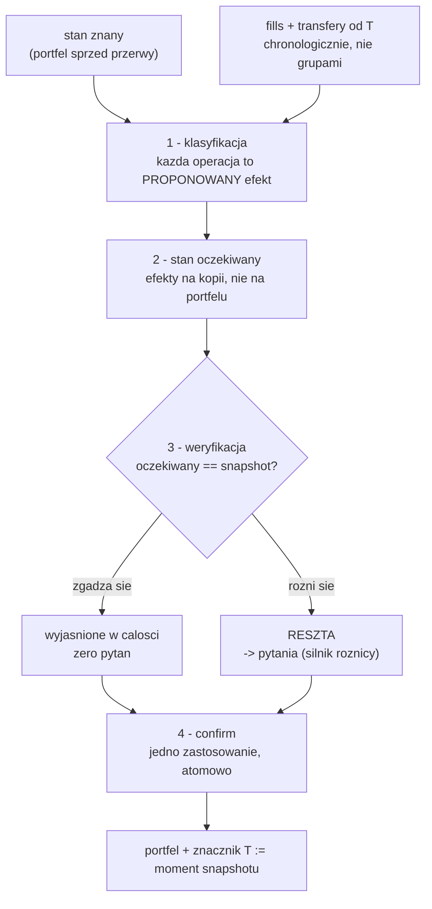

# Synchronizacja po przerwie — wyrównanie stanu krok po kroku

Analiza ścieżki **H** z [tablicy zadań](2026-09-18-okx-tasks.md). Kontekst całej integracji jest
w [analizie głównej](2026-09-18-okx-exchange-backend-integration.md); ten plik rozwija jeden
problem, który okazał się za duży na jedno zadanie (A7).

Statusy są w tablicy, nie tutaj.

## 1. Problem

`REVOKED` nie jest stanem terminalnym — brak połączenia z giełdą to **przerwa**, nie koniec (§5.8
analizy głównej). Połączenie zachowuje `accountUid` i `portfolioId`, portfel zostaje nietknięty,
a `POST /exchange-connection/{id}/reconnect` przestawia status z powrotem na `ACTIVE`.

I na tym się kończy. **Nic nie dogania stanu.** Przez przerwę na giełdzie się działo: doszły
depozyty, zniknęły pozycje, zmieniły się salda — a portfel stoi z liczbami sprzed przerwy ze
statusem mówiącym „działa". To stan kłamiący: status i dane mówią dwie różne rzeczy, a użytkownik
nie ma czym ich rozróżnić.

Pytanie, które za tym stoi, zadał właściciel projektu: *jeżeli mieliśmy przerwę, to może warto
sprawdzić na podstawie ostatniej synchronizacji, jakie operacje zostały wykonane i w jakim czasie*.
Czyli nie „policz różnicę", a **wyrównaj stan krok po kroku**.

## 2. Dlaczego historia jest lepsza od różnicy

Różnica ze snapshotu mówi „jest o 2 BTC więcej". Historia mówi „kupiłeś 1,5 i dostałeś 0,5
przelewem". To nie jest ta sama informacja i rozstrzyga dwie rzeczy, których snapshot nie
rozstrzygnie **nigdy**:

| rozstrzygnięcie | zakup | przelew z zewnątrz |
|---|---|---|
| **koszt nabycia** | cena z fill-a → `DERIVED_FROM_FILLS` | brak, i tak zostaje (C1) |
| **księga wkładów** | nie jest wkładem | **jest** wkładem |

Druga linia jest groźna: pomyłka tutaj czyta przelew jako zysk, czyli dokładnie błąd, przed którym
broni C5. Cały aparat pytań w onboardingu istnieje właśnie dlatego, że snapshot tego nie wie —
a historia go **usuwa**, bo nie trzeba pytać właściciela o coś, co giełda zapisała.

## 3. Snapshot zostaje — jako suma kontrolna

Główne rozstrzygnięcie projektowe: **nie zastępować różnicy historią, a złożyć je**.

1. odtwórz operacje od ostatniego znanego stanu
2. porównaj wynik z dzisiejszym snapshotem

Zgadza się → przerwa jest wyjaśniona w całości, zero pytań. Nie zgadza się → zostaje **reszta
niewyjaśniona**, i tylko ona idzie do dotychczasowej maszynerii pytań.

Bez kroku 2. „wyrównanie stanu" jest nadzieją; z nim jest **sprawdzalne**. Silnik różnicy nie
idzie do kosza — schodzi z roli autora na rolę weryfikatora.

Porównanie idzie po **ilościach, nie wartościach**: wartości ruszają się z cenami, ilości nie.
Z progiem pyłku, bo giełdy zostawiają resztki na ósmym miejscu po przecinku (próg jest już w E10).

## 4. Trzy strumienie wejściowe

Dziś synchronizacja ma **jedno** wejście — snapshot sald. Po przerwie potrzebuje trzech, i wszystkie
jadą w ciele żądania, bo backend nie trzyma poświadczeń giełdowych (decyzja z §2 analizy głównej):

| strumień | co daje | retencja OKX |
|---|---|---|
| **snapshot** | stan *teraz*: salda Trading + Funding, `frozenBal`, `openAvgPx` | zawsze dostępny |
| **fills od T** | zakupy i sprzedaże: ilość, cena, prowizja, moment | 3 miesiące |
| **transfery od T** | depozyty i wypłaty: ilość, moment, identyfikator | nieudokumentowana |

`T` to znacznik synchronizacji — ten, którego dziś nie ma (patrz §8).

Dwa pierwsze strumienie wymagają **nowej zdolności czytania** w `tools/okx`: dziś skrypt czyta
wyłącznie salda (`account/balance`, `asset/balances`), nie `fills-history`, `bills-archive` ani
`asset/deposit-history`.

## 5. Przepływ



**Krok 2. jest nieoczywisty i kluczowy: nie stosujemy od razu.** Każda operacja z historii staje
się najpierw *proponowanym efektem* na kopii stanu. Dopiero gdy suma efektów zgadza się ze
snapshotem, cokolwiek dotyka prawdziwego portfela.

## 6. Co dzieje się z portfelem, operacja po operacji

Odtworzenie idzie **chronologicznie**, mieszając transfery z transakcjami — nie grupami. Kolejność
decyduje o średniej cenie nabycia i o tym, co zostaje po sprzedaży, więc „najpierw wszystkie
depozyty, potem wszystkie transakcje" dałoby inny koszt niż rzeczywisty. Porządek po znaczniku
czasu z giełdy, remisy rozstrzygane identyfikatorem — deterministycznie, bo odtworzenie musi dać
ten sam wynik przy powtórzeniu.

| operacja | co robi z portfelem |
|---|---|
| **depozyt gotówki** | `depositMoney` + wpis w księdze; `ContributionId` **z identyfikatora depozytu na giełdzie** |
| **depozyt waloru** | pozycja w `transferred-in`, koszt **nieznany** (C1); wkład o nieznanej wartości — pokrycie księgi spada i mówi o tym (C9) |
| **wypłata** | odwrotnie; wpis `takenOut` |
| **zakup** | przyrost w `traded` z kosztem z ceny fill-a → `DERIVED_FROM_FILLS` |
| **sprzedaż** | ubytek w `traded` + `RealisedResult` z proceeds i kosztem pokrytej części (F6, C7) |
| **prowizja** | zmniejsza pozycję albo gotówkę; wchodzi w koszt |
| **`frozenBal`** | **nie jest operacją, jest stanem** — `applyExchangeFreeze` raz, na końcu, regułą z D5 |
| **reszta** | jedyna rzecz, która nadal wymaga pytania |

Ostatni wiersz to cała różnica wobec dzisiejszego onboardingu: **pytań jest tyle, ile giełda
przemilczała**, a nie tyle, ile pozycji się zmieniło.

## 7. Czego portfel robić nie może

Cztery zakazy, każdy wyniesiony z już popełnionego błędu w tym projekcie.

**Nigdy nie zerować po cichu.** Snapshot mówi 0, historia nie wyjaśnia dlaczego → to jest pytanie,
nie usunięcie. Portfel, w którym zniknęło wszystko, wygląda identycznie jak nieudany odczyt giełdy,
a „czy naprawdę sprzedałeś wszystko?" jest właściwą odpowiedzią.

**Nigdy nie nadpisywać znanego kosztu ciszą.** Reguła D6, już zakodowana w `CostReconciliation`:
`openAvgPx` istnieje tylko po stronie Trading, więc przesunięcie waloru do Funding sprawia, że
giełda milknie o koszcie — a milczenie nie jest informacją „nie wiadomo".

**Nigdy nie robić wkładu z transakcji.** Zakup to przesunięcie wewnątrz portfela, nie dopłata.
Pomyłka tutaj czyta handel jako wpłatę i wywraca `wealthChange` (C5).

**Nigdy nie stosować częściowo.** Albo całe odtworzenie, albo nic — inaczej powstaje portfel, który
nie jest ani sprzed przerwy, ani po. Dzisiejszy `confirm` jest już tym punktem atomowym i trzeba na
nim zostać.

## 8. Idempotencja — warunek wstępny, nie optymalizacja

Odtworzenie **będzie** powtarzane: ponowna próba, nakładające się okna, podwójna dostawa. Okna
muszą się nakładać, bo bezpieczniej czytać od `T minus zapas` niż zgubić operację na granicy.

| co | zabezpieczenie | stan |
|---|---|---|
| transakcje | unikalny indeks `(portfolioId, originTradeId)` + `appliedTrades` w agregacie | **jest** (F1, F10) |
| wkłady | `ContributionId` z identyfikatora giełdy | **brak** — mintujemy swoje |
| blokady | stan, nie delta — idempotentne z natury | jest (D5) |

Druga linia to jedyny brakujący klocek. Bez niego nakładające się okno policzy wkład dwa razy,
a tego — jak zapisu wyceny w C17 — **nie poprawia się następnym wywołaniem**.

## 9. Nie ma punktu zaczepienia

Odtworzenie potrzebuje `T` o jednym, dokładnym znaczeniu: *portfel był doprowadzony do stanu
zgodnego z giełdą o godzinie T*. Dwa istniejące pola wyglądają na kandydatów i **żadne nim nie
jest**:

```java
public void revoke(String reason, ZonedDateTime now) { … this.lastSyncAt = now; }
public void fail(String reason, ZonedDateTime now)   { … this.lastSyncAt = now; }

/** State was read from the exchange. Says nothing about whether it was applied. */
public void recordSnapshot(ZonedDateTime now) { this.lastSnapshotAt = now; }
```

`lastSyncAt` jest nadpisywane przy **odłączeniu i awarii**, więc nie znaczy „ostatnia udana
synchronizacja", a „ostatnia zmiana statusu" — nazwa kłamie. `lastSnapshotAt` sam w komentarzu
mówi, że nie wie, czy cokolwiek zastosowano.

Odtworzenie od złego punktu albo **powtórzy** operacje, albo je **pominie**. Dlatego znacznik jest
pierwszym zadaniem ścieżki, a nie szczegółem ostatniego.

## 10. Trzy uczciwe wyniki

```
EXPLAINED            reszta pusta — historia wyjaśnia całą przerwę
PARTIALLY_EXPLAINED  reszta istnieje i ma pytania; raport mówi, co wyjaśnione, a co tylko
                     zaobserwowane
UNEXPLAINABLE        T starsze niż retencja — odtworzenie niemożliwe; spadamy do czystej różnicy
                     ze snapshotu (dzisiejsze zachowanie) i mówimy o tym
```

Trzeci przypadek nie jest awarią, tylko **granicą świata**: po trzech miesiącach giełda nie pamięta
i żaden kod tego nie obejdzie. Ważne, żeby odpowiedź tę granicę **nazywała**, zamiast podawać
różnicę udającą wyjaśnienie — ten sam kształt co pokrycie w C4 i luki w C16.

## 11. Raport dla właściciela

Co możemy powiedzieć uczciwie:

- **od kiedy** nie było połączenia (`T`) i co widzieliśmy ostatnio
- **co się stało** — lista operacji, nie „stan się zmienił"
- **czego nie umiemy wyjaśnić** — reszta, pozycja po pozycji
- **dlaczego** — tylko jeśli ktoś to zapisał

Ostatni punkt jest słaby i **nie wolno go obiecywać**. `statusReason` zapisuje się przy `revoke`
i `fail`, ale A12 jest otwarte: nic w produkcji nie produkuje statusu `ERROR`, bo backend nie
dobija się do giełdy. Czyli jedyny powód, jaki kiedykolwiek trafi do bazy, to ten podany przez
samego użytkownika przy odłączeniu. „Klucz prawdopodobnie wygasł" byłoby wymyślaniem.

## 12. Gdzie to mieszka

**W spec-u, nie w nowym mechanizmie.** `PortfolioSpec` ma już wszystko, czego to potrzebuje:

- niesie różnice i pytania
- zakotwicza odpowiedzi w partii, dla której ich udzielono
- odmawia, gdy snapshot się postarzał (`SnapshotExpiredException`, `STALE`)
- jest idempotentny przy `confirm` (`SpecificationAlreadyAppliedException`, D8)
- od D13 umie działać wobec **istniejącego** portfela

Równoległa ścieżka „pojednania" powtórzyłaby te pięć rzeczy i rozjechała się z nimi przy pierwszej
zmianie. Odtworzenie wchodzi więc jako **nowe wejście spec-u**, a nie jako nowy byt.

## 13. Kolejność zadań i dlaczego właśnie taka

Każde następne psuje dane bez poprzedniego — i to jest jedyny powód, dla którego kolejność jest
tutaj sztywna.

| # | zadanie | dlaczego teraz |
|---|---|---|
| **H1** | znacznik synchronizacji o jednym znaczeniu | bez niego odtworzenie startuje z błędnego punktu |
| **H2** | `ContributionId` z identyfikatora giełdy | bez niego nakładające się okno dubluje wkłady |
| **H3** | reconnect kończy się spec-em (dawne A7) | kończy stan „`ACTIVE` z liczbami sprzed tygodnia"; nie zależy od H4, więc idzie wcześniej |
| **H4** | czytanie historii w `tools/okx` | nowa zdolność: `fills-history`, `bills-archive`, `deposit-history` |
| **H5** | odtworzenie + weryfikacja snapshotem | rdzeń; wymaga H1, H2, H4 |
| **H6** | raport przerwy | to, co właściciel faktycznie czyta; wymaga H5 |

H3 jest świadomie **przed** rdzeniem: jego wartość nie zależy od odtworzenia (sam spec wobec
niepustego stanu znanego już usuwa kłamiący status), a maszyneria pod niego stoi od D13.

## 14. Co da się pokazać na żywo

Częściowo — i warto wiedzieć, gdzie jest granica.

Klucz jest **read-only** (A6: `perm == read_only`), więc nie wywołam prawdziwego `401` ani nie
przeniosę środków między kontami. Ale `revoke` + `reconnect` z podstawionym snapshotem i podstawioną
historią odtwarza przerwę wiernie, bo **jedyne, co udaje, to sam odczyt z giełdy** — resztę robi
prawdziwy backend. Tak samo dowodziłem E10, gdzie konto demo ma Funding puste.

Czego nie zademonstruję na koncie demo: przerwy dłuższej niż retencja (musiałbym czekać trzy
miesiące) — ten przypadek zostaje przy testach.
