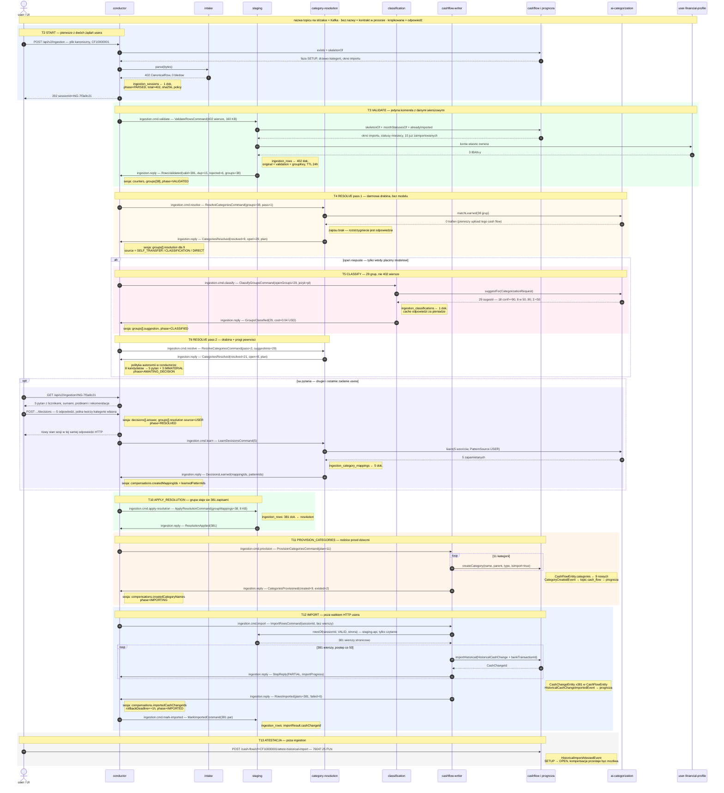
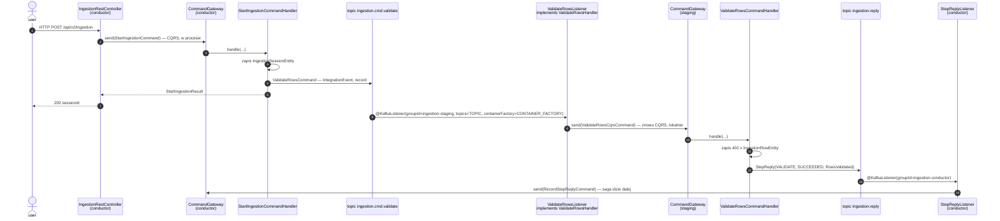
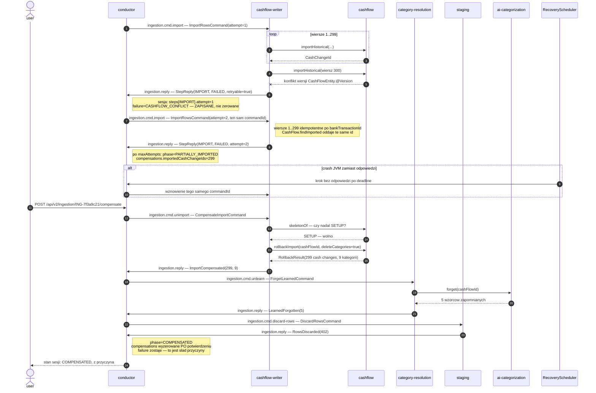

# `data-ingestion-conductor` — drugi ingestion jako saga w trybie orkiestracji

**Data:** 2026-10-24 · **Status:** koncepcja, **nic w `bank-data-ingestion` nie zmienione** ·
**Zadanie:** F69 (po F67, obok F68) · **Wejście:** plik kanoniczny z `bank-data-adapter`
(ten moduł pozostaje nietknięty)

Pytanie, z którego to wyszło: *flow jest skomplikowany, user jest pytany za często — zaprojektuj
drugi ingestion od zera, z sagą i Kafką w trybie orkiestracji, z osobnym podmiotem
`data-ingestion-conductor`, małymi modułami Mavena i kontraktami `*-api`.*

Odpowiedź w jednym akapicie: **dziś user wykonuje 7 żądań do ingestion i podejmuje do ~40 decyzji,
żeby odblokować maszynę; w nowym modelu wykonuje 2 żądania i podejmuje ≤7 decyzji, które tylko
poprawiają wynik.** Największą redukcję daje nie saga, a trzy decyzje projektowe: *pytanie zadawane
per grupa a nie per wiersz*, *filtr istotności* (pytamy o grupy pokrywające 90 % wartości, nie o
ogon) i *przeniesienie decyzji za import* zamiast bramki przed nim. Saga jest tym, co czyni to
bezpiecznym — daje jeden rekord procesu, kompensację per faza i odzysk po awarii, których dziś nie
ma.

---

## Część I — stan obecny, zmierzony z kodu

### 1. Encje i kto jest ich właścicielem

| kolekcja | encja | właściciel | cykl życia | wersjonowanie |
|---|---|---|---|---|
| `staging_sessions` | `StagingSessionEntity` — 25 pól, 9 metod cyklu życia | sekcja `staging` | TTL 24 h (`@Indexed(expireAfter="0s")`) | `@Version` ✅ |
| `staged_transactions` | `StagedTransactionEntity` — `originalData` + `mappedData` + `validation` | sekcja `staging` | TTL per wiersz | brak |
| `category_mappings` | `CategoryMappingEntity` — bankCategory → target | sekcja `mappings` | trwałe | `@Version` ✅ |
| `import_jobs` | `ImportJobEntity` — progress, result, **rollbackData**, summary | sekcja `importing` | **bez TTL** | `@Version` ✅ |
| `pattern_mappings` | w `bank-data-ai-categorization` | obcy moduł, za kontraktem | trwałe | — |

Dwa rekordy procesu, nie jeden: sesja monitoruje wszystko **do** importu, `ImportJob` od importu.
Pałeczka jest przekazywana źle i to jest już opisane w F68
(`2026-10-23-ingestion-process-monitor.md`): `failImport()` zeruje `importJobId`, rollback nie
dotyka sesji ani razu, sesja ma TTL a zadanie nie, `StagingSessionStatus.EXPIRED` nie jest nikomu
nigdy przypisywany. Ta koncepcja zakłada wnioski F68 jako znane i idzie dalej: **jeden rekord
procesu od bajtu do atestacji.**

### 2. Trzy równoległe źródła prawdy o jednym procesie

```
StagingSessionStatus    PENDING · HAS_UNMAPPED_CATEGORIES · HAS_VALIDATION_ERRORS ·
                        SUGGESTIONS_READY · READY_FOR_IMPORT · IMPORTING · COMPLETED · EXPIRED
ClassificationStatus    NOT_STARTED · IN_PROGRESS · COMPLETED · SKIPPED · FAILED
ImportJobStatus         PENDING · PROCESSING · COMPLETED · FAILED · ROLLED_BACK · FINALIZED
```

`recalculateStatus()` wyprowadza pierwszy z liczników **i** z drugiego, trzeci żyje osobno. Gdy
klasyfikacja padnie, `classificationStatus = FAILED`, a `status` zostaje na
`HAS_UNMAPPED_CATEGORIES` — bo `StagingSessionStatus` nie ma `FAILED`. UI nie ma z czego
powiedzieć „coś się nie udało".

### 3. Pełny przepływ i gdzie user musi dotknąć systemu

| # | wywołanie | kto wykonuje | decyzja usera? |
|---|---|---|---|
| 1 | `POST /cash-flow/with-history` | user | `startPeriod`, `initialBalance` |
| 2 | `POST /api/v1/bank-data-adapter/transform` | user | wybór pliku |
| 3 | `POST /api/v1/bank-data-adapter/{id}/import` → `POST .../cf={id}/upload` | adapter przez **HTTP po loopbacku** | — |
| 4 | `POST .../staging/{s}/ai-categorize` | user | **czy w ogóle użyć AI** |
| 5a | `POST .../staging/{s}/accept-ai` | user | **akceptacja całego ekranu sugestii** |
| 5b | `POST .../mappings` (× N grup) + `POST .../revalidate` | user | **per grupa: `CREATE_NEW` / `CREATE_SUBCATEGORY` / `MAP_TO_UNCATEGORIZED`** |
| 5c | `POST .../staging/{s}/force-uncategorized` | user | „rezygnuję z kategoryzacji" |
| 6 | `GET .../staging/{s}` | user | czy jest `READY_FOR_IMPORT` |
| 7 | `POST .../import` | user | start |
| 8 | `GET .../import/{job}` | user | polling (import jedzie w wątku żądania!) |
| 9 | `POST /cash-flow/cf={id}/attest-historical-import` | user | `confirmedBalance` |

**Siedem żądań do ingestion** (3–8 plus ewentualne `/mappings` × N). Testowy plik — 402 wiersze,
Nest Bank — daje po grupowaniu rzędu **40 unikalnych par (merchant, bankCategory)**, a staging
oznacza jako `PENDING_MAPPING` każdy wiersz bez trafienia. Każda taka grupa jest potencjalnym
pytaniem, i co najważniejsze: **wszystkie są blokujące** — `start_import` odmawia, dopóki
`pendingMappingCount > 0`.

### 4. Drabina rozstrzygania kategorii — to działa i trzeba to przenieść

`StageTransactionsCommandHandler.processTransaction` (763 linie, najdłuższy plik modułu) stosuje
priorytety w tej kolejności:

```
-1  self-transfer    IBAN kontrahenta ∈ owned accounts (UserFinancialProfileApi)  → "Przelewy własne"
 0  direct match     skeleton.findCategoryIgnoringCase(bankCategory, type)
 1  learned pattern  categorizationApi.matchLearned(...)  — jeśli cel istnieje w cash flow
 2  category mapping mappingMap[(bankCategory, type)]
 —  w przeciwnym razie: PENDING_MAPPING  → pytanie do usera
```

Walidacja wiersza, też dobrze zrobiona i też do przeniesienia bez zmian:
`skeleton.importWindow().refusalFor(paidDate, now)` (reguła cashflow, jedna kopia), a **tylko jeśli
przeszła** — `monthStatuses.acceptsImportAt(period)` (reguła prognozy, surowsza). Duplikaty:
`alreadyImported.find(bankTransactionId)` → `DUPLICATE` + id kolidującego cash change.

Trzy pytania na cały upload, nie na wiersz: `skeletonOf`, `alreadyImported`, `monthStatusesOf` —
plus jedno `matchLearned` na batch. Ten pomiar (402 wiersze = 4 pytania, nie 1 608) jest już
wygrany i nowy projekt nie ma prawa go zepsuć.

### 5. Jak dane trafiają do cash flow

```
start_import  (wątek żądania HTTP, bez @Async)
  faza 1 CREATING_CATEGORIES      → cashFlowApi.createCategory(name, parent, type, isImport=true)   × K
         (rodzice przed dziećmi — CashFlow.apply(CategoryCreatedEvent) rzuca bez rodzica)
  faza 2 IMPORTING_TRANSACTIONS   → cashFlowApi.importHistorical(HistoricalCashChange)              × N
         idempotentne po bankTransactionId (CashFlow.findImported) — ponowienie nie dubluje
  → ImportJob.complete(summary) + ImportJobCompletedEvent na topic bank_data_ingestion
```

Potem już poza ingestion: `POST /cash-flow/cf={id}/attest-historical-import` z
`confirmedBalance` → `HistoricalImportAttestedEvent` → cash flow przechodzi SETUP → OPEN i
**rollback przestaje być możliwy**.

### 6. Scenariusze porażki — stan faktyczny

| porażka | co się dzieje dziś | luka |
|---|---|---|
| wiersz nie wchodzi | `catch` → `recordFailedTransaction`, `processed++`, pętla leci; job kończy `COMPLETED` | nic nie emituje porażki; sesja mówi `COMPLETED`, tylko licznik mniejszy |
| **kategoria się nie utworzy** | `catch (Exception)` → `log.warn` + `processed++` | **wiersze tej kategorii polecą do `importHistorical` i padną jeden po drugim** — porażka fazy 1 udaje sukces |
| wyjątek całej fazy | `job.fail()`, `session.failImport()`, `ImportJobFailedEvent` | sesja **gubi `importJobId`** — ślad do przyczyny |
| klasyfikacja padnie | `failClassification()` | `status` sesji niezmieniony — dwa źródła prawdy |
| crash JVM w trakcie | nic (brak transakcji) | job wisi `PROCESSING`, sesja `IMPORTING`, **żadnego odzysku**; po 24 h sesja znika |
| rollback importu | `cashFlowApi.rollbackImport`, status `ROLLED_BACK` | **sesja nietknięta** — mówi `COMPLETED` nad pustym cash flow |
| sesja wygasa w trakcie decyzji | TTL kasuje dokument i wiersze | cały upload do powtórzenia od transformacji AI |

Oraz: **sześć zdarzeń na topic `bank_data_ingestion` i ani jednego `@KafkaListener` w reaktorze.**
`ImportProgressEvent` leci co 10 transakcji w próżnię. To jest pomiar z F68 i jest wiążący dla
nowego projektu: *nie dodajemy zdarzenia, które nie ma konsumenta.*

---

## Część II — projekt

### 7. Podmioty i granice

```
                         ┌──────────────────────────────────────┐
  plik kanoniczny  ──▶   │     data-ingestion-conductor         │  ◀── user: 1× start, 1× decyzje
  (bank-data-adapter,    │  sesja = jedyny rekord procesu       │  ──▶ GET sesja (stan, kroki, błędy)
   NIETKNIĘTY)           │  saga: kroki, kompensacja, odzysk    │
                         └───┬────────┬────────┬────────┬───────┘
         komendy (Kafka)     │        │        │        │       fakty (Kafka, gdy będzie konsument)
                             ▼        ▼        ▼        ▼
                        ┌────────┐┌────────┐┌────────┐┌──────────────┐
                        │staging ││classifi││category││cashflow-     │
                        │walidacja││cation  ││resolut.││writer        │
                        │+ wiersze││  (AI)  ││mapowania││kategorie+import│
                        └────────┘└────────┘└────────┘└──────────────┘
                             │        │        │           │
                   odpowiedzi kroków (Kafka, jeden topic) ──┘
```

Pięć zasad, każda z powodu wziętego z pomiaru powyżej:

1. **Conductor nie zależy od żadnego workera.** Zależy od **własnego** kontraktu
   (`ingestion-conductor-api`), od słownika (`ingestion-canonical`) i — tylko do czytania —
   od `cashflow-api`. Workerzy zależą od protokołu conductora. Kontrakty nie zależą od siebie, więc
   cyklu w reaktorze nie ma, choć implementacje „widzą się" w obie strony.
2. **Żaden worker nie zależy od innego workera.** Dziś `importing` czyta `staging` (dozwolone
   jednym wyjątkiem w ArchUnit); tutaj wiersze podróżują w komendzie albo są czytane przez
   `staging-api`, nie przez cudze repozytorium Spring Data.
3. **Sesja jest jednym rekordem procesu** — nie ma `ImportJob` obok niej. `rollbackData` to pole
   kompensacji w sesji, nie druga encja z własnym TTL (albo bez niego).
4. **Kafka do sterowania sagą i do obserwacji — rozdzielone.** Porażka, na którą saga musi
   zareagować, jest **odpowiedzią kroku** (`StepReply(FAILED)`). Porażka, o której ktoś inny ma się
   dowiedzieć, jest **faktem** na topicu obserwacji — i ten topic powstaje dopiero, gdy ma
   konsumenta. Pomieszanie tych dwóch rzeczy dało dziś sześć zdarzeń pisanych w próżnię.
5. **Transport kroku jest wymienny, dokładnie jak `vidulum.cashflow.api.transport`.**
   `vidulum.ingestion.step.transport = kafka | in-process`, **domyślnie `in-process`** — bo
   `matchIfMissing` na implementacji HTTP/Kafka jest pułapką, którą ten projekt już raz przeżył.
   Testy komponentowe przechodzą całą sagę bez Dockera; produkcja ustawia `kafka`.

### 8. Moduły Mavena

```
vidulum-app-ingestion/                      AGREGATOR (pom), jak market/ i wealth/
├── ingestion-canonical/                    słownik: CanonicalRow, TransactionClassification,
│                                           PaymentMethod, nazwy kolumn CSV. Bez Springa,
│                                           bez storage, zależy tylko od shared-kernel + cashflow-api (Type)
├── ingestion-intake/                       bajty → wiersze kanoniczne. Liść, zero storage
├── ingestion-conductor-api/                PROTOKÓŁ: IngestionConductorApi (ModuleApi),
│                                           komendy kroków + interfejsy handlerów (ModuleEventHandler),
│                                           StepReply, IngestionSessionView, DecisionRequest/Answer.
│                                           Bez Springa
├── ingestion-conductor/                    saga + encja sesji + REST + wiring Kafki
├── ingestion-staging/                      wiersze + walidacja (worker kroku VALIDATE)
├── ingestion-staging-api/                  tylko to, o co conductor pyta synchronicznie
├── ingestion-classification/               worker kroku CLASSIFY → bank-data-ai-categorization-api
├── ingestion-category-resolution/          mapowania + drabina + nauka (worker kroku RESOLVE)
├── ingestion-cashflow-writer/              PROVISION_CATEGORIES + IMPORT + kompensacja → cashflow-api
└── (vidulum-ingestion-tests/)              bez src/main — wszystkie testy Springowe/Testcontainers
```

Dlaczego tyle małych artefaktów, a nie jeden moduł z pakietami jak dziś: F67 pokazało, że sekcje
**dały się** nazwać i wymusić testem, ale nadal mieszkają w jednym jarze, więc `importing` czyta
`StagingSessionMongoRepository` cudzej sekcji i jest to legalne. Granica Mavena jest tym, co zamienia
tę zasadę z testu w fakt kompilacji. Reguły z `pom.xml` projektu obowiązują:
`*-api` ma **jedną** zależność i zero starterów; `-data-mongodb` w pomie = „ten moduł persystuje";
`lombok` i testowe startery przychodzą z roota.

**Czego tu nie ma, świadomie:**
- `ingestion-canonical` nie jest wspólny z `bank-data-adapter`. Adapter dokleja kolumnę CSV,
  ingestion ją parsuje — kontrakt to **nazwa kolumny i słownik słów**, nie typ Javy. Ta kopia ma
  zostać kopią pilnowaną testem słownika (`TransactionClassificationVocabularyTest`), bo tolerancja,
  która czyni rozjazd bezpiecznym, czyni go też cichym.
- `ingestion-conductor` nie ma `*-api` dla kroków w drugą stronę. Protokół jest jeden i należy do
  conductora, bo to on jest właścicielem sagi — to jest `ModuleSpi`, gniazdo, nie `ModuleApi`.

### 9. Encja sesji — „jedno miejsce, gdzie widzę stan"

```java
@Document("ingestion_sessions")
class IngestionSessionEntity {
    @Id String sessionId;
    @Indexed String cashFlowId;
    @Indexed String ownerId;

    // ——— skąd to przyszło (korelacja z adapterem, bez zależności od niego)
    String transformationId;          // tylko korelacja, nigdy nie wołamy adaptera po to
    String originalFileName;
    String detectedBank, detectedLanguage, detectedCountry;
    String canonicalCsvSha256;        // ten sam plik dwa razy = ta sama sesja (idempotencja startu)

    // ——— JEDNA maszyna stanów (nie trzy)
    @Indexed IngestionPhase phase;    // niżej
    Instant createdAt, lastModifiedAt, expiresAt;

    // ——— przebieg: po tym user czyta „co się dzieje"
    List<StepRecord> steps;           // step, status, attempt, commandId, replyId,
                                      // startedAt, finishedAt, durationMs, failure
    RowCounters counters;             // total, parsed, valid, duplicate, rejected,
                                      // resolved, unresolved, imported, failedToImport
    // ——— interakcja z userem, policzalna
    List<DecisionRecord> decisions;   // request + answer | autoResolved(reason) + kto i kiedy
    AutonomyPolicy policy;            // kopia polityki użytej w tej sesji (audyt powtarzalny)

    // ——— kompensacja per faza, nie jedna flaga
    Compensations compensations;       // createdCategoryNames, importedCashChangeIds,
                                       // learnedPatternIds, createdMappingIds, rollbackDeadline
    Failure failure;                   // code, message, step, retryable, occurredAt — NIGDY nie zerowane
    @Version Long version;
}
```

```
IngestionPhase:
  RECEIVED → PARSED → VALIDATED → CLASSIFIED → RESOLVED ─┬─▶ AWAITING_DECISION ─┐
                                                          │                      │
                                                          └──────────◀───────────┘
         ─▶ PROVISIONING_CATEGORIES → IMPORTING → IMPORTED
                                                 └─▶ PARTIALLY_IMPORTED
  stany końcowe: IMPORTED · PARTIALLY_IMPORTED · FAILED · COMPENSATED · EXPIRED · ABANDONED
```

Cztery rzeczy, które ta encja naprawia, każda wzięta z tabeli porażek:

- `FAILED` **istnieje** jako stan sesji i `failure` nigdy nie jest czyszczone (dziś
  `failImport()` zeruje `importJobId` dokładnie w momencie porażki).
- Kompensacja jest w tej samej encji co postęp, więc rollback **musi** dotknąć sesji — nie ma
  drugiego dokumentu, który mógłby zostać na `COMPLETED`.
- `EXPIRED` jest **przypisywany** przez harmonogram, nie udawany przez TTL Mongo. TTL kasuje
  dopiero sesje w stanie końcowym, po oknie rollbacku; wygaśnięcie w trakcie decyzji nie jest
  zniknięciem, jest zastosowaniem polityki (patrz niżej).
- `steps[].commandId/replyId` to jednocześnie idempotencja i baza odzysku: krok bez odpowiedzi po
  deadline jest wznawialny, odpowiedź na nieaktualny `commandId` jest ignorowana.

Wiersze **nie** siedzą w sesji: 402 wiersze × historia decyzji to dokument rosnący bez ograniczenia,
a MongoDB nie da unikalności w tablicy wewnątrz dokumentu (lekcja `CashFlow.findImported` z
CLAUDE.md). Zostają w `ingestion_rows`, kluczowane `sessionId`, własność `ingestion-staging`.

### 10. Protokół — komendy, odpowiedzi, fakty

Trzy rodzaje wiadomości i to jest najważniejsze rozróżnienie całego projektu:

| | komenda | odpowiedź kroku | fakt |
|---|---|---|---|
| kierunek | conductor → worker | worker → conductor | conductor → świat |
| topic | `ingestion.cmd.<step>` | `ingestion.reply` (jeden) | `ingestion.facts` |
| klucz | `sessionId` | `sessionId` | `cashFlowId` |
| kto deklaruje | `ingestion-conductor-api` | `ingestion-conductor-api` | `ingestion-conductor-api` |
| czy wolno zgubić | **nie** (DLQ + wznowienie) | **nie** (DLQ + wznowienie) | tak, to telemetria |
| **powstaje** | w fazie P1 | w fazie P1 | **dopiero gdy ma konsumenta** (F4/alerts) |

```java
// ingestion-conductor-api — komenda i gniazdo dla workera klasyfikacji
public record ClassifyRowsCommand(
        String sessionId, String commandId, int attempt,
        CashFlowId cashFlowId, String detectedLanguage,
        List<CanonicalRow> rows,          // słownik z ingestion-canonical
        CategorySnapshot categories       // drzewo kategorii, raz na sesję
) implements IntegrationEvent {}

public interface ClassifyRowsHandler extends ModuleEventHandler {
    String TOPIC = "ingestion.cmd.classify";
    String CONTAINER_FACTORY = "ingestionClassifyContainerFactory";
    void onClassifyRows(ClassifyRowsCommand command);
}

// jedna koperta odpowiedzi dla wszystkich kroków
public record StepReply(
        String sessionId, String stepId, IngestionStep step,
        String commandId, StepStatus status,          // SUCCEEDED | PARTIAL | FAILED | REJECTED
        StepOutcome outcome,                          // sealed: per krok
        Failure failure,                              // code, message, retryable
        Instant occurredAt
) implements IntegrationEvent {}
```

Komendy (jeden topic na krok, bo inaczej każdy worker czyta wszystko i filtruje):

| krok | komenda | worker | odpowiedź (`StepOutcome`) |
|---|---|---|---|
| `VALIDATE` | `ValidateRowsCommand` | staging | `RowsValidated(valid, duplicate, rejected[], groups[])` |
| `RESOLVE` ① | `ResolveCategoriesCommand(pass=1)` | category-resolution | `CategoriesResolved(resolved[], open[], plan)` |
| `CLASSIFY` | `ClassifyGroupsCommand` | classification | `GroupsClassified(suggestions[], cost)` |
| `RESOLVE` ② | `ResolveCategoriesCommand(pass=2, suggestions)` | category-resolution | `CategoriesResolved(resolved[], open[], plan)` |
| `LEARN` | `LearnDecisionsCommand` | category-resolution | `DecisionsLearned(mappingIds[], patternIds[])` |
| `APPLY_RESOLUTION` | `ApplyResolutionCommand(groupMappings[])` | staging | `ResolutionApplied(rowsResolved)` |
| `PROVISION_CATEGORIES` | `ProvisionCategoriesCommand` | cashflow-writer | `CategoriesProvisioned(created[], existed[])` |
| `IMPORT` | `ImportRowsCommand` | cashflow-writer | `RowsImported(pairs[], failed[])` + `PARTIAL` co 50 wierszy |
| `MARK_IMPORTED` | `MarkImportedCommand(pairs[])` | staging | `ImportMarked(count)` |
| ↩ `UNIMPORT` | `CompensateImportCommand` | cashflow-writer | `ImportCompensated(deleted, categoriesDeleted)` |
| ↩ `UNLEARN` | `ForgetLearnedCommand` | category-resolution | `LearnedForgotten(count)` |
| ↩ `DISCARD_ROWS` | `DiscardRowsCommand` | staging | `RowsDiscarded(count)` |

`RESOLVE` jedzie **dwa razy i to jest oszczędność, nie powtórzenie**: pierwszy przebieg używa
wyłącznie darmowej drabiny (direct match, wyuczone wzorce, mapowania, słowo klasyfikacji z CSV), a
`CLASSIFY` dostaje **tylko grupy, których nie rozstrzygnął**. Dziś user woła `/ai-categorize` dla
całej sesji, zawsze, nie wiedząc, czy model jest w ogóle potrzebny. Szczegóły w §21.

Fakty (później, z konsumentem): `IngestionStarted`, `StepFinished`, `DecisionRequested`,
`DecisionAutoResolved`, `IngestionImported`, `IngestionPartiallyImported`, `IngestionFailed`,
`IngestionCompensated`, `IngestionExpired`. Dziś UI dostaje stan z `GET` sesji — i to jest
wystarczające, bo odpowiedź HTTP na `POST` decyzji zawiera nowy stan sesji, więc nie ma okna, w
którym ekran kłamie.

### 11. Redukcja interakcji z userem — konkretnie, z liczbami

Cztery dźwignie, w kolejności siły:

**(a) Pytanie per grupa, nigdy per wiersz.** Jedna decyzja = jedna para
`(pattern, bankCategory, type)` z licznikiem, sumą i trzema przykładami. 402 wiersze → ~40 grup.
To jest już częściowo w `accept-ai`, ale dziś user akceptuje **cały ekran naraz albo konfiguruje
mapowania pojedynczo** — nie ma stanu „odpowiedziałem na 3 z 7".

**(b) Filtr istotności — to jest główna dźwignia.** Pytamy tylko o grupy, które **coś znaczą**:
posortowane po |sumie|, do pokrycia `askOnlyTopShareOfValue = 0.9`, nie więcej niż
`maxQuestions = 7`. Ogon (grupy po 1–2 wiersze na 12 zł) **nie jest pytaniem** — dostaje najlepszy
typ AI, a jeśli go nie ma, `Uncategorized` z flagą `provisional`. Na testowym pliku: ~40 grup →
**≤7 pytań**, bo rozkład wartości w wyciągu bankowym jest skrajnie skośny.

**(c) Druga wysyłka nie pyta o nic.** Odpowiedź z `remember = true` (domyślnie tak) jedzie krokiem
`LEARN` do `category-resolution` i staje się mapowaniem **oraz** wzorcem. Przy kolejnym wyciągu z
tego samego banku drabina rozstrzyga wszystko na priorytetach 0–2 i saga nie wchodzi w
`AWAITING_DECISION`. Dziś to też częściowo działa (`learn` + `matchLearned`), ale tylko dla
sugestii przyjętych przez `accept-ai` z `saveToCache`.

**(d) Decyzja po imporcie, nie przed.** Polityka:

```java
record AutonomyPolicy(
    AutonomyLevel level,              // AUTOPILOT | REVIEW_MATERIAL (domyślne) | REVIEW_ALL
    int autoAcceptConfidence,         // 90 — przyjmij bez pytania
    int askConfidenceFloor,           // 50 — niżej nie pytaj, zastosuj fallback
    double askOnlyTopShareOfValue,    // 0.90
    int maxQuestions,                 // 7
    Duration decisionTtl,             // PT24H
    Fallback fallback,                // UNCATEGORIZED | AI_BEST_GUESS
    boolean importDespiteRejectedRows // true — wiersz odrzucony nie blokuje reszty
) {}
```

- `AUTOPILOT` — saga nie zatrzymuje się nigdy; wszystko nierozstrzygnięte wchodzi jako
  `Uncategorized`/`provisional`, a user przegląda to **po** imporcie, mając już pieniądze w cash
  flow. **Zero interakcji poza startem i atestacją.**
- `REVIEW_MATERIAL` — ≤7 pytań, jeden ekran, jedno `POST`.
- `REVIEW_ALL` — dzisiejsze zachowanie, dla kogoś, kto tego chce.

I jeszcze dwie rzeczy, które dziś są pytaniami, a nie powinny być:

- **Wiersz niepoprawny nie zatrzymuje wyciągu.** Dziś jeden zły `paidDate` daje
  `HAS_VALIDATION_ERRORS` i `start_import` odmawia dla całości. W nowym modelu wiersz idzie do
  `rejected[]` z powodem i `ErrorCode`, import leci dalej, sesja kończy `PARTIALLY_IMPORTED`, a
  przegląd odrzutów jest opcjonalny.
- **Nieodpowiedziana decyzja nie zabija uploadu.** Po `decisionTtl` conductor stosuje
  `recommended` i emituje `DecisionAutoResolved(reason = TTL)`. Dziś TTL kasuje sesję i wiersze, a
  cały upload trzeba powtórzyć od transformacji AI (czyli zapłacić modelowi drugi raz).

Wynik netto, liczony na testowym pliku:

| | dziś | `REVIEW_MATERIAL` | `AUTOPILOT` |
|---|---|---|---|
| żądania usera do ingestion | 7 | **2** | **1** |
| punkty decyzyjne (max) | ~40 + wybór trybu | **≤7, jeden ekran** | **0** |
| upload tego samego banku, drugi raz | tyle samo | **0 pytań** | 0 pytań |
| jeden zły wiersz | blokuje całość | importuje resztę | importuje resztę |
| brak odpowiedzi 24 h | upload stracony | polityka + audyt | n/d |

**Zależność, którą trzeba nazwać uczciwie:** `AUTOPILOT` jest bezpieczny tylko wtedy, gdy user może
poprawić kategorię **po** imporcie. Domena to umie — `CashChangeEditedEvent` nosi `categoryName`,
`EditCashChangeCommandHandler` istnieje, projekcja prognozy to obsługuje — ale
**`CashFlowModuleApi` nie ma metody `recategorize`**, więc dziś jedynym narzędziem jest pełny
rollback. Stąd rekomendacja: **domyślnie `REVIEW_MATERIAL`**, a `AUTOPILOT` włączamy w momencie,
gdy do `cashflow-api` dojdzie jedna metoda (`recategorize(cashFlowId, cashChangeId, category)`).
To jedna metoda w kontrakcie, nie projekt w domenie.

### 12. Mapowania i kategorie własne

`ingestion-category-resolution` jest **jedynym** miejscem, w którym żyje drabina z §4 — dziś jest
ona w dwóch kopiach (`stage_transactions` i `revalidate_staging`, 763 + 436 linii, i już się
rozjechały co do kolejności priorytetów). Moduł odpowiada na jedną komendę i zwraca trzy rzeczy:

```java
record CategoriesResolved(
    List<ResolvedRow> resolved,     // rowId → (category, parent, type, source: SELF_TRANSFER |
                                    //         DIRECT | PATTERN | MAPPING | CLASSIFICATION | AI)
    List<OpenGroup> open,           // grupy bez rozstrzygnięcia: licznik, suma, próbki, opcje
    CategoryPlan plan               // (name, parent, type)[] — rodzice PRZED dziećmi
) implements StepOutcome {}
```

- **Kategorie własne** to `CategoryPlan`, wykonywany osobnym krokiem `PROVISION_CATEGORIES`, z
  własną odpowiedzią. Dziś tworzenie kategorii jest fazą wewnątrz `start_import`, której porażka
  jest łykana przez `catch (Exception) { log.warn; processed++; }` — i wtedy wszystkie wiersze tej
  kategorii padają pojedynczo w fazie 2. W nowym modelu `CategoriesProvisioned.created[]` idzie do
  `compensations`, a porażka kroku to `StepReply(FAILED)`, nie wpis w logu.
- **`MappingAction` traci `MAP_TO_EXISTING` jako osobną decyzję usera.** Dziś enum ma cztery
  wartości, a REST-owa ścieżka dopuszcza trzy (CLAUDE.md: „nie ma `MAP_TO_EXISTING`"), bo czwartej
  używa tylko `accept-ai` wewnętrznie. W protokole decyzji jest **jedna** struktura opcji —
  `Option(action, categoryName, parentName, confidence, source, reason)` — i to ta sama struktura
  dla sugestii AI, wzorca z pamięci i ręcznego wyboru usera. Nie dwa słowniki na jedną decyzję.
- **Mapowanie jest trwałe, wiersze nie.** `category_mappings` przechodzi do tego modułu bez zmian
  semantyki; `ingestion_rows` ma TTL i jest kasowane przy stanie końcowym sesji.

### 13. Saga — kroki, powtórzenia, kompensacja

```
START (HTTP, 202 + sessionId)
  │  conductor: cashFlowApi.exists + skeletonOf  → 404/409 natychmiast, bez sagi
  │  intake: bajty → wiersze (in-process, liść)      step PARSED
  ├─▶ VALIDATE ──────────── staging                 (duplikaty, daty, self-transfer, grupowanie)
  ├─▶ RESOLVE ① ─────────── category-resolution     (darmowa drabina, bez AI)
  │     open.isEmpty() ? ─────────────────────────────────────▶ APPLY_RESOLUTION
  ├─▶ CLASSIFY ──────────── classification          (TYLKO grupy z open[])
  ├─▶ RESOLVE ② ─────────── category-resolution     (drabina + sugestie, progi pewności)
  │     open.isEmpty() ? ──▶ dalej
  │     : AWAITING_DECISION ──(POST decisions | TTL)──▶ LEARN
  ├─▶ APPLY_RESOLUTION ──── staging                 (grupa → 381 wierszy)
  ├─▶ PROVISION_CATEGORIES ─ cashflow-writer
  ├─▶ IMPORT ─────────────── cashflow-writer        (+ MARK_IMPORTED → staging)
  └─▶ IMPORTED | PARTIALLY_IMPORTED
```

**Powtórzenia:** krok ma `maxAttempts` i wykładniczy backoff; `Failure.retryable` decyduje, czy
powtarzać (timeout AI, 429, konflikt wersji → tak; `IMPORT_DATE_IN_FUTURE`, `CASHFLOW_CLOSED` →
nie, to `REJECTED`, nie `FAILED`). Po wyczerpaniu prób: `FAILED` + kompensacja.

**Kompensacja nazwana per faza**, bo fazy mają różną odwracalność — i to jest poprawka do dzisiejszej
jednej flagi `deleteCategories`:

| co powstało | odwracalne? | kompensacja |
|---|---|---|
| cash changes | tak, póki cash flow w SETUP | `UNIMPORT` po `importedCashChangeIds` (okno 1 h, `rollbackDeadline`) |
| kategorie | **warunkowo** — user mógł już ich użyć | kasujemy tylko te z `createdCategoryNames`, których nie używa nic poza tą sesją; `Uncategorized` nigdy |
| wyuczone wzorce | tak | `UNLEARN` po `learnedPatternIds` — bo to była ta sama decyzja co import |
| mapowania | tak, ale zwykle nie chcemy | zostają; to wiedza o banku, nie o tym wyciągu |
| wiersze staged | tak | `DISCARD_ROWS` lub TTL |

**Po atestacji kompensacja jest zabroniona** — `HistoricalImportAttestedEvent` przestawia cash flow
na OPEN i historia należy do usera. Sesja przechodzi wtedy w `ABANDONED`-nieodwracalne (dziś to
samo sprawdza `ImportJob.canRollback` przez `isInSetup()`, i to działa dobrze).

**Odzysk po awarii JVM** — dziś nie istnieje. `IngestionRecoveryScheduler` co minutę szuka sesji w
stanie niekońcowym, których bieżący krok nie dostał odpowiedzi w `stepDeadline`, i: wznawia krok
(idempotentnie, ten sam `commandId`, bo import jest idempotentny po `bankTransactionId`) albo
oznacza `FAILED` + kompensacja po `maxAttempts`. To jest jedyne miejsce, gdzie harmonogram jest
potrzebny, i jest dokładnie tą funkcją, której brak zostawia dziś job w `PROCESSING` na zawsze.

### 14. Porażki — jak są obsłużone w nowym modelu

| porażka | wykrycie | reakcja sagi | co widzi user |
|---|---|---|---|
| wiersz nieparsowalny | `intake` | `rejected[]` + `ErrorCode`, reszta leci | licznik odrzutów + powód per wiersz |
| zła data / zamknięty miesiąc | `VALIDATE` (`importWindow` → `monthStatuses`, ta kolejność) | `REJECTED` dla wiersza | j.w., z komunikatem cashflow |
| duplikat | `VALIDATE` (`alreadyImported`) | pomijany, nie błąd | „15 wierszy już było", z id kolidujących |
| AI timeout / 429 | `StepReply(FAILED, retryable)` | backoff, N prób, potem **pomiń krok** i zjedź drabiną niżej | sesja mówi `CLASSIFY: FAILED (pominięty)` — import **nie** jest tracony |
| limit kosztu AI | `classification` sam odmawia | `REJECTED` kroku, drabina bez AI | informacja o pominiętej klasyfikacji |
| kategoria się nie utworzy | `PROVISION_CATEGORIES` → `FAILED` | **import nie startuje**; kompensacja kategorii już utworzonych | jedna porażka z nazwą kategorii — nie N porażek wierszy |
| część wierszy nie weszła | `RowsImported.failed[]` | `PARTIALLY_IMPORTED` + fakt | „387/402 weszło, 15 nie, oto one i dlaczego" |
| konflikt `@Version` sesji | wyjątek optymistyczny | powtórzenie przetworzenia odpowiedzi | niewidoczne |
| odpowiedź przyszła dwa razy | `commandId` już zamknięty | zignorowana | niewidoczne |
| odpowiedź spóźniona po kompensacji | `stepId` nieaktualny | zignorowana + log | niewidoczne |
| crash JVM | `IngestionRecoveryScheduler` | wznowienie kroku albo `FAILED` + kompensacja | sesja żyje i mówi prawdę |
| wiadomość trująca | `DefaultErrorHandler` → **DLQ** `<topic>.dlt` | `FAILED` + fakt, bez pętli | sesja `FAILED` z przyczyną |

**DLQ przestaje być opcjonalne** (`TODO-kafka-dead-letter-queue.md` staje się warunkiem wstępnym
fazy P1): komenda zgubiona po dziewięciu próbach to dokładnie ten kształt defektu, który raz już
cicho zabił projekcję prognozy, a każdy zapis był 2xx.

### 15. Reguły architektoniczne do wymuszenia testem

W `vidulum-ingestion-tests` (albo jako `IngestionArchTest` w conductorze — do decyzji przy
implementacji):

1. `ingestion-canonical` nie zależy od niczego w rodzinie ingestion (to ta sama reguła, którą
   `CanonicalRowIsSelfContainedTest` już dowiózł — przenosimy ją na poziom modułów).
2. Żaden worker nie zależy od innego workera ani od `ingestion-conductor` (tylko od
   `ingestion-conductor-api`).
3. `ingestion-conductor` nie zależy od żadnego workera — ani od `*-api` workera poza
   `ingestion-staging-api`, jeśli ten powstanie.
4. Każda klasa z `@KafkaListener` implementuje `ModuleEventHandler` (reguła z
   `ModuleBoundariesArchTest`, tu **bez listy wyjątków** — moduł jest nowy, więc nie ma długu).
5. Każda komenda i każda odpowiedź to `record` implementujący `IntegrationEvent` (też bez
   wyjątków — siedem klas na liście `EVENTS_STILL_CLASSES` to dług starych modułów).
6. `assertSealed("ingestion_*")` dla każdego workera: `app` / `domain` / `infrastructure`
   nieosiągalne z zewnątrz.
7. Brak cykli między modułami rodziny (`slices`).
8. **Conductor nie zna AI**: nic w `ingestion-conductor` nie zależy od
   `bank_data_ai_categorization` ani od `spring-ai`. To jest ta sama reguła, którą F67 wymusiło dla
   sekcji `classification`, i to ona czyni klasyfikator wymiennym.

### 16. Wejście — bez zmian w `bank-data-adapter`

Adapter ma zabity na stałe adres `/api/v1/bank-data-ingestion/cf={id}/upload` i konfigurowalny
tylko host (`bank-data-ingestion.base-url`). Dlatego **start sesji inicjuje UI, nie adapter**:

```
POST /api/v2/ingestion            multipart: file (CSV kanoniczny) + cashFlowId
                                  + transformationId (korelacja) + policy (opcjonalnie)
  → 202 { sessionId, phase: RECEIVED }
GET  /api/v2/ingestion/{sessionId}        → cała sesja: fazy, kroki, czasy, liczniki, decyzje, odrzuty
POST /api/v2/ingestion/{sessionId}/decisions   → odpowiedzi na ≤7 pytań, jedno żądanie
POST /api/v2/ingestion/{sessionId}/compensate  → świadome wycofanie (w oknie)
```

UI ma plik kanoniczny — albo z transformacji, albo przez istniejące publiczne
`GET /api/v1/bank-data-adapter/{transformationId}/download`. Conductor **nie woła adaptera po
loopbacku**: ta aplikacja już raz tworzyła kategorie przez własny REST we własnym JVM i to jest
nazwana pułapka. Jeśli kiedyś adapter ma pchać sam — właściwą drogą jest `bank-data-adapter-api`
z transportem in-process, i to jest zmiana adaptera, nie nasza.

### 17. Kolejność prac

| faza | zakres | co dowodzi | Kafka? |
|---|---|---|---|
| **P0** | `ingestion-canonical`, `ingestion-intake`, `ingestion-conductor-api`, `ingestion-conductor` z sagą na transporcie `in-process`; encja sesji; REST v2 | maszyna stanów, sesja jako monitor, 2 żądania usera — **bez Dockera w testach** | nie |
| **P1** | `ingestion-staging` + `ingestion-cashflow-writer`; `AUTOPILOT` end-to-end; transport `kafka` + DLQ | import 402 wierszy poza wątkiem HTTP, idempotencja, `PARTIALLY_IMPORTED` | tak |
| **P2** | `ingestion-classification` + `ingestion-category-resolution`; decyzje, polityka, `LEARN` | **≤7 pytań**, drugi upload bez pytań | tak |
| **P3** | kompensacja per faza + `IngestionRecoveryScheduler` | przeżycie crashu, spójność po rollbacku | tak |
| **P4** | topic faktów + pierwszy konsument (F4 websocket-gateway albo `vidulum-alerts`) | koniec pisania w próżnię | tak |
| **P5** | `recategorize` w `cashflow-api` → `AUTOPILOT` domyślnie | zero interakcji | — |

P0 i P1 nie potrzebują nowych zdarzeń obserwacyjnych i nie potrzebują zmian w cashflow. Stary
`bank-data-ingestion` żyje przez cały czas na `/api/v1/...` i jest wyłączany dopiero, gdy v2 ma
parytet — nie ma użytkowników produkcyjnych, więc wyłączenie to usunięcie modułu, nie migracja.

### 18. Do rozstrzygnięcia (potrzebuję decyzji)

1. **Domyślny poziom autonomii** — rekomendacja `REVIEW_MATERIAL` do czasu P5, potem `AUTOPILOT`.
2. **Fallback dla ogona** — `Uncategorized` (jak dziś) czy osobna kategoria `Do przeglądu`?
   Druga opcja jest szczersza i daje gotową listę roboczą, ale to nowa kategoria w cash flow.
3. **Progi** — `maxQuestions = 7` i `askOnlyTopShareOfValue = 0.90` to moje propozycje z rozkładu
   testowego pliku; warto je zmierzyć na drugim banku przed utrwaleniem.
4. ~~Czy `ingestion-staging-api` ma istnieć~~ — **rozstrzygnięte przy rozpisaniu pipeline'u, §20**:
   dane wierszowe podróżują **referencją** (jedna komenda `ValidateRowsCommand` je wnosi, dalej już
   tylko `sessionId`), dane grupowe **wartością** (bo grup jest ~38, nie 402). Czyli
   `ingestion-staging-api` istnieje od P1, ale tylko do czytania.
5. **Atestacja** — zostaje ręczna (user potwierdza `confirmedBalance`) czy conductor proponuje
   saldo z ostatniego wiersza i pyta tylko o potwierdzenie?

---

## Część III — pipeline krok po kroku

### 19. Trzy znaczenia słowa „command" w tym repo — i które z nich leci na Kafkę

To jest odpowiedź na pytanie „czy `command` z propozycji to jest command rzucany na topic":
**tak, ale to trzecie znaczenie tego słowa i trzeba je odróżnić od dwóch już istniejących.**

| | **CQRS Command** | **Step Command** (nowe) | **HTTP request** |
|---|---|---|---|
| typ | `implements Command` (shared-kernel) | `implements IntegrationEvent` (record) | DTO kontrolera |
| transport | w procesie, `CommandGateway.send()` | **topic Kafki** `ingestion.cmd.<step>` (albo in-process, gdy tak ustawiony transport) | sieć |
| adresat | `CommandHandler` znaleziony refleksją | worker, przez `@KafkaListener` w klasie implementującej handler z `conductor-api` | `@RestController` |
| synchroniczny | tak — zwraca wynik | **nie** — odpowiedź wraca osobną wiadomością `StepReply` | tak |
| kto to wymyślił | istnieje od początku projektu | ta koncepcja | istnieje |
| przykład | `StageTransactionsCommand`, `StartImportJobCommand` | `ValidateRowsCommand`, `ImportRowsCommand` | `POST /api/v2/ingestion` |

Jak się składają — jeden przepływ przechodzi przez wszystkie trzy:

```
HTTP POST /api/v2/ingestion
   └─ IngestionRestController
        └─ commandGateway.send(new StartIngestionCommand(...))      ← CQRS, w procesie
             └─ StartIngestionCommandHandler
                  ├─ zapisuje IngestionSessionEntity
                  └─ stepDispatcher.dispatch(new ValidateRowsCommand(...))   ← Step Command
                        └─ [transport=kafka]  KafkaTemplate.send("ingestion.cmd.validate", sessionId, cmd)
                        └─ [transport=in-process]  wywołanie handlera wprost (testy komponentowe)
                              ▼
                        ValidateRowsListener implements ValidateRowsHandler   ← w ingestion-staging
                          @KafkaListener(groupId="ingestion-staging", topics=TOPIC, containerFactory=CONTAINER_FACTORY)
                          └─ commandGateway.send(new ValidateRowsCqrsCommand(...))   ← znowu CQRS, lokalnie
                               └─ ValidateRowsCommandHandler  ← tu dzieje się praca
                                    └─ replyEmitter.emit(StepReply(...))  → topic "ingestion.reply"
                                          ▼
                                    StepReplyListener (w conductorze) → saga idzie dalej
```

Dwie konsekwencje, które warto zobaczyć wprost:

- **Worker ma własną warstwę CQRS i to nie jest ceremonia.** Listener Kafki tłumaczy wiadomość na
  komendę w procesie i nic więcej nie robi — więc ta sama praca jest wywoływalna z testu
  komponentowego bez Kafki i bez Dockera. To jest dokładnie to, co dziś robi
  `TradeConfirmedToPortfolio`: listener zamienia zdarzenie na `ProcessTradeCommand` i oddaje
  sterowanie gatewayowi.
- **Wiadomość jest typowanym rekordem, nie kopertą z mapą.** Dzisiejszy
  `BankDataIngestionUnifiedEvent` nosi `metadata: Map<String,String>` i `content: JsonContent` —
  czyli konsument dostaje JSON w stringu i sam musi wiedzieć, co w nim jest. Nowe komendy i
  `StepReply` są rekordami (reguła `anIntegrationEventIsARecord`), więc deserializacja jest
  sprawdzana typem.

Przykład wiadomości, dosłownie — `ingestion.cmd.validate`, klucz `ING-7f3a…`:

```json
{
  "sessionId": "ING-7f3a9c21",
  "commandId": "cmd-validate-1",
  "attempt": 1,
  "cashFlowId": "CF10000001",
  "chunkIndex": 0, "chunkCount": 1,
  "rows": [
    { "lineNo": 1, "bankTransactionId": "2023011301", "name": "ŻABKA POLSKA 4521 WARSZAWA",
      "description": "TRANSAKCJA KARTĄ PŁATNICZĄ", "bankCategory": "Zakupy kartą",
      "amount": "23.45", "currency": "PLN", "type": "OUTFLOW",
      "operationDate": "2023-01-13", "bookingDate": "2023-01-14",
      "sourceAccountNumber": "PL61109010140000071219812874", "targetAccountNumber": null,
      "merchant": "ŻABKA", "merchantConfidence": 0.93, "paymentMethod": "CARD",
      "classification": "MERCHANT", "classificationReason": "Card payment at convenience store",
      "location": "WARSZAWA" }
    /* … 401 pozostałych … */
  ]
}
```

402 wiersze × ~400 B ≈ **160 KB** — mieści się w domyślnym `max.message.bytes` (1 MB). Dlatego
`chunkIndex`/`chunkCount`: przy wyciągu 5 000-wierszowym komenda jest dzielona po 1 000 wierszy, a
worker odpowiada jednym `StepReply` po ostatnim chunku. **To jedyna komenda w całym pipeline, która
nosi dane wierszowe** — patrz zasada w §20.

### 20. Model danych w szczegółach

#### 20.1 Zasada, z której wynika cała reszta

> **Dane wierszowe podróżują referencją, dane grupowe wartością.**

Bo wiersze są liczone w setkach i tysiącach, a grupy w dziesiątkach: ten sam wyciąg to 402 wiersze i
**38 grup**. Wszystko, co człowiek i model mają do powiedzenia, dotyczy grupy — więc wszystko, co
krąży po topicach po pierwszym kroku, jest grupowe i małe.

| dane | liczność (testowy plik) | kolekcja | **jedyny piszący** | kto czyta |
|---|---|---|---|---|
| rekord procesu: fazy, kroki, decyzje, kompensacje, **grupy** | 1 dok. | `ingestion_sessions` | `ingestion-conductor` | REST (user), saga |
| wiersz kanoniczny + walidacja + rozstrzygnięcie + wynik importu | 402 dok. | `ingestion_rows` | `ingestion-staging` | writer (import), REST (podgląd), conductor przez `staging-api` |
| mapowanie bankCategory → kategoria | rośnie trwale | `ingestion_category_mappings` | `ingestion-category-resolution` | tylko drabina |
| odpowiedź modelu (cache) | 1 dok./sesja | `ingestion_classifications` | `ingestion-classification` | ponowienie kroku |
| wzorce wyuczone | trwałe | `pattern_mappings` | **obcy moduł** `bank-data-ai-categorization` | przez kontrakt `matchLearned` / `learn` |
| cash changes i kategorie | 381 + 11 | `cash_flows` (osadzone) | **obcy moduł** `cashflow` | przez kontrakt `CashFlowModuleApi` |

Nic w ingestion nie pisze do cudzej kolekcji i nic nie czyta cudzego repozytorium Spring Data — to
jest ta różnica wobec dziś, gdzie `classification` i `importing` wołają
`stagingSessionRepository.save(...)` na encji należącej do `staging` (sześć wywołań cyklu życia
obcej encji, punkt 2 z F68).

#### 20.2 `ingestion_sessions` — rekord procesu

```java
@Document("ingestion_sessions")
class IngestionSessionEntity {
    @Id String sessionId;                     // "ING-7f3a9c21"
    @Indexed String cashFlowId;               // "CF10000001"
    @Indexed String ownerId;

    // skąd przyszły dane — korelacja, nie zależność
    String transformationId;                  // z adaptera, tylko do skojarzenia w audycie
    String originalFileName;                  // "lista_operacji_20260111.csv"
    String detectedBank, detectedLanguage, detectedCountry;   // "Nest Bank", "pl", "PL"
    @Indexed String canonicalCsvSha256;       // idempotencja startu: ten sam plik = ta sama sesja

    @Indexed IngestionPhase phase;            // JEDNA maszyna stanów
    AutonomyPolicy policy;                    // kopia polityki, żeby audyt był powtarzalny
    Instant createdAt, lastModifiedAt, expiresAt;

    List<StepRecord>     steps;               // przebieg — to czyta user w GET
    RowCounters          counters;
    List<GroupRecord>    groups;              // ~38 — jednostka pracy i decyzji
    List<DecisionRecord> decisions;           // audyt interakcji z userem
    Compensations        compensations;
    Failure              failure;             // NIGDY nie zerowane
    @Version Long version;
}

record StepRecord(IngestionStep step, StepStatus status, int attempt,
                  String commandId, String replyId,             // idempotencja + odzysk
                  Instant startedAt, Instant finishedAt, Long durationMs,
                  Instant deadline,                              // po nim wchodzi RecoveryScheduler
                  Failure failure) {}

record RowCounters(int total, int parsed, int valid, int duplicate, int rejected,
                   int resolved, int unresolved, int imported, int failedToImport) {}

record GroupRecord(
    String groupKey,                   // "MERCHANT|ŻABKA|Zakupy kartą" | "CLASS|BANK_FEE" | "SELF_TRANSFER"
    Type type, int rowCount, Money total, List<String> samples,   // 3 nazwy, do pokazania w UI
    double valueShare,                 // |total| / Σ|total| — wejście filtra istotności
    Resolution resolution,             // null dopóki nierozstrzygnięta
    Suggestion suggestion,             // null gdy AI nie było pytane
    String decisionId) {}              // null gdy nikt nie pytał usera

record Resolution(CategoryName category, CategoryName parent, Type type,
                  ResolutionSource source,   // SELF_TRANSFER|DIRECT|PATTERN|MAPPING|CLASSIFICATION|AI|USER|FALLBACK
                  int confidence, boolean provisional, String reason) {}

record DecisionRecord(String decisionId, DecisionKind kind, String groupKey,
                      List<Option> options, Option recommended,
                      Instant askedAt, Instant autoResolveAt,
                      Option answer, String answeredBy, Instant answeredAt,
                      AutoResolveReason autoResolved) {}   // TTL | IMMATERIAL | LOW_CONFIDENCE | null

record Compensations(List<String> createdCategoryNames, List<String> importedCashChangeIds,
                     List<String> learnedPatternIds, List<String> createdMappingIds,
                     Instant rollbackDeadline) {}
```

#### 20.3 `ingestion_rows` — dane

```java
@Document("ingestion_rows")
@CompoundIndex(name="session_status_idx", def="{'sessionId':1,'validation.status':1}")
@CompoundIndex(name="cf_bank_txn_idx",   def="{'cashFlowId':1,'original.bankTransactionId':1}")
class IngestionRowEntity {
    @Id String rowId;
    @Indexed String sessionId;
    @Indexed String cashFlowId;
    int lineNo;                                   // numer wiersza w CSV — do komunikatu błędu

    OriginalDocument   original;                  // 17 pól wiersza kanonicznego, jak dziś
    ValidationDocument validation;                // status, errors[], duplicateOfCashChangeId, selfTransfer
    @Indexed String    groupKey;                  // nadany w VALIDATE — spina wiersz z grupą
    ResolutionDocument resolution;                // null do APPLY_RESOLUTION
    ImportDocument     importResult;              // cashChangeId albo błąd — null do MARK_IMPORTED

    Instant createdAt;
    @Indexed(expireAfter = "0s") Instant expiresAt;    // TTL — dane znikają, rekord procesu zostaje
}
```

Dlaczego wiersze **nie** siedzą w sesji: 402 osadzone dokumenty plus historia decyzji to dokument
rosnący bez ograniczenia, a MongoDB nie da unikalności wewnątrz tablicy jednego dokumentu — to jest
ta sama lekcja, którą CLAUDE.md zapisuje przy `CashFlow.findImported`. Indeks
`(cashFlowId, original.bankTransactionId)` działa, bo tu jest **dokument na wiersz**.

#### 20.4 Trzy obowiązki z CLAUDE.md, których ten projekt nie może przegapić

1. **Każda nowa encja `@Document` musi trafić do `DataCleaner` swojej subdomeny** — cztery nowe:
   `IngestionSessionDataCleaner`, `IngestionRowDataCleaner`, `IngestionMappingDataCleaner`,
   `IngestionClassificationDataCleaner`. **`mongoTemplate.remove(new Query(), X.class)` —
   nigdy `dropCollection`**, bo to zabiera indeksy, a cleanery biegną chwilę po tym, jak start
   utworzył je z adnotacji.
2. **Cache odpowiedzi modelu musi być czyszczony razem z resztą** — `ingestion_classifications`
   zostawiony między przebiegami sprawi, że nowy przebieg użyje odpowiedzi poprzedniego modelu i
   będzie wyglądał deterministycznie, nie będąc. Dokładnie ta sama uwaga, którą CLAUDE.md stawia
   przy `bank_data_adapter`.
3. **Indeksy trzeba włączyć** — `spring.data.mongodb.auto-index-creation` (nie pod kluczem
   `spring.mongodb`), a test ma sprawdzać `mongoTemplate.indexOps(X.class).getIndexInfo()`, nie
   obecność adnotacji.

### 21. Przykład: 402 wiersze Nest Banku, krok po kroku

**Dane wejściowe** (z CLAUDE.md, „Test data must be consistent"): `lista_operacji_20260111.csv`,
Nest Bank, 402 wiersze, PLN, 2023-01-13 … 2025-12-31, `startPeriod = 2023-01`,
`initialBalance = 863.94 PLN`, IBAN `PL61109010140000071219812874`,
`confirmedBalance` przy atestacji `76047.25 PLN`. Cash flow: `CF10000001`, faza `SETUP`.

---

#### T0 · user → cashflow (poza ingestion)

| | |
|---|---|
| odpala | **user** |
| kod | `cashflow` → `CashFlowRestController` → `CreateCashFlowWithHistoryCommand` |
| co się dzieje | `POST /cash-flow/with-history` z `startPeriod=2023-01`, `initialBalance=863.94 PLN`, IBAN |
| zapis | `cash_flows` → `CashFlowEntity` (faza SETUP); `CashFlowWithHistoryCreatedEvent` na topic `cash_flow` → `cashflow_forecast_processor` tworzy `CashFlowForecastStatementEntity` dla miesięcy 2023-01 … teraz |
| stan ingestion | **nie istnieje** |

#### T1 · user → bank-data-adapter (NIETKNIĘTY)

| | |
|---|---|
| odpala | **user** |
| kod | `bank-data-adapter` → `AiBankCsvController` → `AiBankCsvTransformService` |
| co się dzieje | `POST /api/v1/bank-data-adapter/transform` — AI mapuje format Nest Banku na 17 kolumn kanonicznych i dokleja `classification,classificationReason,location` |
| zapis | `ai_csv_transformations` → `AiCsvTransformationDocument` (`transformedCsvContent`, `suggestedStartPeriod="2023-01"`, `detectedBank="Nest Bank"`, `detectedLanguage="pl"`, koszt, tokeny) |
| stan ingestion | nadal nie istnieje |
| wynik dla usera | `transformationId` + CSV do pobrania (`/download`) |

#### T2 · user → conductor: START

| | |
|---|---|
| odpala | **user** (UI, mając plik kanoniczny i `transformationId`) |
| kod | `ingestion-conductor` → `IngestionRestController` → `StartIngestionCommandHandler` |
| wejście | `POST /api/v2/ingestion`, multipart: `file`, `cashFlowId=CF10000001`, `transformationId`, opcjonalnie `policy` |
| woła synchronicznie | `cashFlowApi.exists` + `cashFlowApi.skeletonOf` (**in-process**, `cashflow-api`) → brak cash flow = 404 **od razu**, `isClosed()` = 409 — bez zakładania sesji |
| praca | `ingestion-intake` → `CanonicalCsvParser.parse(bytes)` → `List<CanonicalRow>` (402 OK, 0 błędów). SHA-256 pliku → jeśli istnieje sesja niekończowa z tym samym skrótem, zwraca **ją** (idempotencja startu) |
| zapis | `ingestion_sessions`: 1 dokument. `phase: RECEIVED → PARSED`, `steps=[PARSE: SUCCEEDED, 38 ms]`, `counters.total=402, parsed=402`, `policy` (kopia), `expiresAt = now+24h`, `canonicalCsvSha256` |
| gdzie są dane | **tylko w pamięci tego żądania** — zaraz pojadą w komendzie |
| wysyła | `ValidateRowsCommand` → topic `ingestion.cmd.validate`, klucz `ING-7f3a9c21` (jedyna komenda z danymi wierszowymi) |
| odpowiedź do usera | `202 { sessionId: "ING-7f3a9c21", phase: "PARSED" }` — **wątek HTTP jest wolny**, import nie jedzie w nim (dziś jedzie) |

#### T3 · conductor → staging: VALIDATE

| | |
|---|---|
| odpala | **conductor** (komenda na topicu) |
| kod | `ingestion-staging` → `ValidateRowsListener implements ValidateRowsHandler` → `ValidateRowsCommandHandler` |
| woła | `cashFlowApi.skeletonOf` (okno importu + drzewo kategorii) · `cashFlowForecastApi.monthStatusesOf` · `cashFlowApi.alreadyImported` · `userFinancialProfileApi` (konta własne) — **4 pytania na 402 wiersze**, nie 1 608 |
| praca per wiersz | 1) duplikat? `alreadyImported.find(bankTransactionId)` → `DUPLICATE` + id kolidującego cash change · 2) `skeleton.importWindow().refusalFor(paidDate, now)` → `REJECTED` z `ErrorCode` cashflow · 3) **tylko jeśli przeszło** `monthStatuses.acceptsImportAt(period)` → `REJECTED` (np. miesiąc `ATTESTED`) · 4) IBAN kontrahenta ∈ konta własne → `selfTransfer=true` · 5) nadaje `groupKey` |
| zapis | `ingestion_rows`: **402 dokumenty**, każdy z `original` + `validation` + `groupKey`, TTL 24 h |
| wynik liczbowy | `valid=381`, `duplicate=15`, `rejected=6` (4× data przed `startPeriod`, 2× miesiąc `ATTESTED`), `selfTransfer=4` wierszy, **grup = 38** |
| odpowiedź | `StepReply(VALIDATE, SUCCEEDED, RowsValidated(381, 15, 6, groups[38]))` → topic `ingestion.reply` |
| co robi conductor | `ingestion_sessions`: `counters`, `groups[38]` (klucz, licznik, suma, 3 próbki, `valueShare`), `steps[VALIDATE: SUCCEEDED]`, `phase: VALIDATED` |

Przykładowe grupy, jak wyglądają w sesji:

| `groupKey` | wiersze | suma | `valueShare` |
|---|---|---|---|
| `MERCHANT\|ŻABKA\|Zakupy kartą` | 34 | −1 240,55 PLN | 0,018 |
| `MERCHANT\|NETFLIX\|Płatności cykliczne` | 24 | −1 079,76 PLN | 0,016 |
| `CLASS\|BANK_FEE` | 18 | −214,00 PLN | 0,003 |
| `SELF_TRANSFER` | 4 | −12 000,00 PLN | 0,174 |
| `MERCHANT\|PRACODAWCA SP Z O O\|Przelewy przychodzące` | 36 | +248 400,00 PLN | 0,361 |

#### T4 · conductor → category-resolution: RESOLVE ① (bez AI, darmowo)

| | |
|---|---|
| odpala | **conductor** |
| kod | `ingestion-category-resolution` → `ResolveCategoriesListener` → `CategoryLadder` |
| wejście | `ResolveCategoriesCommand(sessionId, cashFlowId, groups[38], categorySnapshot, pass=1, suggestions=none)` — **dane grupowe, ~15 KB** |
| woła | `categorizationApi.matchLearned(cashFlowId, grupy→TransactionToMatch)` (darmowe, bez modelu) · własne `ingestion_category_mappings` · `categorySnapshot` z komendy (zero dodatkowych pytań do cashflow) |
| drabina | `SELF_TRANSFER` → „Przelewy własne"/„Zarządzanie kontem" · `DIRECT` → `skeleton.findCategoryIgnoringCase(bankCategory, type)` · `PATTERN` → wzorzec wyuczony, jeśli cel istnieje · `MAPPING` → `ingestion_category_mappings` · `CLASSIFICATION` → słowo z CSV (`BANK_FEE` → „Opłaty bankowe" itd.) |
| zapis | **żaden** — rozstrzygnięcie jest odpowiedzią, nie stanem tego modułu |
| wynik (pierwszy upload, pusta pamięć) | `resolved = 9` (1× SELF_TRANSFER, 5× CLASSIFICATION, 3× DIRECT), `open = 29`, `plan` = kategorie do utworzenia dla tych 9 |
| odpowiedź | `StepReply(RESOLVE, SUCCEEDED, CategoriesResolved(resolved[9], open[29], plan))` |
| conductor | `groups[].resolution` dla 9 grup (`source: SELF_TRANSFER/CLASSIFICATION/DIRECT`), `phase: RESOLVED`; `open` niepuste → krok `CLASSIFY` |

#### T5 · conductor → classification: CLASSIFY (jedyne miejsce, gdzie płacimy modelowi)

| | |
|---|---|
| odpala | **conductor** |
| kod | `ingestion-classification` → `ClassifyGroupsListener` → `TransactionCategorizationApi.suggestFor(...)` (kontrakt z F66, bez zmian) |
| wejście | `ClassifyGroupsCommand(sessionId, cashFlowId, detectedLanguage="pl", openGroups[29], categorySnapshot)` — **29 grup, nie 402 wiersze** |
| woła | `bank-data-ai-categorization` przez kontrakt; ten moduł sam konsultuje własną pamięć wzorców i dopiero potem model |
| zapis | `ingestion_classifications`: 1 dokument (sugestie, statystyki, koszt) — cache, bo to odpowiedź za pieniądze; ponowienie kroku po awarii nie płaci drugi raz |
| wynik | 29 sugestii: **18** z pewnością ≥ 90, **8** w 50–90, **3** < 50 |
| odpowiedź | `StepReply(CLASSIFY, SUCCEEDED, GroupsClassified(suggestions[29], cost))` |
| conductor | `groups[].suggestion`, `steps[CLASSIFY]`, `phase: CLASSIFIED` |
| **gdy padnie** | `StepReply(FAILED, retryable=true)` → backoff, N prób → potem **krok pominięty**, nie porażka sesji: drabina ② jedzie bez sugestii i wszystko nierozstrzygnięte staje się pytaniem albo fallbackiem. Import **nie** jest tracony (dziś `classificationStatus=FAILED` zostawia sesję w sprzecznym stanie) |

#### T6 · conductor → category-resolution: RESOLVE ② + polityka autonomii

| | |
|---|---|
| odpala | **conductor** |
| kod | ten sam `CategoryLadder`, `pass=2` z sugestiami |
| drabina ② | pewność ≥ `autoAcceptConfidence (90)` → przyjęte bez pytania (**18**) · 50–90 → kandydat na pytanie (**8**) · < 50 → `FALLBACK` + `provisional=true` (**3**) |
| odpowiedź | `CategoriesResolved(resolved[21], open[8], plan)` — razem rozstrzygniętych 30 z 38 |
| **polityka jest w conductorze, nie w drabinie** | `AutonomyPolicy` sortuje 8 kandydatów po `valueShare`, bierze do pokrycia 90 % wartości i nie więcej niż `maxQuestions=7` → **5 pytań**, pozostałe **3 auto-rozstrzygnięte** z `AutoResolveReason.IMMATERIAL` (łącznie 47 zł na 402 wiersze) |
| zapis | `ingestion_sessions`: `groups[].resolution` (21+3), `decisions[5]` jako `DecisionRecord` z `options`, `recommended`, `autoResolveAt = now+24h`; `phase: AWAITING_DECISION` |

Dlaczego podział „drabina w workerze, polityka w conductorze": drabina odpowiada na pytanie *co to
za kategoria* i jest regułą domenową, która musi istnieć w jednej kopii (dziś istnieje w dwóch).
Polityka odpowiada na pytanie *czy w ogóle pytać człowieka* i należy do właściciela sesji, bo to
ona jest przedmiotem audytu w `decisions[]`.

#### T7 · user → conductor: podgląd (jedno żądanie, jeden ekran)

```
GET /api/v2/ingestion/ING-7f3a9c21
{
  "sessionId": "ING-7f3a9c21", "cashFlowId": "CF10000001", "phase": "AWAITING_DECISION",
  "source": { "bank": "Nest Bank", "file": "lista_operacji_20260111.csv", "language": "pl" },
  "counters": { "total":402, "valid":381, "duplicate":15, "rejected":6, "resolved":368, "unresolved":13 },
  "steps": [
    {"step":"PARSE",   "status":"SUCCEEDED","durationMs":38},
    {"step":"VALIDATE","status":"SUCCEEDED","durationMs":1120},
    {"step":"RESOLVE", "status":"SUCCEEDED","attempt":1,"durationMs":96},
    {"step":"CLASSIFY","status":"SUCCEEDED","durationMs":8430,"cost":"0.04 USD"},
    {"step":"RESOLVE", "status":"SUCCEEDED","attempt":2,"durationMs":61}
  ],
  "openDecisions": [
    { "decisionId":"d1", "groupKey":"MERCHANT|PRACODAWCA SP Z O O|Przelewy przychodzące",
      "rowCount":36, "total":"+248400.00 PLN", "type":"INFLOW",
      "samples":["PRACODAWCA SP Z O O - WYNAGRODZENIE", "...", "..."],
      "options":[ {"action":"CREATE_NEW","category":"Wynagrodzenie","confidence":72,"source":"AI"},
                  {"action":"MAP_TO_EXISTING","category":"Przychody","confidence":40,"source":"AI"} ],
      "recommended":{"action":"CREATE_NEW","category":"Wynagrodzenie"},
      "autoResolveAt":"2026-10-25T09:14:00Z" }
    /* … 4 pozostałe … */
  ],
  "autoResolved": [ {"groupKey":"MERCHANT|KIOSK RUCH|Zakupy kartą","reason":"IMMATERIAL","applied":"Uncategorized"} ],
  "rejected":   [ {"lineNo":7,"reason":"IMPORT_DATE_BEFORE_START","message":"2022-12-28 < 2023-01"} ],
  "duplicates": [ {"bankTransactionId":"2023011301","existingCashChangeId":"CC00001234"} ]
}
```

To jest odpowiedź na „chcę łatwo przejrzeć obecny stan": **jeden dokument, jeden `GET`, bez
składania z dwóch encji o dwóch różnych statusach.**

#### T8 · user → conductor: DECYZJE (jedno żądanie na pięć pytań)

| | |
|---|---|
| odpala | **user** |
| kod | `ingestion-conductor` → `AnswerDecisionsCommandHandler` |
| wejście | `POST /api/v2/ingestion/ING-7f3a9c21/decisions` — 5 odpowiedzi; jedna tworzy **kategorię własną**: `{"decisionId":"d4","action":"CREATE_SUBCATEGORY","category":"Subskrypcje","parent":"Rozrywka","remember":true}` |
| zapis | `ingestion_sessions`: `decisions[].answer/answeredBy/answeredAt`, `groups[].resolution` (`source: USER`), `phase: AWAITING_DECISION → RESOLVED` |
| wysyła | `LearnDecisionsCommand` → `ingestion.cmd.learn` |
| odpowiedź do usera | **nowy stan sesji w tej samej odpowiedzi HTTP** — ekran nie kłamie przez okno dolotu zdarzenia (to jest powód, dla którego decyzje nie idą przez kolejkę; §10) |

#### T9 · conductor → category-resolution: LEARN

| | |
|---|---|
| kod | `ingestion-category-resolution` → `LearnDecisionsListener` |
| zapis własny | `ingestion_category_mappings`: **5 dokumentów** (bankCategory → kategoria, `confidence`, `action`) |
| woła | `categorizationApi.learn(cashFlowId, patterns)` → obcy moduł zapisuje `pattern_mappings` z `PatternSource.USER` |
| odpowiedź | `DecisionsLearned(mappingIds[5], patternIds[5])` |
| conductor | `compensations.createdMappingIds`, `compensations.learnedPatternIds` — gdyby import trzeba było wycofać, to **ta sama decyzja** i idzie razem z nim |
| **efekt na przyszłość** | następny wyciąg z Nest Banku rozstrzygnie te 5 grup w kroku RESOLVE ① i **sesja nie wejdzie w `AWAITING_DECISION`** |

#### T10 · conductor → staging: APPLY_RESOLUTION (grupa → wiersze)

| | |
|---|---|
| kod | `ingestion-staging` → `ApplyResolutionListener` |
| wejście | `ApplyResolutionCommand(sessionId, groupMappings[38])` — **38 wpisów, ~8 KB** |
| praca | dla każdego `groupKey` jedno zapytanie zbiorcze po `ingestion_rows.groupKey` → zapisuje `resolution` na wierszach |
| zapis | `ingestion_rows`: 381 dokumentów dostaje `resolution` (kategoria, rodzic, `source`, `provisional`) |
| odpowiedź | `ResolutionApplied(381)` |
| conductor | `counters.resolved=381, unresolved=0`; `phase: RESOLVED` |

To jest moment, w którym dane wierszowe stają się importowalne — i jedyne miejsce, gdzie decyzja
grupowa staje się 381 zapisami.

#### T11 · conductor → cashflow-writer: PROVISION_CATEGORIES

| | |
|---|---|
| kod | `ingestion-cashflow-writer` → `ProvisionCategoriesListener` |
| wejście | `ProvisionCategoriesCommand(sessionId, cashFlowId, plan[11])` — **rodzice przed dziećmi**, bo `CashFlow.apply(CategoryCreatedEvent)` rzuca bez rodzica |
| woła | `cashFlowApi.createCategory(name, parent, type, isImport=true)` × 11 |
| zapis w cashflow | `CategoryCreatedEvent` → `CashFlowEntity.categories`; zdarzenie na topic `cash_flow` → `cashflow_forecast_processor` dokłada kategorie do `CashFlowForecastEntity` |
| wynik | `created=9`, `existed=2` (`CategoryAlreadyExistsException` **nie jest błędem**) |
| odpowiedź | `CategoriesProvisioned(created[9], existed[2])` |
| conductor | `compensations.createdCategoryNames[9]`; `phase: PROVISIONING_CATEGORIES → IMPORTING` |
| **różnica wobec dziś** | porażka utworzenia kategorii to `StepReply(FAILED)` i **import nie startuje**. Dziś `catch (Exception) { log.warn; processed++; }` udaje sukces, a potem padają pojedynczo wszystkie wiersze tej kategorii |

#### T12 · conductor → cashflow-writer: IMPORT

| | |
|---|---|
| kod | `ingestion-cashflow-writer` → `ImportRowsListener` |
| wejście | `ImportRowsCommand(sessionId, cashFlowId)` — **bez wierszy**; worker czyta je stronicowo przez `ingestion-staging-api`: `rowsOf(sessionId, VALID, page)` |
| woła per wiersz | `cashFlowApi.importHistorical(cashFlowId, new HistoricalCashChange(category, name, description, Money, Type, paidDate, paidDate, selfTransfer, bankTransactionId))` → `CashChangeId` |
| zapis w cashflow | `HistoricalCashChangeImportedEvent` → `CashChangeEntity` osadzony w `CashFlowEntity`; topic `cash_flow` → `HistoricalCashChangeImportedEventHandler` → `CashFlowForecastStatementEntity` właściwego miesiąca |
| postęp | co 50 wierszy `StepReply(IMPORT, PARTIAL, ImportProgress(processed, total))` → conductor aktualizuje `counters.imported`. **To jest ta telemetria, która dziś leci w próżnię** — tu ma konsumenta: własną sagę |
| idempotencja | `bankTransactionId` → `CashFlow.findImported`; ponowienie kroku po awarii oddaje te same id, nie dubluje |
| odpowiedź | `RowsImported(pairs[381], failed[0])` |
| conductor | `compensations.importedCashChangeIds[381]`, `rollbackDeadline = now+1h`, `phase: IMPORTED`; wysyła `MarkImportedCommand(pairs)` |
| T12b | `ingestion-staging` zapisuje `importResult.cashChangeId` na 381 wierszach → `ImportMarked(381)` |

#### T13 · user → cashflow: ATESTACJA (poza ingestion)

| | |
|---|---|
| odpala | **user** |
| kod | `cashflow` → `AttestHistoricalImportCommandHandler` |
| wejście | `POST /cash-flow/cf=CF10000001/attest-historical-import` z `confirmedBalance = 76047.25 PLN` |
| zapis | `HistoricalImportAttestedEvent` → `CashFlowEntity` **SETUP → OPEN** |
| wpływ na ingestion | **żaden zapis** — conductor sprawdza `skeletonOf().isOpen()` **w momencie kompensacji** i wtedy jej odmawia. Świadomie bez nowego konsumenta Kafki: jedno synchroniczne pytanie do źródła prawdy bije nasłuch, który może się spóźnić |

#### Podsumowanie wywołań — kto kogo wołał

| wołany | ile razy na te 402 wiersze | przez kogo |
|---|---|---|
| `CashFlowModuleApi.skeletonOf` | 3 (start, VALIDATE, PROVISION) | conductor, staging, writer |
| `CashFlowForecastApi.monthStatusesOf` | 1 | staging |
| `CashFlowModuleApi.alreadyImported` | 1 | staging |
| `UserFinancialProfileApi` (konta własne) | 1 | staging |
| `TransactionCategorizationApi.matchLearned` | 2 (RESOLVE ① i ②) | category-resolution |
| `TransactionCategorizationApi.suggestFor` | **1, na 29 grup** | classification |
| `TransactionCategorizationApi.learn` | 1 | category-resolution |
| `CashFlowModuleApi.createCategory` | 11 | writer |
| `CashFlowModuleApi.importHistorical` | 381 | writer |
| **żądania HTTP usera do ingestion** | **2** (start + decyzje; `GET` do woli) | user |

### 22. Podróż jednego wiersza przez wszystkie reprezentacje

Wiersz 1: `ŻABKA POLSKA 4521 WARSZAWA`, 23,45 PLN, OUTFLOW, 2023-01-13.

| # | postać | typ / klasa | gdzie leży | kto nadaje |
|---|---|---|---|---|
| 1 | linia CSV banku | tekst | plik usera | bank |
| 2 | linia CSV kanonicznego, 17 kolumn | tekst | `AiCsvTransformationDocument.transformedCsvContent` | `bank-data-adapter` (AI) |
| 3 | `CanonicalRow` | record, `ingestion-canonical` | pamięć + `ValidateRowsCommand` na topicu | `ingestion-intake` |
| 4 | `+ validation` | `IngestionRowEntity.ValidationDocument` | **`ingestion_rows`** | `ingestion-staging` (VALIDATE) |
| 5 | `+ groupKey` `MERCHANT\|ŻABKA\|Zakupy kartą` | pole indeksowane | `ingestion_rows` | `ingestion-staging` (VALIDATE) |
| 6 | grupa z licznikiem 34 i sumą −1 240,55 | `GroupRecord` | **`ingestion_sessions.groups[]`** | conductor (z odpowiedzi VALIDATE) |
| 7 | rozstrzygnięcie `Zakupy spożywcze` / `Żywność`, `source=AI`, conf 93 | `Resolution` | `ingestion_sessions.groups[]`, potem `ingestion_rows.resolution` | category-resolution → staging |
| 8 | `HistoricalCashChange` | record, **`cashflow-api`** | argument wywołania | `ingestion-cashflow-writer` |
| 9 | `CashChangeEntity` (`CC00001235`) | osadzony w `CashFlowEntity` | **`cash_flows`** | `cashflow` |
| 10 | pozycja w prognozie 2023-01 | `CashFlowForecastStatementEntity` | `cash_flow_forecast_statements` | `cashflow_forecast_processor` (z topicu `cash_flow`) |
| 11 | `importResult.cashChangeId = CC00001235` | `IngestionRowEntity.ImportDocument` | `ingestion_rows` | `ingestion-staging` (MARK_IMPORTED) |

Postacie 4–5–7–11 to **ten sam dokument** — wiersz nie jest kopiowany między kolekcjami, tylko
uzupełniany przez jedynego piszącego. Postać 2 jest własnością adaptera i jej nie dotykamy;
postacie 9–10 są własnością cashflow i powstają **wyłącznie** przez kontrakt.

### 23. Co gdzie leży po zakończeniu i kiedy znika

| co | gdzie | kiedy znika |
|---|---|---|
| 381 cash changes + 11 kategorii | `cash_flows`, `cash_flow_forecast_statements` | **nigdy** — to są dane usera |
| rekord procesu (fazy, kroki, 38 grup, 5 decyzji, kompensacje) | `ingestion_sessions` | po stanie końcowym + okno audytu (propozycja: 30 dni) |
| 402 wiersze z walidacją i wynikiem importu | `ingestion_rows` | TTL 24 h od utworzenia |
| cache odpowiedzi modelu | `ingestion_classifications` | TTL = TTL sesji; **czyszczony przez `DataCleaner`** |
| 5 mapowań + 5 wzorców | `ingestion_category_mappings`, `pattern_mappings` | **zostają** — to wiedza o banku, nie o tym wyciągu |

Kolejność jest celowa: **dane znikają, rekord procesu zostaje.** Dziś jest odwrotnie — sesja ma TTL
24 h, a `ImportJobEntity` nie ma żadnego, więc po dobie zostaje zadanie wskazujące na nieistniejącą
sesję.

### 24. Ten sam przykład, gdy import pada w połowie

Scenariusz: `importHistorical` na wierszu 300 odbija konfliktem wersji (`CashFlowEntity.@Version`,
bo ktoś równolegle dopisał cash change), i powtórzenia nie pomagają.

| chwila | co się dzieje | stan w encjach |
|---|---|---|
| wiersz 300 | `StepReply(IMPORT, FAILED, retryable=true)` | `steps[IMPORT].attempt=1, failure=CASHFLOW_CONFLICT` |
| ponowienie | ten sam `commandId`; wiersze 1–299 są idempotentne po `bankTransactionId` → oddają te same id | `counters.imported` nie rośnie podwójnie |
| po `maxAttempts` | `phase: PARTIALLY_IMPORTED`, `failure` **zapisane i nie czyszczone** | `compensations.importedCashChangeIds[299]` |
| decyzja usera lub polityki | `POST /compensate` albo automat | — |
| kompensacja | `CompensateImportCommand` → writer sprawdza `skeletonOf().isInSetup()` → `cashFlowApi.rollbackImport(cashFlowId, deleteCategories=true)`; potem `UNLEARN` (5 wzorców) i `DISCARD_ROWS` | `phase: COMPENSATED`, `compensations` wyzerowane **po** potwierdzeniu, `failure` zostaje |
| crash JVM zamiast błędu | `IngestionRecoveryScheduler` widzi `steps[IMPORT]` bez odpowiedzi po `deadline` | wznawia krok (idempotentnie) albo `FAILED` + kompensacja |

Porównanie z dziś, dla tego samego scenariusza: job zostaje `PROCESSING` **na zawsze**, sesja
`IMPORTING`, nikt nie wznawia, po 24 h sesja znika, a jedynym świadkiem jest `rollbackData` zadania,
którego nikt automatycznie nie czyta.

### 25. Luka, która wyszła dopiero przy rozpisaniu tego pipeline'u

**`cashflow-api` nie umie wycofać wybranych cash changes — tylko cały import.**
`rollbackImport(cashFlowId, deleteCategories)` kasuje wszystko, co import wniósł do cash flow, więc
`compensations.importedCashChangeIds` jest dziś listą, której nie ma czym wykorzystać (i dokładnie
tak jest w obecnym `ImportJob.rollbackData` — zbierana, nigdy nieużywana do kompensacji
selektywnej).

Konsekwencja: jeśli dwie sesje zaimportują do tego samego cash flow w fazie SETUP, kompensacja
jednej **zabierze dane drugiej**. Dwa wyjścia:

1. **Conductor wymusza jedną aktywną sesję na cash flow w SETUP** — druga dostaje 409. Tanie,
   zgodne z rzeczywistym przypadkiem użycia (jeden wyciąg = jeden backfill), i rekomendowane na
   P1–P3.
2. **`deleteImported(cashFlowId, List<CashChangeId>)` w `cashflow-api`** — potrzebne dopiero, gdy
   ktoś zacznie importować wiele plików do jednego SETUP-u, albo przy imporcie przyrostowym w fazie
   OPEN (gdzie `rollbackImport` jest zabroniony, bo cash flow już nie jest w SETUP).

Razem z `recategorize` z §11 to są **dwie metody w kontrakcie cashflow**, od których zależą
odpowiednio `AUTOPILOT` i kompensacja selektywna. Obie mają już pokrycie w domenie
(`CashChangeEditedEvent` nosi `categoryName`, `ImportRolledBackEvent` istnieje) — więc to
rozszerzenie kontraktu, nie projekt w agregacie.

### 26. Diagramy sekwencji

Konwencja na wszystkich trzech diagramach: **strzałka z nazwą topicu** = wiadomość Kafki
(asynchroniczna, z DLQ, wznawialna), **strzałka bez nazwy topicu** = wywołanie kontraktu w procesie,
**strzałka kropkowana** = wartość zwrócona. Notatki po prawej mówią, **co i do której encji zostaje
zapisane**.

#### 26.1 Przebieg udany — od pliku do atestacji



Co ten diagram pokazuje, a czego nie widać z tabel:

- **Dwie strzałki od usera do conductora** na cały import — start i decyzje. Trzecia, atestacja, idzie
  do cashflow, nie tutaj.
- **`alt` wokół CLASSIFY** — model jest pytany tylko, gdy darmowa drabina czegoś nie rozstrzygnęła,
  a przy drugim uploadzie z tego samego banku ta gałąź się nie wykonuje.
- **`opt` wokół decyzji** — w trybie `AUTOPILOT` cały ten blok nie istnieje i przebieg jest w pełni
  automatyczny.
- **Jedna gruba strzałka i jedna cienka**: wiersze przechodzą przez topic dokładnie raz
  (`ValidateRowsCommand`), a import czyta je referencją przez `staging-api`.

#### 26.2 Zoom na jeden krok — trzy znaczenia słowa „command"



Trzy rzeczy, które ten diagram ustala:

1. **Odpowiedź HTTP wychodzi przed wykonaniem pracy** — `202` wraca po zapisie sesji i wysłaniu
   komendy, a nie po przetworzeniu 402 wierszy. Dziś cały import jedzie w wątku żądania.
2. **Listener nie zawiera logiki** — tłumaczy wiadomość na komendę w procesie i oddaje sterowanie
   gatewayowi. Dlatego `ValidateRowsCommandHandler` jest wywoływalny z testu komponentowego bez
   Kafki i bez Dockera (`vidulum.ingestion.step.transport=in-process`), a to ten sam kształt co
   dzisiejszy `TradeConfirmedToPortfolio`.
3. **`groupId` per moduł** — `ingestion-staging`, `ingestion-conductor`, `ingestion-classification`.
   Lag konsumenta staje się czytelny per moduł, zamiast tonąć w jednym `group-id`.

#### 26.3 Porażka importu i kompensacja



Dla porównania ten sam scenariusz dziś: zadanie zostaje `PROCESSING` na zawsze, sesja `IMPORTING`,
`failImport()` zeruje `importJobId`, nikt nie wznawia, po 24 h sesja znika, a rollback — gdy ktoś go
ręcznie wywoła — **nie dotyka sesji ani razu**, więc zostaje ona na `COMPLETED` nad pustym cash flow.

**Co w diagramie 26.3 jest jednocześnie luką z §25:** `rollbackImport` kasuje *cały* import tego cash
flow, nie te 299 cash changes z tej sesji. Dopóki conductor nie wymusi jednej aktywnej sesji na cash
flow w fazie SETUP, ta strzałka potrafi zabrać dane innej sesji.

---

## Powiązane

- `2026-10-23-ingestion-process-monitor.md` — F68: pomiar dzisiejszego monitora i jego sześciu
  miejsc obsługi porażki; ta koncepcja zakłada jego wnioski
- `2026-10-22-bank-data-ingestion-sections.md` — F67: sekcje i ich reguły, z których wyrastają
  granice modułów
- `2026-10-12-module-contracts-api-impl-split.md` — wzorzec `*-api` / impl, markery
  `ModuleApi` / `ModuleSpi` / `ModuleEventHandler`
- `VID-148-recurring-rules-atomicity-saga.md` — ta sama klasa problemu (dwa magazyny, brak 2PC)
  rozważana dla recurring rules; tam wybrano idempotencję + rekoncyliację, tu saga, bo proces jest
  wielokrokowy i ma rekord
- `TODO-kafka-dead-letter-queue.md` — **warunek wstępny** fazy P1
- `2026-10-15-alerts-module-design.md` — naturalny dom konsumenta faktów ingestion (P4)
