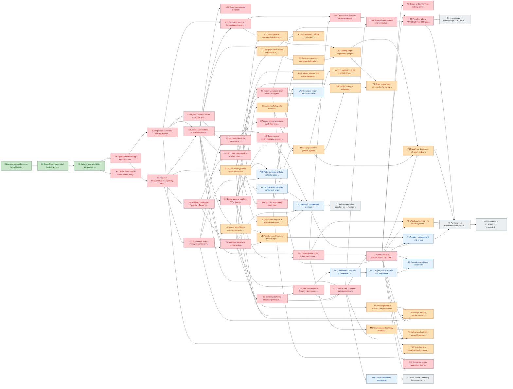

# Ingestion v2 — tablica zadań

**Ten plik jest źródłem prawdy o statusach.** Uzasadnienia, pomiary i diagramy są w
[projekcie](2026-10-24-data-ingestion-conductor-saga.md), specyfikacje modułów w
[katalogu projektowym](ingestion-conductor-design/00-index.md), a granice między artefaktami w
[audycie](ingestion-conductor-design/10-granice-artefaktow.md).

Zmieniając status, zmieniaj go **tutaj**, nie w projekcie — a potem przelicz tablicę:

```bash
python3 tools/task-board/refresh.py docs/features-backlog/ingestion-v2-tasks.md
```

Sekcje **Postęp**, **Gotowe do wzięcia** i **Graf zależności** są **wyprowadzane** z tabel w
„Zadania według ścieżek" i nie należy ich edytować ręcznie. Skrypt sprawdza przy okazji spójność:
nieznane id, duplikaty i wpisy w kolumnie „odblokowuje", którym po drugiej stronie nie odpowiada
zależność. Tryb `--check` nadaje się do CI.

**Dla świeżej sesji:** zacznij od „Gotowe do wzięcia" — to zadania otwarte, których wszystkie
zależności są zrobione. Opis każdego zadania, wraz z gotowym tytułem PR i definicją ukończenia,
jest w „Opisy zadań" niżej. Co zostało zrobione i czego się przy tym nauczyliśmy — w „Dziennik".

**Przestrzeń identyfikatorów tej tablicy jest własna** (litery K, S, M, Z, L, R, W, T, X).
Tablica OKX ma swoją (A–H), więc `F57` zawsze znaczy zadanie tamtej, a `S7` tej.

## Legenda

| priorytet | znaczenie |
|---|---|
| **P0** | blokuje pierwszy import end-to-end (fazy P0–P1 projektu) |
| **P1** | redukcja interakcji z userem: klasyfikacja, drabina, decyzje (faza P2) |
| **P2** | wytrzymałość: kompensacja, odzysk, DLQ, retencja (faza P3) |
| **P3** | wygaszenie v1, obserwacja, dokumentacja (fazy P4–P5) |

| status | znaczenie |
|---|---|
| `open` | nierozpoczęte |
| `wip` | w toku |
| `blocked` | zablokowane, opisz czym |
| `finished` | zrobione |

| ścieżka | zakres |
|---|---|
| **K** — Kontrakty i fundamenty | słownik, parser, protokół sagi, kody błędu, agregator Mavena |
| **S** — Saga i sesja | conductor: encja sesji, maszyna stanów, REST v2, polityka autonomii, transport |
| **M** — Magazyn wierszy | staging: kontrakt R, encja wiersza, walidacja, grupowanie |
| **Z** — Zapis do cash flow | writer: kategorie z planu, import, wycofanie — jedyny moduł piszący do cashflow |
| **L** — Klasyfikacja | worker AI: pyta kontraktu F66, cache odpowiedzi, odwzorowanie na grupy |
| **R** — Rozstrzyganie kategorii | drabina w jednej kopii, plan kategorii, nauka i zapominanie |
| **W** — Wytrzymałość | ponowienia, kompensacja per faza, odzysk po awarii, DLQ, retencja |
| **T** — Testy i reguły | moduł integracyjny, reguły architektoniczne, przepływy end-to-end |
| **X** — Wygaszenie v1 i obserwacja | metody w cashflow-api, topic faktów, usunięcie starego modułu, dokumentacja |

## Postęp

Przeliczane skryptem. Nie edytuj ręcznie.

| | P0 | P1 | P2 | P3 | razem |
|---|---|---|---|---|---|
| `finished` | 3 | 0 | 0 | 0 | **3** |
| `open` | 28 | 22 | 9 | 5 | **64** |
| **razem** | 31 | 22 | 9 | 5 | **67** |

## Gotowe do wzięcia

Zadania otwarte, których **wszystkie zależności są zrobione**.

| # | prio | zadanie | odblokowuje |
|---|---|---|---|
| **K4** | P0 | Agregator vidulum-app-ingestion i miejsce w reaktorze | K5, K7 |
| **K9** | P0 | Osiem ErrorCode w shared-kernel jednym commitem | — |

## Zadania według ścieżek

### K — Kontrakty i fundamenty

| # | prio | status | zadanie | zależy od | odblokowuje |
|---|---|---|---|---|---|
| **K1** | P0 | **finished** | Analiza stanu obecnego i projekt sagi z conductorem | — | K2 |
| **K2** | P0 | **finished** | Specyfikacje per moduł: kontrakty, metody, testy | K1 | K3 |
| **K3** | P0 | **finished** | Audyt granic artefaktów i potwierdzenie /api/v2 | K2 | K4, K9 |
| **K4** | P0 | `open` | Agregator vidulum-app-ingestion i miejsce w reaktorze | K3 | K5, K7 |
| **K5** | P0 | `open` | ingestion-canonical: słownik wiersza i GroupKey | K4 | K6, K8, K11, T10 |
| **K6** | P0 | `open` | ingestion-intake: parser CSV bez Springa | K5 | S4 |
| **K7** | P0 | `open` | Protokół: StepCommand, StepReply, typy wartości | K4 | K8, M1, R1, S1 |
| **K8** | P0 | `open` | Jedenaście komend i jedenaście gniazd handlerów | K5, K7 | K10, K11, L1, M3, M5, R2, S2, S12, Z1 |
| **K9** | P0 | `open` | Osiem ErrorCode w shared-kernel jednym commitem | K3 | — |
| **K10** | P0 | `open` | Testy kontraktowe protokołu | K8 | — |
| **K11** | P0 | `open` | GroupKey zgodny z ContextMapping silnika | K5, K8 | L3, M4 |

### S — Saga i sesja

| # | prio | status | zadanie | zależy od | odblokowuje |
|---|---|---|---|---|---|
| **S1** | P0 | `open` | Encja sesji: jedna maszyna stanów z FAILED | K7 | S2, S4, T8, W6 |
| **S2** | P0 | `open` | IngestionSaga jako czysta funkcja | K8, S1 | L4, S3, S6, S8, W2 |
| **S3** | P0 | `open` | StepDispatcher in-process i przełącznik transportu | S2 | S6, S12 |
| **S4** | P0 | `open` | Start sesji: pre-flight, parsowanie, idempotencja po sha256 | K6, S1 | S5, S7 |
| **S5** | P0 | `open` | REST v2: start, widok sesji, lista | S4 | S9, S11, T11, W5 |
| **S6** | P0 | `open` | Odbiór odpowiedzi kroków i idempotencja | S2, S3 | S12, W1 |
| **S7** | P0 | `open` | Jedna aktywna sesja na cash flow w fazie SETUP | S4 | — |
| **S8** | P1 | `open` | AutonomyPolicy i filtr istotności | S2 | S9 |
| **S9** | P1 | `open` | Decyzje usera w jednym żądaniu | S5, S8 | R6, S10, T4 |
| **S10** | P1 | `open` | TTL decyzji: polityka zamiast utraty uploadu | S9 | — |
| **S11** | P1 | `open` | Podgląd wierszy sesji przez staging-api | M2, S5 | — |
| **S12** | P0 | `open` | Kafka: topici komend, topic odpowiedzi, dispatcher | K8, S3, S6 | T1, T9, W4, Z4 |

### M — Magazyn wierszy

| # | prio | status | zadanie | zależy od | odblokowuje |
|---|---|---|---|---|---|
| **M1** | P0 | `open` | Kontrakt magazynu wierszy, tylko do czytania | K7 | L1, M2, Z1 |
| **M2** | P0 | `open` | Encja wiersza, indeksy, TTL, cleaner | M1 | M3, M5, S11, T8, W6, Z2 |
| **M3** | P0 | `open` | Walidacja wiersza w jednej, zamrożonej kolejności | K8, M2 | M4, M6, T1, T5 |
| **M4** | P0 | `open` | Grupowanie wierszy i udział w wartości | K11, M3 | Z4 |
| **M5** | P0 | `open` | Zastosowanie rozstrzygnięcia, oznaczenie importu, kasowanie | K8, M2 | W2 |
| **M6** | P1 | `open` | Chunkowanie komendy walidacji | M3 | T9 |

### Z — Zapis do cash flow

| # | prio | status | zadanie | zależy od | odblokowuje |
|---|---|---|---|---|---|
| **Z1** | P0 | `open` | Tworzenie kategorii jako osobny, nieprzemilczany krok | K8, M1 | Z2, Z3 |
| **Z2** | P0 | `open` | Import wierszy do cash flow z postępem | M2, Z1 | T1, W5, Z4 |
| **Z3** | P1 | `open` | Wycofanie importu z prawdziwymi liczbami | Z1 | W2 |
| **Z4** | P0 | `open` | Pierwszy import end-to-end bez pytań (AUTOPILOT) | M4, S12, Z2 | T3 |

### L — Klasyfikacja

| # | prio | status | zadanie | zależy od | odblokowuje |
|---|---|---|---|---|---|
| **L1** | P1 | `open` | Worker klasyfikacji i mapowanie na kontrakt silnika | K8, M1 | L2, L3, L4 |
| **L2** | P1 | `open` | Cache odpowiedzi modelu z czyszczeniem | L1 | T8 |
| **L3** | P1 | `open` | Odwzorowanie odpowiedzi silnika na grupy | K11, L1 | R4 |
| **L4** | P1 | `open` | Porażka klasyfikacji nie zabiera importu | L1, S2 | T6 |

### R — Rozstrzyganie kategorii

| # | prio | status | zadanie | zależy od | odblokowuje |
|---|---|---|---|---|---|
| **R1** | P1 | `open` | Moduł rozstrzygania i trwałe mapowania | K7 | R2, R6, R7, T8 |
| **R2** | P1 | `open` | CategoryLadder: sześć priorytetów w jednej kopii | K8, R1 | R3, R5 |
| **R3** | P1 | `open` | Przebieg pierwszy: darmowa drabina bez modelu | R2 | R4 |
| **R4** | P1 | `open` | Przebieg drugi z sugestiami i progami | L3, R3 | R8, T4 |
| **R5** | P1 | `open` | Plan kategorii: rodzice przed dziećmi | R2 | — |
| **R6** | P1 | `open` | Nauka z decyzji człowieka | R1, S9 | R8 |
| **R7** | P2 | `open` | Zapominanie: pierwszy konsument forget | R1 | W2 |
| **R8** | P1 | `open` | Drugi upload tego samego banku nie pyta o nic | R4, R6 | — |

### W — Wytrzymałość

| # | prio | status | zadanie | zależy od | odblokowuje |
|---|---|---|---|---|---|
| **W1** | P2 | `open` | Ponowienia, backoff i rozróżnienie FAILED/REJECTED | S6 | W3 |
| **W2** | P2 | `open` | Łańcuch kompensacji per faza | M5, R7, S2, Z3 | T6, X2 |
| **W3** | P2 | `open` | Odzysk po awarii: krok bez odpowiedzi | W1 | T7 |
| **W4** | P2 | `open` | DLQ dla komend i odpowiedzi | S12 | X3 |
| **W5** | P2 | `open` | Częściowy import i raport odrzutów | S5, Z2 | — |
| **W6** | P2 | `open` | Retencja: dane znikają, rekord procesu zostaje | M2, S1 | — |

### T — Testy i reguły

| # | prio | status | zadanie | zależy od | odblokowuje |
|---|---|---|---|---|---|
| **T1** | P0 | `open` | Moduł testów integracyjnych i jego baza | M3, S12, Z2 | T2, T3, T4, T5, T6, T7, T8, T9, T10, T11 |
| **T2** | P0 | `open` | Reguły architektoniczne rodziny, zero zwolnień | T1 | — |
| **T3** | P0 | `open` | Przepływ udany: AUTOPILOT na 402 wierszach | T1, Z4 | X1, X4 |
| **T4** | P1 | `open` | Przepływ z decyzjami: ≤7 pytań, jedno żądanie | R4, S9, T1 | X4 |
| **T5** | P1 | `open` | Walidacja i odmowy na działającym serwerze | M3, T1 | X4 |
| **T6** | P2 | `open` | Porażki i kompensacja end-to-end | L4, T1, W2 | X4 |
| **T7** | P2 | `open` | Odzysk po zgubionej odpowiedzi | T1, W3 | — |
| **T8** | P1 | `open` | Storage: indeksy, wersje, cleanery | L2, M2, R1, S1, T1 | — |
| **T9** | P1 | `open` | Kafka jako kontrakt i parytet transportów | M6, S12, T1 | — |
| **T10** | P1 | `open` | Test słownika klasyfikacji wobec adaptera | K5, T1 | — |
| **T11** | P0 | `open` | Bootstrap: wiring, zależności, cleanery | S5, T1 | — |

### X — Wygaszenie v1 i obserwacja

| # | prio | status | zadanie | zależy od | odblokowuje |
|---|---|---|---|---|---|
| **X1** | P3 | `open` | recategorize w cashflow-api → AUTOPILOT domyślnie | T3 | — |
| **X2** | P3 | `open` | deleteImported w cashflow-api → kompensacja selektywna | W2 | — |
| **X3** | P3 | `open` | Topic faktów i pierwszy konsument w reaktorze | W4 | — |
| **X4** | P3 | `open` | Parytet z v1 i wyłączenie bank-data-ingestion | T3, T4, T5, T6 | X5 |
| **X5** | P3 | `open` | Dokumentacja: CLAUDE.md i przewodnik manualny | X4 | — |

## Opisy zadań

Po jednym bloku na zadanie: tytuł gotowy do PR, opis, definicja ukończenia, pliki i wskazanie
specyfikacji. Kolumna „zadanie" w tabelach wyżej to skrót tego samego.

### K1 · Analiza stanu obecnego i projekt sagi z conductorem

**PR:** `docs: analiza bank-data-ingestion i projekt data-ingestion-conductor`  
**Priorytet:** P0 · **Status:** **finished** · **Zależy od:** — · **Odblokowuje:** K2

Pomiar dzisiejszego przepływu (encje, trzy równoległe maszyny stanów, 7 żądań usera, 6 scenariuszy porażki) i projekt nowego: saga w trybie orkiestracji, conductor jako właściciel jedynego rekordu procesu, redukcja interakcji do 2 żądań i ≤7 decyzji.

**Definicja ukończenia:**
- dokument z częściami I–III i trzema diagramami sekwencji
- liczby wzięte z kodu, nie z pamięci

**Pliki:** `docs/features-backlog/2026-10-24-data-ingestion-conductor-saga.md`
**Specyfikacja:** —

### K2 · Specyfikacje per moduł: kontrakty, metody, testy

**PR:** `docs: specyfikacje dziesięciu artefaktów rodziny ingestion`  
**Priorytet:** P0 · **Status:** **finished** · **Zależy od:** K1 · **Odblokowuje:** K3

Jeden plik na artefakt: co posiada, jaki ma kontrakt, jakie testy i na którym poziomie, czego w nim nie ma i gdzie to jest. Plus osobny plik z testami integracyjnymi całego przepływu.

**Definicja ukończenia:**
- 10 plików w katalogu projektowym
- każdy scenariusz testowy ma given → then

**Pliki:** `docs/features-backlog/ingestion-conductor-design/00-index.md`
**Specyfikacja:** —

### K3 · Audyt granic artefaktów i potwierdzenie /api/v2

**PR:** `docs: audyt granic rodziny ingestion zmierzony na kodzie`  
**Priorytet:** P0 · **Status:** **finished** · **Zależy od:** K2 · **Odblokowuje:** K4, K9

Dziesięć krawędzi między sekcjami policzonych plik po pliku, wywołania kontraktów zmapowane na nowych właścicieli. Unieważnił jedną granicę z projektu (klasyfikacja nie może dostawać samych grup, bo kontrakt F66 bierze transakcje) i potwierdził prefiks /api/v2 bez zmian w shared-kernelu.

**Definicja ukończenia:**
- sześć poprawek naniesionych w specyfikacjach
- dokument główny uspójniony, zero sprzeczności

**Pliki:** `docs/features-backlog/ingestion-conductor-design/10-granice-artefaktow.md`
**Specyfikacja:** —

### K4 · Agregator vidulum-app-ingestion i miejsce w reaktorze

**PR:** `build: agregator vidulum-app-ingestion z dziesięcioma modułami`  
**Priorytet:** P0 · **Status:** `open` · **Zależy od:** K3 · **Odblokowuje:** K5, K7

Pom-packaged agregator obok market/ i wealth/, z opisem mówiącym, co trzyma rodzinę razem. Moduły puste, ale reaktor policzony: po vidulum-app-cashflow, przed vidulum-cashflow-tests.

**Definicja ukończenia:**
- `./mvnw -f vidulum-app-ingestion/pom.xml validate` przechodzi
- agregator nie jest parentem — moduły dziedziczą z roota

**Pliki:** `vidulum-app-ingestion/pom.xml`, `pom.xml`
**Specyfikacja:** [10](ingestion-conductor-design/10-granice-artefaktow.md) §8

### K5 · ingestion-canonical: słownik wiersza i GroupKey

**PR:** `feat(ingestion): słownik wiersza kanonicznego jako osobny artefakt`  
**Priorytet:** P0 · **Status:** `open` · **Zależy od:** K4 · **Odblokowuje:** K6, K8, K11, T10

CanonicalRow z 17 polami i metodami effective*, TransactionClassification, PaymentMethod, CanonicalColumns oraz GroupKey — jednostka pracy całego pipeline'u. Bez Springa, bez storage, dwie zależności.

**Definicja ukończenia:**
- 17 testów jednostkowych, trzy z pętlą po values()
- money() pilnuje skali BigDecimal
- moduł nie ma w classpathie niczego z rodziny ingestion

**Pliki:** `vidulum-app-ingestion/ingestion-canonical/`
**Specyfikacja:** [01](ingestion-conductor-design/01-ingestion-canonical.md)

### K6 · ingestion-intake: parser CSV bez Springa

**PR:** `feat(ingestion): parser kanonicznego CSV jako liść bez Springa`  
**Priorytet:** P0 · **Status:** `open` · **Zależy od:** K5 · **Odblokowuje:** S4

CanonicalCsvParser.parse(byte[], Charset) zamiast MultipartFile, błąd wiersza jako pozycja w errors[] a nie wyjątek, deterministyczne nadanie bankTransactionId gdy go nie ma. Heurystyka polskich typów operacji przenosi się tu ze słownika.

**Definicja ukończenia:**
- 25 testów, w tym plik złoty 402-wierszowy
- zły wiersz nie zabiera 401 pozostałych
- to samo wejście dwa razy → to samo id

**Pliki:** `vidulum-app-ingestion/ingestion-intake/`
**Specyfikacja:** [02](ingestion-conductor-design/02-ingestion-intake.md)

### K7 · Protokół: StepCommand, StepReply, typy wartości

**PR:** `feat(ingestion): protokół sagi — koperty i typy wartości`  
**Priorytet:** P0 · **Status:** `open` · **Zależy od:** K4 · **Odblokowuje:** K8, M1, R1, S1

StepCommand z commandId i attempt, jedna koperta StepReply dla wszystkich kroków, sealed StepOutcome, rozróżnienie FAILED/REJECTED oraz typy grup i kategorii: GroupSummary, Resolution, CategoryPlan, Option, CategorySnapshot.

**Definicja ukończenia:**
- kontrakt bez Springa, trzy zależności
- CategorySnapshot nosi tylko to, czego potrzebuje drabina

**Pliki:** `vidulum-app-ingestion/ingestion-conductor-api/`
**Specyfikacja:** [03](ingestion-conductor-design/03-ingestion-conductor-api.md)

### K8 · Jedenaście komend i jedenaście gniazd handlerów

**PR:** `feat(ingestion): komendy kroków i gniazda dla workerów`  
**Priorytet:** P0 · **Status:** `open` · **Zależy od:** K5, K7 · **Odblokowuje:** K10, K11, L1, M3, M5, R2, S2, S12, Z1

Komenda na krok plus interfejs handlera ze stałymi TOPIC i CONTAINER_FACTORY — wzorzec TradeConfirmedHandler. Conductor deklaruje gniazda, workerzy je implementują; kształtem to ModuleSpi, nie ModuleApi.

**Definicja ukończenia:**
- 11 par komenda/handler
- topici unikalne i zgodne z konwencją ingestion.cmd.*
- żadnej koperty z Map<String,String>

**Pliki:** `vidulum-app-ingestion/ingestion-conductor-api/`
**Specyfikacja:** [03](ingestion-conductor-design/03-ingestion-conductor-api.md)

### K9 · Osiem ErrorCode w shared-kernel jednym commitem

**PR:** `feat(shared-kernel): osiem kodów błędu dla ingestion v2`  
**Priorytet:** P0 · **Status:** `open` · **Zależy od:** K3 · **Odblokowuje:** —

ErrorHttpHandler siedzi w shared-kernelu i mapuje BusinessException.getErrorCode(), więc każdy nowy kod to zmiana shared-kernela, czyli pełny przebieg reaktora. Osiem kodów po jednym na moduł to osiem przebiegów zamiast jednego — stąd jeden commit na początku.

**Definicja ukończenia:**
- osiem stałych z właściwymi statusami HTTP
- `./mvnw clean test` cały reaktor zielony, raz

**Pliki:** `vidulum-shared-kernel/src/main/java/com/multi/vidulum/common/error/ErrorCode.java`
**Specyfikacja:** [10](ingestion-conductor-design/10-granice-artefaktow.md) §6

### K10 · Testy kontraktowe protokołu

**PR:** `test(ingestion): testy kontraktowe protokołu sagi`  
**Priorytet:** P0 · **Status:** `open` · **Zależy od:** K8 · **Odblokowuje:** —

Refleksyjne i serializacyjne: każda komenda jest rekordem implementującym StepCommand, topici unikalne, StepOutcome wyczerpuje kroki, Money przechodzi round-trip Jacksona ze skalą, ZonedDateTime ze strefą i godziną.

**Definicja ukończenia:**
- 16 przypadków
- round-trip 1234.50 zachowuje equals, nie tylko compareTo

**Pliki:** `vidulum-app-ingestion/ingestion-conductor-api/src/test/`
**Specyfikacja:** [03](ingestion-conductor-design/03-ingestion-conductor-api.md)

### K11 · GroupKey zgodny z ContextMapping silnika

**PR:** `test(ingestion): zgodność GroupKey z kluczem odpowiedzi silnika`  
**Priorytet:** P0 · **Status:** `open` · **Zależy od:** K5, K8 · **Odblokowuje:** L3, M4

Silnik kategoryzacji grupuje po effectiveMerchant() i odpowiada ContextMapping kluczowanym parą (pattern, bankCategory). Komponent merchanta w GroupKey musi być tym samym, inaczej odwzorowanie odpowiedzi na grupy jest stratne.

**Definicja ukończenia:**
- test wiąże klucz grupy z kluczem ContextMapping
- AutoCategorizableSuggestion ↔ CLASS|WORD

**Pliki:** `vidulum-app-ingestion/ingestion-canonical/src/test/`
**Specyfikacja:** [10](ingestion-conductor-design/10-granice-artefaktow.md) §4

### S1 · Encja sesji: jedna maszyna stanów z FAILED

**PR:** `feat(ingestion): sesja jako jedyny rekord procesu`  
**Priorytet:** P0 · **Status:** `open` · **Zależy od:** K7 · **Odblokowuje:** S2, S4, T8, W6

IngestionSessionEntity z jedną fazą (nie trzema statusami), steps[], counters, groups[], decisions[], compensations i failure, które NIGDY nie jest zerowane. Plus repozytorium domenowe i DataCleaner.

**Definicja ukończenia:**
- @Version na encji
- test: fail → compensate → failure nadal obecne
- cleaner czyści przez remove(), nie dropCollection

**Pliki:** `vidulum-app-ingestion/ingestion-conductor/`
**Specyfikacja:** [04](ingestion-conductor-design/04-ingestion-conductor.md) §20.2

### S2 · IngestionSaga jako czysta funkcja

**PR:** `feat(ingestion): saga jako czysta funkcja decyzji o następnym kroku`  
**Priorytet:** P0 · **Status:** `open` · **Zależy od:** K8, S1 · **Odblokowuje:** L4, S3, S6, S8, W2

next(session, reply, now) → NextAction (Dispatch | Ask | Finish | Compensate | Fail | Ignore). Bez repozytorium, bez Kafki, bez zegara w polu — więc cała decyzyjność procesu jest testowalna tabelą.

**Definicja ukończenia:**
- 20 testów przejść
- test parametryzowany po IngestionPhase.values() × StepStatus.values()
- RESOLVE pomija CLASSIFY, gdy open jest puste

**Pliki:** `vidulum-app-ingestion/ingestion-conductor/.../saga/`
**Specyfikacja:** [04](ingestion-conductor-design/04-ingestion-conductor.md) §A

### S3 · StepDispatcher in-process i przełącznik transportu

**PR:** `feat(ingestion): transport kroku wymienny, domyślnie in-process`  
**Priorytet:** P0 · **Status:** `open` · **Zależy od:** S2 · **Odblokowuje:** S6, S12

vidulum.ingestion.step.transport = kafka | in-process, domyślnie in-process — bo matchIfMissing na implementacji zdalnej jest pułapką, którą ten projekt już raz przeżył. Testy komponentowe przechodzą całą sagę bez Dockera.

**Definicja ukończenia:**
- dwie implementacje, dokładnie jedna jako bean
- domyślna jest lokalna

**Pliki:** `vidulum-app-ingestion/ingestion-conductor/.../saga/`
**Specyfikacja:** [04](ingestion-conductor-design/04-ingestion-conductor.md)

### S4 · Start sesji: pre-flight, parsowanie, idempotencja po sha256

**PR:** `feat(ingestion): start sesji z pre-flightem cash flow i idempotencją pliku`  
**Priorytet:** P0 · **Status:** `open` · **Zależy od:** K6, S1 · **Odblokowuje:** S5, S7

exists + skeletonOf przed założeniem sesji (404/409 natychmiast), parsowanie przez intake, sha256 pliku jako klucz idempotencji startu, zapis sesji w fazie PARSED i wysłanie ValidateRowsCommand.

**Definicja ukończenia:**
- brak cash flow → 404, sesja nie powstaje
- ten sam plik dwa razy → ten sam sessionId

**Pliki:** `vidulum-app-ingestion/ingestion-conductor/.../app/commands/`
**Specyfikacja:** [04](ingestion-conductor-design/04-ingestion-conductor.md) §D

### S5 · REST v2: start, widok sesji, lista

**PR:** `feat(ingestion): endpointy /api/v2/ingestion`  
**Priorytet:** P0 · **Status:** `open` · **Zależy od:** S4 · **Odblokowuje:** S9, S11, T11, W5

POST /api/v2/ingestion (202 + sessionId), GET /api/v2/ingestion/{id} z pełnym stanem procesu, GET /api/v2/ingestion?cashFlowId=. userId z JWT, sesja innego usera to 404 a nie 403.

**Definicja ukończenia:**
- jeden GET pokazuje fazy, kroki, czasy, liczniki, decyzje, odrzuty
- 202 wraca przed wykonaniem pracy

**Pliki:** `vidulum-app-ingestion/ingestion-conductor/.../IngestionRestController.java`
**Specyfikacja:** [04](ingestion-conductor-design/04-ingestion-conductor.md)

### S6 · Odbiór odpowiedzi kroków i idempotencja

**PR:** `feat(ingestion): StepReplyListener i idempotentne księgowanie odpowiedzi`  
**Priorytet:** P0 · **Status:** `open` · **Zależy od:** S2, S3 · **Odblokowuje:** S12, W1

Odpowiedź po commandId zamyka krok; duplikat jest ignorowany, odpowiedź na nieaktualny stepId też, odpowiedź dla nieznanej sesji nie wywala konsumenta.

**Definicja ukończenia:**
- trzy testy ignorowania
- historia kroków przeżywa ponowienia (trzy StepRecord, nie jeden)

**Pliki:** `vidulum-app-ingestion/ingestion-conductor/.../saga/`
**Specyfikacja:** [04](ingestion-conductor-design/04-ingestion-conductor.md) §A

### S7 · Jedna aktywna sesja na cash flow w fazie SETUP

**PR:** `feat(ingestion): strażnik jednej aktywnej sesji na cash flow w SETUP`  
**Priorytet:** P0 · **Status:** `open` · **Zależy od:** S4 · **Odblokowuje:** —

rollbackImport kasuje cały import cash flow, nie wiersze jednej sesji — więc dwie sesje w SETUP znaczyłyby, że kompensacja jednej zabiera dane drugiej. Druga sesja dostaje 409, dopóki pierwsza nie jest w stanie końcowym.

**Definicja ukończenia:**
- 409 dla drugiej sesji
- po stanie końcowym pierwszej druga startuje

**Pliki:** `vidulum-app-ingestion/ingestion-conductor/.../app/commands/`
**Specyfikacja:** [10](ingestion-conductor-design/10-granice-artefaktow.md) §4 i główny §25

### S8 · AutonomyPolicy i filtr istotności

**PR:** `feat(ingestion): polityka autonomii i filtr istotności pytań`  
**Priorytet:** P1 · **Status:** `open` · **Zależy od:** S2 · **Odblokowuje:** S9

Progi 90/50, pokrycie 90 procent wartości, maxQuestions 7, TTL decyzji, fallback i trzy poziomy: AUTOPILOT, REVIEW_MATERIAL, REVIEW_ALL. Polityka należy do conductora, bo to ona jest przedmiotem audytu w decisions[].

**Definicja ukończenia:**
- 8 kandydatów → 5 pytań i 3 IMMATERIAL
- granice 89/90 i 49/50 zamrożone testem
- każda nieprzepytana grupa ma zapisany powód

**Pliki:** `vidulum-app-ingestion/ingestion-conductor/.../policy/`
**Specyfikacja:** [04](ingestion-conductor-design/04-ingestion-conductor.md) §B

### S9 · Decyzje usera w jednym żądaniu

**PR:** `feat(ingestion): jedno żądanie na wszystkie decyzje sesji`  
**Priorytet:** P1 · **Status:** `open` · **Zależy od:** S5, S8 · **Odblokowuje:** R6, S10, T4

POST /api/v2/ingestion/{id}/decisions przyjmuje odpowiedzi na wszystkie pytania naraz, zapisuje je w decisions[] z autorem i czasem, i zwraca NOWY stan sesji w tej samej odpowiedzi HTTP — żeby nie było okna, w którym ekran kłamie.

**Definicja ukończenia:**
- odpowiedź POST nie zawiera AWAITING_DECISION
- odpowiedź na zamkniętą decyzję odrzucona
- kategoria własna z CREATE_SUBCATEGORY trafia do planu

**Pliki:** `vidulum-app-ingestion/ingestion-conductor/.../app/commands/`
**Specyfikacja:** [04](ingestion-conductor-design/04-ingestion-conductor.md)

### S10 · TTL decyzji: polityka zamiast utraty uploadu

**PR:** `feat(ingestion): auto-rozstrzygnięcie decyzji po TTL`  
**Priorytet:** P1 · **Status:** `open` · **Zależy od:** S9 · **Odblokowuje:** —

Nieodpowiedziana decyzja po 24 h dostaje recommended i zapis autoResolved=TTL, zamiast zabierać cały upload. Dziś TTL kasuje sesję i wiersze, więc trzeba powtórzyć od transformacji AI, czyli zapłacić modelowi drugi raz.

**Definicja ukończenia:**
- zegar przesunięty → rekomendacja zastosowana, import jedzie
- harmonogram nie rusza sesji w stanie końcowym

**Pliki:** `vidulum-app-ingestion/ingestion-conductor/.../saga/`
**Specyfikacja:** [04](ingestion-conductor-design/04-ingestion-conductor.md) §C

### S11 · Podgląd wierszy sesji przez staging-api

**PR:** `feat(ingestion): GET /api/v2/ingestion/{id}/rows`  
**Priorytet:** P1 · **Status:** `open` · **Zależy od:** M2, S5 · **Odblokowuje:** —

Podgląd wierszy z filtrem statusu, stronicowany, czytany przez IngestionRowsApi. Jedyna krawędź conductora do magazynu wierszy i jedyny powód jej istnienia; kontrakt nie ma metody zapisującej, więc nie może urosnąć w pisanie do cudzej kolekcji.

**Definicja ukończenia:**
- stronicowanie bez gubienia i dublowania wierszy
- conductor nie zależy od implementacji stagingu

**Pliki:** `vidulum-app-ingestion/ingestion-conductor/.../IngestionRestController.java`
**Specyfikacja:** [10](ingestion-conductor-design/10-granice-artefaktow.md) §4

### S12 · Kafka: topici komend, topic odpowiedzi, dispatcher

**PR:** `feat(ingestion): transport kafkowy sagi z kluczem sessionId`  
**Priorytet:** P0 · **Status:** `open` · **Zależy od:** K8, S3, S6 · **Odblokowuje:** T1, T9, W4, Z4

Topic na krok plus jeden topic odpowiedzi, klucz sessionId dla kolejności per sesja, KafkaStepDispatcher i konfiguracja konsumentów z groupId nazwanym po module.

**Definicja ukończenia:**
- ten sam przepływ przechodzi na obu transportach
- klucz = sessionId na każdym rekordzie

**Pliki:** `vidulum-app-ingestion/ingestion-conductor/.../infrastructure/`
**Specyfikacja:** [projekt](2026-10-24-data-ingestion-conductor-saga.md) §10

### M1 · Kontrakt magazynu wierszy, tylko do czytania

**PR:** `feat(ingestion): ingestion-staging-api jako kontrakt tylko do czytania`  
**Priorytet:** P0 · **Status:** `open` · **Zależy od:** K7 · **Odblokowuje:** L1, M2, Z1

IngestionRowsApi: rowsOf, countsOf, rowsOfGroup plus StagedRowView i RowFilter. Trzech czytających (writer, klasyfikacja, conductor), zero piszących poza stagingiem — i kontrakt nie ma metody zapisującej, więc to nie jest obietnica, a kształt.

**Definicja ukończenia:**
- brak typu Mongo na powierzchni kontraktu
- ValidationStatus ma trzy stany, bez PENDING_MAPPING

**Pliki:** `vidulum-app-ingestion/ingestion-staging-api/`
**Specyfikacja:** [05](ingestion-conductor-design/05-ingestion-staging.md)

### M2 · Encja wiersza, indeksy, TTL, cleaner

**PR:** `feat(ingestion): magazyn wierszy z indeksami i TTL`  
**Priorytet:** P0 · **Status:** `open` · **Zależy od:** M1 · **Odblokowuje:** M3, M5, S11, T8, W6, Z2

IngestionRowEntity (original + validation + groupKey + resolution + importResult), dwa indeksy złożone, indeks TTL na expiresAt, repozytorium, implementacja kontraktu R i DataCleaner.

**Definicja ukończenia:**
- dokument na wiersz, nie tablica w sesji
- cleaner czyści przez remove(), indeksy zostają

**Pliki:** `vidulum-app-ingestion/ingestion-staging/`
**Specyfikacja:** [05](ingestion-conductor-design/05-ingestion-staging.md) §20.3

### M3 · Walidacja wiersza w jednej, zamrożonej kolejności

**PR:** `feat(ingestion): walidacja wierszy — duplikaty, okno importu, miesiące, przelewy własne`  
**Priorytet:** P0 · **Status:** `open` · **Zależy od:** K8, M2 · **Odblokowuje:** M4, M6, T1, T5

Duplikat po bankTransactionId, potem okno importu cashflow, i TYLKO jeśli przeszło — statusy miesięcy prognozy, żeby jedna zła data nie dała dwóch komunikatów. Plus wykrycie przelewu własnego po IBAN-ie i nadanie groupKey.

**Definicja ukończenia:**
- duplicateOfCashChangeId to id ISTNIEJĄCEGO cash change
- cztery pytania zewnętrzne na 402 wiersze, nie 1608
- owner z komendy, nie ze skeletonu

**Pliki:** `vidulum-app-ingestion/ingestion-staging/.../commands/`
**Specyfikacja:** [05](ingestion-conductor-design/05-ingestion-staging.md) §A–B

### M4 · Grupowanie wierszy i udział w wartości

**PR:** `feat(ingestion): grupy jako jednostka pracy pipeline'u`  
**Priorytet:** P0 · **Status:** `open` · **Zależy od:** K11, M3 · **Odblokowuje:** Z4

GroupSummary z licznikiem, sumą, trzema próbkami i valueShare — wejście filtra istotności. Wiersze auto-kategorizowalne grupują się po słowie klasyfikacji, nie po merchancie; kierunki są rozdzielone.

**Definicja ukończenia:**
- 402 wiersze → 38 grup na pliku złotym
- suma valueShare ≈ 1.0
- duplikaty i odrzuty poza sumami grup

**Pliki:** `vidulum-app-ingestion/ingestion-staging/.../commands/`
**Specyfikacja:** [05](ingestion-conductor-design/05-ingestion-staging.md) §C

### M5 · Zastosowanie rozstrzygnięcia, oznaczenie importu, kasowanie

**PR:** `feat(ingestion): trzy komendy magazynu — apply, mark, discard`  
**Priorytet:** P0 · **Status:** `open` · **Zależy od:** K8, M2 · **Odblokowuje:** W2

ApplyResolutionHandler przenosi rozstrzygnięcie grupy na jej wiersze jednym zapytaniem zbiorczym, MarkImportedHandler zapisuje pary rowId → cashChangeId, DiscardRowsHandler kasuje wiersze tylko swojej sesji.

**Definicja ukończenia:**
- 38 grup → 381 wierszy z resolution
- wiersze innej sesji nietknięte
- nieznany rowId pomijany bez wyjątku

**Pliki:** `vidulum-app-ingestion/ingestion-staging/.../commands/`
**Specyfikacja:** [05](ingestion-conductor-design/05-ingestion-staging.md) §D

### M6 · Chunkowanie komendy walidacji

**PR:** `feat(ingestion): dzielenie ValidateRowsCommand na części`  
**Priorytet:** P1 · **Status:** `open` · **Zależy od:** M3 · **Odblokowuje:** T9

Jedyna komenda z danymi wierszowymi: 402 wiersze to ~160 KB i mieści się w domyślnym max.message.bytes, ale wyciąg 5000-wierszowy już nie. Chunki po 1000 wierszy, jedna odpowiedź po ostatnim.

**Definicja ukończenia:**
- trzy chunki → 402 dokumenty i jedna odpowiedź
- ponowienie chunka nie dubluje wierszy

**Pliki:** `vidulum-app-ingestion/ingestion-staging/.../commands/`
**Specyfikacja:** [projekt](2026-10-24-data-ingestion-conductor-saga.md) §19

### Z1 · Tworzenie kategorii jako osobny, nieprzemilczany krok

**PR:** `feat(ingestion): provisioning kategorii z planu, rodzice przed dziećmi`  
**Priorytet:** P0 · **Status:** `open` · **Zależy od:** K8, M1 · **Odblokowuje:** Z2, Z3

CategoryPlan wykonywany osobnym krokiem: rodzice przed dziećmi (bo apply(CategoryCreatedEvent) rzuca bez rodzica), CategoryAlreadyExists to existed a nie błąd, a każda inna porażka to StepReply(FAILED) i import się NIE ZACZYNA. Dziś catch(Exception) + processed++ udaje sukces.

**Definicja ukończenia:**
- porażka tworzenia nie wpuszcza importu
- created[] zgodne z tym, co naprawdę powstało
- moduł nie ma -data-mongodb w pomie

**Pliki:** `vidulum-app-ingestion/ingestion-cashflow-writer/`
**Specyfikacja:** [08](ingestion-conductor-design/08-ingestion-cashflow-writer.md) §A

### Z2 · Import wierszy do cash flow z postępem

**PR:** `feat(ingestion): import wierszy przez kontrakt cashflow, z postępem`  
**Priorytet:** P0 · **Status:** `open` · **Zależy od:** M2, Z1 · **Odblokowuje:** T1, W5, Z4

Wiersze czytane stronicowo przez staging-api, HistoricalCashChange z nietkniętą skalą Money i strefą paidDate, dueDate = paidDate, bankTransactionId i flaga selfTransfer. Postęp jako StepReply(PARTIAL) co 50 wierszy — telemetria, która wreszcie ma konsumenta.

**Definicja ukończenia:**
- 381 wierszy → 381 wywołań i 381 par
- ponowienie oddaje te same id (idempotencja po bankTransactionId)
- wiersz, który padł, nie zatrzymuje pozostałych

**Pliki:** `vidulum-app-ingestion/ingestion-cashflow-writer/`
**Specyfikacja:** [08](ingestion-conductor-design/08-ingestion-cashflow-writer.md) §B

### Z3 · Wycofanie importu z prawdziwymi liczbami

**PR:** `feat(ingestion): kompensacja importu po stronie cash flow`  
**Priorytet:** P1 · **Status:** `open` · **Zależy od:** Z1 · **Odblokowuje:** W2

Sprawdzenie isInSetup przed czymkolwiek (po atestacji odmowa z powodem ATTESTED), rollbackImport z deleteCategories wyprowadzonym z listy utworzonych, i raport z RollbackResult — bez zer z palca.

**Definicja ukończenia:**
- skeleton OPEN → REJECTED, zero wywołań
- liczby z RollbackResult, nie wymyślone

**Pliki:** `vidulum-app-ingestion/ingestion-cashflow-writer/`
**Specyfikacja:** [08](ingestion-conductor-design/08-ingestion-cashflow-writer.md) §C

### Z4 · Pierwszy import end-to-end bez pytań (AUTOPILOT)

**PR:** `feat(ingestion): 402 wiersze wchodzą bez jednej decyzji usera`  
**Priorytet:** P0 · **Status:** `open` · **Zależy od:** M4, S12, Z2 · **Odblokowuje:** T3

Zszycie fazy P1: start → walidacja → grupowanie → plan z fallbackiem → provisioning → import, wszystko poza wątkiem HTTP. Dowód, że szkielet działa, zanim dojdzie klasyfikacja i decyzje.

**Definicja ukończenia:**
- jedno żądanie usera, faza IMPORTED
- 381 cash changes i 11 kategorii w cash flow
- import nie jedzie w wątku żądania

**Pliki:** `—`
**Specyfikacja:** [projekt](2026-10-24-data-ingestion-conductor-saga.md) §21

### L1 · Worker klasyfikacji i mapowanie na kontrakt silnika

**PR:** `feat(ingestion): worker klasyfikacji pytający kontraktu F66`  
**Priorytet:** P1 · **Status:** `open` · **Zależy od:** K8, M1 · **Odblokowuje:** L2, L3, L4

ClassifyGroupsCommand nosi KLUCZE grup, a worker dociąga ich wiersze przez staging-api — bo CategorizationRequest bierze transakcje i silnik grupuje je sam. Mapowanie na TransactionToCategorize to jedenaście wartości zmierzonych z kodu silnika.

**Definicja ukończenia:**
- jedno wywołanie suggestFor na całą partię
- wiersze tylko grup otwartych
- moduł bez spring-ai i bez webmvc

**Pliki:** `vidulum-app-ingestion/ingestion-classification/`
**Specyfikacja:** [06](ingestion-conductor-design/06-ingestion-classification.md)

### L2 · Cache odpowiedzi modelu z czyszczeniem

**PR:** `feat(ingestion): cache odpowiedzi klasyfikatora na requestHash`  
**Priorytet:** P1 · **Status:** `open` · **Zależy od:** L1 · **Odblokowuje:** T8

Odpowiedź za pieniądze zapisana raz: ponowienie kroku po awarii nie płaci drugi raz. Hash z cashFlowId, kluczy grup, języka i drzewa kategorii. Koszt raportowany w odpowiedzi, nie zapisywany w sesji — lekcja F67.

**Definicja ukończenia:**
- drugie wywołanie tej samej komendy nie dotyka kontraktu
- cleaner czyści cache, inaczej przebieg udaje determinizm

**Pliki:** `vidulum-app-ingestion/ingestion-classification/`
**Specyfikacja:** [06](ingestion-conductor-design/06-ingestion-classification.md)

### L3 · Odwzorowanie odpowiedzi silnika na grupy

**PR:** `feat(ingestion): odwzorowanie sugestii silnika na klucze grup`  
**Priorytet:** P1 · **Status:** `open` · **Zależy od:** K11, L1 · **Odblokowuje:** R4

ContextMapping po parze (pattern, bankCategory), AutoCategorizableSuggestion po słowie klasyfikacji, BankCategoryFallback dla grup o słabym merchancie. Bez zgadywania, bo silnik już odpowiada per grupa.

**Definicja ukończenia:**
- trzy testy odwzorowania, jeden na kształt odpowiedzi
- sugestia bez pasującej grupy jest raportowana, nie gubiona

**Pliki:** `vidulum-app-ingestion/ingestion-classification/`
**Specyfikacja:** [10](ingestion-conductor-design/10-granice-artefaktow.md) §4

### L4 · Porażka klasyfikacji nie zabiera importu

**PR:** `feat(ingestion): polityka porażki klasyfikacji`  
**Priorytet:** P1 · **Status:** `open` · **Zależy od:** L1, S2 · **Odblokowuje:** T6

Timeout i 429 to FAILED retryable z backoffem; limit kosztu to REJECTED bez ponawiania, bo ponawianie tylko spali budżet. Po wyczerpaniu prób krok jest POMIJANY, drabina jedzie bez sugestii, import nie jest tracony.

**Definicja ukończenia:**
- sesja mówi CLASSIFY: FAILED i mimo to kończy IMPORTED
- nic nie trafia do cache przy porażce

**Pliki:** `vidulum-app-ingestion/ingestion-classification/`
**Specyfikacja:** [06](ingestion-conductor-design/06-ingestion-classification.md) §B

### R1 · Moduł rozstrzygania i trwałe mapowania

**PR:** `feat(ingestion): mapowania kategorii jako własność jednego modułu`  
**Priorytet:** P1 · **Status:** `open` · **Zależy od:** K7 · **Odblokowuje:** R2, R6, R7, T8

CategoryMapping z @Version, repozytorium, cleaner. Pom ma cashflow-api wyłącznie dla typów Type i CategoryName — ani jednego wywołania metody, bo drzewo kategorii przychodzi w komendzie jako CategorySnapshot.

**Definicja ukończenia:**
- cleaner dopisany, remove() nie dropCollection
- reguła: zero wywołań CashFlowModuleApi z tego modułu

**Pliki:** `vidulum-app-ingestion/ingestion-category-resolution/`
**Specyfikacja:** [07](ingestion-conductor-design/07-ingestion-category-resolution.md)

### R2 · CategoryLadder: sześć priorytetów w jednej kopii

**PR:** `feat(ingestion): drabina rozstrzygania kategorii w jednym miejscu`  
**Priorytet:** P1 · **Status:** `open` · **Zależy od:** K8, R1 · **Odblokowuje:** R3, R5

Self-transfer, dopasowanie bezpośrednie, wzorzec wyuczony, mapowanie, słowo klasyfikacji, sugestia AI — w tej kolejności, raz. Dziś drabina stoi w dwóch kopiach (763 i 436 linii), które już się rozjechały co do priorytetów.

**Definicja ukończenia:**
- test parametryzowany po ResolutionSource.values(): każde źródło kiedyś wygrywa
- grupa pasująca do wszystkiego rozstrzyga się najwyższym
- matchLearned raz na przebieg, nie per grupa

**Pliki:** `vidulum-app-ingestion/ingestion-category-resolution/`
**Specyfikacja:** [07](ingestion-conductor-design/07-ingestion-category-resolution.md) §A

### R3 · Przebieg pierwszy: darmowa drabina bez modelu

**PR:** `feat(ingestion): RESOLVE bez AI jako pierwszy przebieg`  
**Priorytet:** P1 · **Status:** `open` · **Zależy od:** R2 · **Odblokowuje:** R4

Pierwszy przebieg używa wyłącznie tego, co darmowe, i oddaje open[] — czyli model jest pytany tylko o to, czego drabina nie rozstrzygnęła. Dziś user woła /ai-categorize dla całej sesji, zawsze, nie wiedząc, czy model jest potrzebny.

**Definicja ukończenia:**
- pusta pamięć → 9 z 38 grup rozstrzygniętych na pliku złotym
- sugestie w przebiegu 1 są ignorowane

**Pliki:** `vidulum-app-ingestion/ingestion-category-resolution/`
**Specyfikacja:** [07](ingestion-conductor-design/07-ingestion-category-resolution.md) §D

### R4 · Przebieg drugi z sugestiami i progami

**PR:** `feat(ingestion): RESOLVE z sugestiami i progami pewności`  
**Priorytet:** P1 · **Status:** `open` · **Zależy od:** L3, R3 · **Odblokowuje:** R8, T4

Pewność ≥ 90 przyjęta bez pytania, 50–90 kandydat na pytanie, poniżej 50 fallback z flagą provisional. Progi przychodzą z polityki conductora — drabina ich nie wymyśla.

**Definicja ukończenia:**
- granice 89/90 i 49/50 zamrożone
- 21 z 29 otwartych grup rozstrzygniętych na pliku złotym

**Pliki:** `vidulum-app-ingestion/ingestion-category-resolution/`
**Specyfikacja:** [07](ingestion-conductor-design/07-ingestion-category-resolution.md) §A

### R5 · Plan kategorii: rodzice przed dziećmi

**PR:** `feat(ingestion): CategoryPlan z walidacją kolejności`  
**Priorytet:** P1 · **Status:** `open` · **Zależy od:** R2 · **Odblokowuje:** —

Kolejność listy JEST kontraktem, więc validated() rzuca, gdy dziecko stoi przed rodzicem. Brakujący rodzic dopisany, nawet gdy model proponował tylko dziecko; ta sama nazwa w dwóch kierunkach to dwie pozycje.

**Definicja ukończenia:**
- plan 11 pozycji na pliku złotym, zwalidowany
- 12 grup w jedną nową kategorię → jedna pozycja

**Pliki:** `vidulum-app-ingestion/ingestion-category-resolution/`
**Specyfikacja:** [07](ingestion-conductor-design/07-ingestion-category-resolution.md) §B

### R6 · Nauka z decyzji człowieka

**PR:** `feat(ingestion): LEARN — mapowanie i wzorzec z decyzji usera`  
**Priorytet:** P1 · **Status:** `open` · **Zależy od:** R1, S9 · **Odblokowuje:** R8

Odpowiedź z remember=true staje się mapowaniem ORAZ wzorcem (PatternSource.USER). Druga identyczna decyzja poprawia, nie duplikuje; ponowienie komendy nie zapisuje dwa razy.

**Definicja ukończenia:**
- 5 decyzji → 5 mapowań i 5 wzorców
- remember=false nie zapisuje nic
- ids zwrócone do kompensacji

**Pliki:** `vidulum-app-ingestion/ingestion-category-resolution/`
**Specyfikacja:** [07](ingestion-conductor-design/07-ingestion-category-resolution.md) §C

### R7 · Zapominanie: pierwszy konsument forget

**PR:** `feat(ingestion): UNLEARN — kompensacja wiedzy wyuczonej`  
**Priorytet:** P2 · **Status:** `open` · **Zależy od:** R1 · **Odblokowuje:** W2

TransactionCategorizationApi.forget ma dziś ZERO wywołań produkcyjnych: metoda kontraktu bez konsumenta. Ten krok jest jej pierwszym — jeśli transakcje są wycofywane, wzorce z akceptacji człowieka są tą samą decyzją.

**Definicja ukończenia:**
- forget wołane raz, mapowania tylko tego cash flow
- wiedza innego cash flow nietknięta

**Pliki:** `vidulum-app-ingestion/ingestion-category-resolution/`
**Specyfikacja:** [10](ingestion-conductor-design/10-granice-artefaktow.md) §2

### R8 · Drugi upload tego samego banku nie pyta o nic

**PR:** `feat(ingestion): dowód, że nauka działa — drugi wyciąg bez pytań`  
**Priorytet:** P1 · **Status:** `open` · **Zależy od:** R4, R6 · **Odblokowuje:** —

Po pierwszym imporcie drugi plik tego samego banku rozstrzyga się na priorytetach 0–2 i saga nie wchodzi w AWAITING_DECISION. To jest ta część redukcji interakcji, której nie da się udowodnić jednym przebiegiem.

**Definicja ukończenia:**
- drugi upload: decisions puste, faza IMPORTED
- pierwszy upload nadal pyta o ≤7 grup

**Pliki:** `—`
**Specyfikacja:** [projekt](2026-10-24-data-ingestion-conductor-saga.md) §11

### W1 · Ponowienia, backoff i rozróżnienie FAILED/REJECTED

**PR:** `feat(ingestion): polityka ponowień kroku`  
**Priorytet:** P2 · **Status:** `open` · **Zależy od:** S6 · **Odblokowuje:** W3

maxAttempts z wykładniczym backoffem; Failure.retryable decyduje, czy w ogóle ponawiać. REJECTED (cash flow CLOSED, miesiąc ATTESTED) nie jest ponawiane, bo ponawianie nie pomoże.

**Definicja ukończenia:**
- trzy próby, potem kompensacja
- REJECTED → zero ponowień w steps[]

**Pliki:** `vidulum-app-ingestion/ingestion-conductor/.../saga/`
**Specyfikacja:** [projekt](2026-10-24-data-ingestion-conductor-saga.md) §13

### W2 · Łańcuch kompensacji per faza

**PR:** `feat(ingestion): kompensacja nazwana per faza, nie jedna flaga`  
**Priorytet:** P2 · **Status:** `open` · **Zależy od:** M5, R7, S2, Z3 · **Odblokowuje:** T6, X2

UNIMPORT → UNLEARN → DISCARD_ROWS, w tej kolejności, z odmową gdy cash flow wyszedł z SETUP. Kategorie kasowane tylko te utworzone przez tę sesję; Uncategorized nigdy; mapowania zostają, bo to wiedza o banku, nie o wyciągu.

**Definicja ukończenia:**
- kolejność zamrożona testem
- failure zostaje po kompensacji
- compensations zerowane PO potwierdzeniu

**Pliki:** `vidulum-app-ingestion/ingestion-conductor/.../saga/`
**Specyfikacja:** [projekt](2026-10-24-data-ingestion-conductor-saga.md) §13

### W3 · Odzysk po awarii: krok bez odpowiedzi

**PR:** `feat(ingestion): harmonogram wznawiania zawieszonych kroków`  
**Priorytet:** P2 · **Status:** `open` · **Zależy od:** W1 · **Odblokowuje:** T7

Sesje w stanie niekończowym, których bieżący krok nie dostał odpowiedzi w deadline, są wznawiane TYM SAMYM commandId albo kończone porażką z kompensacją. Dziś crash JVM zostawia zadanie w PROCESSING na zawsze.

**Definicja ukończenia:**
- wznowienie nie dubluje cash changes
- po maxAttempts: FAILED + kompensacja

**Pliki:** `vidulum-app-ingestion/ingestion-conductor/.../saga/`
**Specyfikacja:** [projekt](2026-10-24-data-ingestion-conductor-saga.md) §13

### W4 · DLQ dla komend i odpowiedzi

**PR:** `feat(ingestion): dead letter topic dla wiadomości trujących`  
**Priorytet:** P2 · **Status:** `open` · **Zależy od:** S12 · **Odblokowuje:** X3

DefaultErrorHandler z DeadLetterPublishingRecoverer na topicach komend i odpowiedzi. Bez tego komenda zgubiona po dziewięciu próbach to dokładnie ten kształt defektu, który raz już cicho zabił projekcję prognozy, a każdy zapis był 2xx.

**Definicja ukończenia:**
- wiadomość nieparsowalna ląduje w .dlt, konsument nie pętli się
- sesja przechodzi w FAILED z przyczyną

**Pliki:** `vidulum-app-ingestion/ingestion-conductor/.../infrastructure/`
**Specyfikacja:** [projekt](2026-10-24-data-ingestion-conductor-saga.md) §14

### W5 · Częściowy import i raport odrzutów

**PR:** `feat(ingestion): PARTIALLY_IMPORTED z raportem, co nie weszło`  
**Priorytet:** P2 · **Status:** `open` · **Zależy od:** S5, Z2 · **Odblokowuje:** —

Wiersze odrzucone i duplikaty nie blokują wyciągu, ale muszą być widoczne: liczniki, powód per wiersz, id kolidującego cash change. Dziś sesja mówi COMPLETED, tylko licznik jest mniejszy, i nic nie mówi UI, że 15 wierszy nie weszło.

**Definicja ukończenia:**
- failed>0 → PARTIALLY_IMPORTED
- GET sesji pokazuje rejected[] z ErrorCode i duplicates[] z id

**Pliki:** `vidulum-app-ingestion/ingestion-conductor/`
**Specyfikacja:** [projekt](2026-10-24-data-ingestion-conductor-saga.md) §14

### W6 · Retencja: dane znikają, rekord procesu zostaje

**PR:** `feat(ingestion): TTL wierszy, retencja sesji, przypisywany EXPIRED`  
**Priorytet:** P2 · **Status:** `open` · **Zależy od:** M2, S1 · **Odblokowuje:** —

Wiersze mają TTL 24 h, sesja żyje do okna audytu po stanie końcowym, a EXPIRED jest PRZYPISYWANY przez harmonogram, nie udawany przez TTL Mongo. Dziś jest odwrotnie: sesja ma TTL, a ImportJobEntity nie ma żadnego.

**Definicja ukończenia:**
- po TTL wierszy sesja nadal czytelna przez GET
- EXPIRED pojawia się w steps/fazie, nie przez zniknięcie dokumentu

**Pliki:** `vidulum-app-ingestion/ingestion-conductor/`, `vidulum-app-ingestion/ingestion-staging/`
**Specyfikacja:** [projekt](2026-10-24-data-ingestion-conductor-saga.md) §23

### T1 · Moduł testów integracyjnych i jego baza

**PR:** `test(ingestion): vidulum-ingestion-tests z bazą, aktorami i atrapą klasyfikatora`  
**Priorytet:** P0 · **Status:** `open` · **Zależy od:** M3, S12, Z2 · **Odblokowuje:** T2, T3, T4, T5, T6, T7, T8, T9, T10, T11

Bez src/main, Testcontainers, własny IngestionTestApplication, trzech aktorów HTTP i deterministyczna atrapa TransactionCategorizationApi. Zegar na 2026-01-15, NIE na 2022-01-01 — bo plik testowy ma transakcje z 2023–2025, a ImportWindow odrzuca przyszłość, więc test przechodziłby nie testując niczego.

**Definicja ukończenia:**
- moduł nie ma src/main
- żaden test nie woła prawdziwego modelu
- kontenery współdzielone, pełny przebieg < 5 min

**Pliki:** `vidulum-ingestion-tests/`
**Specyfikacja:** [09](ingestion-conductor-design/09-ingestion-tests.md)

### T2 · Reguły architektoniczne rodziny, zero zwolnień

**PR:** `test(ingestion): IngestionBoundariesArchTest — 13 reguł bez listy wyjątków`  
**Priorytet:** P0 · **Status:** `open` · **Zależy od:** T1 · **Odblokowuje:** —

Conductor nie zależy od implementacji workera i nie zna AI, tylko writer pisze do cash flow, tylko staging pisze wiersze, klasyfikacja jest liściem, każdy @KafkaListener implementuje ModuleEventHandler, każda komenda jest rekordem, brak cykli. Moduł jest nowy, więc nie ma długu do zmierzenia.

**Definicja ukończenia:**
- 13 reguł, zero zwolnień
- trzy reguły na poziomie wywołań metod, nie pakietów
- dowód negatywny dla reguły liścia

**Pliki:** `vidulum-ingestion-tests/src/test/`
**Specyfikacja:** [projekt](2026-10-24-data-ingestion-conductor-saga.md) §15

### T3 · Przepływ udany: AUTOPILOT na 402 wierszach

**PR:** `test(ingestion): cały wyciąg wchodzi bez jednej decyzji usera`  
**Priorytet:** P0 · **Status:** `open` · **Zależy od:** T1, Z4 · **Odblokowuje:** X1, X4

Faza IMPORTED, liczniki asercją całoobiektową, zero decyzji, 381 cash changes w cash flow, pozycje w prognozie w 36 miesiącach, 11 kategorii. Plus licznik żądań: dokładnie jedno zmieniające stan.

**Definicja ukończenia:**
- asercje przez konstruktory, nie buildery
- suma miesiąca z prognozy równa sumie wierszy tego miesiąca

**Pliki:** `vidulum-ingestion-tests/src/test/`
**Specyfikacja:** [09](ingestion-conductor-design/09-ingestion-tests.md) §A

### T4 · Przepływ z decyzjami: ≤7 pytań, jedno żądanie

**PR:** `test(ingestion): REVIEW_MATERIAL — jeden ekran, jedno żądanie, import`  
**Priorytet:** P1 · **Status:** `open` · **Zależy od:** R4, S9, T1 · **Odblokowuje:** X4

AWAITING_DECISION z nie więcej niż siedmioma pytaniami, jedno POST z pięcioma odpowiedziami (jedna tworzy podkategorię), potem IMPORTED i ta hierarchia JEST w cash flow.

**Definicja ukończenia:**
- openDecisions.size() <= 7
- kategoria własna z parentem w cash flow
- drugi upload tego samego banku: zero pytań

**Pliki:** `vidulum-ingestion-tests/src/test/`
**Specyfikacja:** [09](ingestion-conductor-design/09-ingestion-tests.md) §A

### T5 · Walidacja i odmowy na działającym serwerze

**PR:** `test(ingestion): odrzuty, duplikaty, miesiąc zaatestowany, kody HTTP`  
**Priorytet:** P1 · **Status:** `open` · **Zależy od:** M3, T1 · **Odblokowuje:** X4

Wiersze przed startPeriod i z przyszłości odrzucone z ErrorCode, ten sam plik dwa razy to 402 duplikaty i zero nowych cash changes, miesiąc ATTESTED odrzuca swoje wiersze, nieznany cash flow to 404, sesja innego usera to 404 a nie 403.

**Definicja ukończenia:**
- odrzut nie daje PARTIALLY_IMPORTED
- duplicateOfCashChangeId wskazuje realne CC

**Pliki:** `vidulum-ingestion-tests/src/test/`
**Specyfikacja:** [09](ingestion-conductor-design/09-ingestion-tests.md) §B

### T6 · Porażki i kompensacja end-to-end

**PR:** `test(ingestion): klasyfikacja pada, provisioning pada, kompensacja po częściowym imporcie`  
**Priorytet:** P2 · **Status:** `open` · **Zależy od:** L4, T1, W2 · **Odblokowuje:** X4

Trzy scenariusze, trzy różne zachowania: klasyfikacja pada i import mimo to przechodzi, provisioning pada i NIC nie wchodzi, częściowy import kompensowany do pustego cash flow z zachowanym failure. Plus odmowa kompensacji po atestacji.

**Definicja ukończenia:**
- po kompensacji cash flow pusty, wzorce zapomniane, faza COMPENSATED
- failure nadal obecne

**Pliki:** `vidulum-ingestion-tests/src/test/`
**Specyfikacja:** [09](ingestion-conductor-design/09-ingestion-tests.md) §C

### T7 · Odzysk po zgubionej odpowiedzi

**PR:** `test(ingestion): wznowienie kroku dowodzi idempotencji end-to-end`  
**Priorytet:** P2 · **Status:** `open` · **Zależy od:** T1, W3 · **Odblokowuje:** —

Przełącznik testowy gubi StepReply z importu, harmonogram wznawia ten sam commandId, a w cash flow jest dokładnie 381 cash changes, nie 762. To jedyny test, który dowodzi idempotencji na prawdziwym agregacie, a nie na atrapie.

**Definicja ukończenia:**
- dokładnie 381 cash changes po wznowieniu
- steps[] pokazuje dwie próby

**Pliki:** `vidulum-ingestion-tests/src/test/`
**Specyfikacja:** [09](ingestion-conductor-design/09-ingestion-tests.md) §C

### T8 · Storage: indeksy, wersje, cleanery

**PR:** `test(ingestion): indeksy w bazie, konflikt wersji, czyszczenie kolekcji`  
**Priorytet:** P1 · **Status:** `open` · **Zależy od:** L2, M2, R1, S1, T1 · **Odblokowuje:** —

Asercja na indexOps(...).getIndexInfo(), nie na adnotacji — bo adnotacja niczego nie dowodzi. Dwa równoległe POST decyzji: jeden 409. Cleanery czyszczą cztery kolekcje I indeksy zostają. Cache klasyfikatora nie przeżywa czyszczenia.

**Definicja ukończenia:**
- indeksy złożone i TTL obecne w bazie
- po czyszczeniu kolekcje puste, indeksy na miejscu
- po czyszczeniu klasyfikator wołany ponownie

**Pliki:** `vidulum-ingestion-tests/src/test/`
**Specyfikacja:** [09](ingestion-conductor-design/09-ingestion-tests.md) §D

### T9 · Kafka jako kontrakt i parytet transportów

**PR:** `test(ingestion): klucz partycji, chunkowanie, ten sam przepływ bez Kafki`  
**Priorytet:** P1 · **Status:** `open` · **Zależy od:** M6, S12, T1 · **Odblokowuje:** —

Każdy rekord kluczowany sessionId, komenda walidacji dzielona dla wyciągu 5000-wierszowego, i ten sam przepływ przechodzi na transporcie in-process — to ten test pilnuje, że testy komponentowe modułów nie kłamią. Plus: brak topicu faktów, dopóki nie ma konsumenta.

**Definicja ukończenia:**
- klucz = sessionId na każdym rekordzie
- in-process i kafka dają ten sam stan końcowy

**Pliki:** `vidulum-ingestion-tests/src/test/`
**Specyfikacja:** [09](ingestion-conductor-design/09-ingestion-tests.md) §E

### T10 · Test słownika klasyfikacji wobec adaptera

**PR:** `test(ingestion): zgodność słownika klasyfikacji z bank-data-adapter`  
**Priorytet:** P1 · **Status:** `open` · **Zależy od:** K5, T1 · **Odblokowuje:** —

Kopia enuma po dwóch stronach granicy tekstowej jest celowa, ale rozjazd jest cichy. Ten test psuje się, gdy którakolwiek strona zyska słowo, którego nie ma druga — i jest jedynym powodem, dla którego moduł testów zależy od adaptera.

**Definicja ukończenia:**
- zbiory nazw stałych identyczne
- fromString nie zwraca UNKNOWN dla żadnego słowa adaptera

**Pliki:** `vidulum-ingestion-tests/src/test/`
**Specyfikacja:** [09](ingestion-conductor-design/09-ingestion-tests.md) §G

### T11 · Bootstrap: wiring, zależności, cleanery

**PR:** `feat(app): wpięcie rodziny ingestion do bootstrapu`  
**Priorytet:** P0 · **Status:** `open` · **Zależy od:** S5, T1 · **Odblokowuje:** —

Sześć zależności compile w vidulum-app (bez nich moduły się zbudują, ale nie wstaną), asercje w BootstrapWiresEveryModuleTest i cztery nowe DataCleaner zbierane przez List<DataCleaner>. @SpringBootApplication skanuje com.multi.vidulum, więc pakiety ingestion_* znajdą się same — o ile są na classpathie.

**Definicja ukończenia:**
- kontroler v2 obecny w kontekście
- cztery cleanery widoczne jako beany

**Pliki:** `vidulum-app/pom.xml`, `vidulum-app/src/test/java/com/multi/vidulum/BootstrapWiresEveryModuleTest.java`
**Specyfikacja:** [10](ingestion-conductor-design/10-granice-artefaktow.md) §8

### X1 · recategorize w cashflow-api → AUTOPILOT domyślnie

**PR:** `feat(cashflow-api): recategorize jako warunek trybu AUTOPILOT`  
**Priorytet:** P3 · **Status:** `open` · **Zależy od:** T3 · **Odblokowuje:** —

AUTOPILOT jest bezpieczny tylko wtedy, gdy user może poprawić kategorię PO imporcie. Domena to umie — CashChangeEditedEvent nosi categoryName, handler i projekcja istnieją — ale kontrakt nie ma metody. To jedna metoda w kontrakcie, nie projekt w agregacie.

**Definicja ukończenia:**
- metoda w CashFlowModuleApi z testem kontraktu
- AUTOPILOT staje się domyślną polityką

**Pliki:** `vidulum-app-cashflow/cashflow-api/`, `vidulum-app-cashflow/cashflow/`
**Specyfikacja:** [projekt](2026-10-24-data-ingestion-conductor-saga.md) §11

### X2 · deleteImported w cashflow-api → kompensacja selektywna

**PR:** `feat(cashflow-api): wycofanie wybranych cash changes zamiast całego importu`  
**Priorytet:** P3 · **Status:** `open` · **Zależy od:** W2 · **Odblokowuje:** —

rollbackImport kasuje cały import cash flow, więc compensations.importedCashChangeIds nie ma dziś czym być wykorzystane, a dwie sesje w jednym SETUP znaczą, że kompensacja jednej zabiera dane drugiej. Potrzebne, gdy wejdzie import przyrostowy w fazie OPEN, gdzie rollbackImport jest zabroniony.

**Definicja ukończenia:**
- metoda po liście id, z testem
- strażnik jednej sesji z S7 przestaje być konieczny

**Pliki:** `vidulum-app-cashflow/cashflow-api/`, `vidulum-app-cashflow/cashflow/`
**Specyfikacja:** [10](ingestion-conductor-design/10-granice-artefaktow.md) §4

### X3 · Topic faktów i pierwszy konsument w reaktorze

**PR:** `feat(ingestion): topic faktów ingestion z konsumentem, który go czyta`  
**Priorytet:** P3 · **Status:** `open` · **Zależy od:** W4 · **Odblokowuje:** —

Dziewięć zdarzeń obserwacyjnych (start, kroki, decyzje, import, porażka, kompensacja) — ale TYLKO razem z pierwszym konsumentem w reaktorze. Dziś bank_data_ingestion emituje sześć zdarzeń, których nie czyta ani jeden @KafkaListener; dopisanie siódmego bez konsumenta to powtórzenie tego błędu.

**Definicja ukończenia:**
- konsument w reaktorze, nie poza nim
- test: brak topicu faktów, dopóki nie ma konsumenta

**Pliki:** `vidulum-app-ingestion/ingestion-conductor/`
**Specyfikacja:** [projekt](2026-10-24-data-ingestion-conductor-saga.md) §10

### X4 · Parytet z v1 i wyłączenie bank-data-ingestion

**PR:** `chore: wyłączenie bank-data-ingestion po osiągnięciu parytetu`  
**Priorytet:** P3 · **Status:** `open` · **Zależy od:** T3, T4, T5, T6 · **Odblokowuje:** X5

Stary modul żyje na /api/v1 przez cały czas migracji — to on jest warunkiem nietykalności adaptera. Po parytecie: usunięcie modułu, jego testów z cashflow-tests i zależności z bootstrapu. Bez użytkowników produkcyjnych to usunięcie, nie migracja.

**Definicja ukończenia:**
- lista funkcji v1 odhaczona przeciw testom v2
- reaktor bez vidulum-bank-data-ingestion zielony

**Pliki:** `vidulum-app-cashflow/bank-data-ingestion/`, `vidulum-cashflow-tests/`
**Specyfikacja:** [projekt](2026-10-24-data-ingestion-conductor-saga.md) §17

### X5 · Dokumentacja: CLAUDE.md i przewodnik manualny

**PR:** `docs: endpointy v2, cleanery i zakres budowania w CLAUDE.md`  
**Priorytet:** P3 · **Status:** `open` · **Zależy od:** X4 · **Odblokowuje:** —

Tabela endpointów, wiersz w tabeli cleanerów, wiersz w Deciding the scope dla rodziny ingestion, i przepisany przewodnik manualnego testu importu. CLAUDE.md jest blisko limitu 50 KB, więc dodanie trzeba opłacić skróceniem opisu v1.

**Definicja ukończenia:**
- wc -c CLAUDE.md poniżej 50 KB
- przewodnik manualny opisuje dwa żądania, nie jedenaście kroków

**Pliki:** `CLAUDE.md`, `docs/manual-testing/CASHFLOW_IMPORT_TEST_GUIDE.md`
**Specyfikacja:** [projekt](2026-10-24-data-ingestion-conductor-saga.md) §17

## Dziennik

Co zrobione i czego się przy tym nauczyliśmy — wpis z datą na każdą zamkniętą porcję pracy.
Statusy mieszkają w tabelach wyżej, tu jest pamięć między sesjami.

### 2026-10-24 — analiza, projekt, specyfikacje, audyt granic (K1, K2, K3)

- **K1** Zmierzony stan obecny: cztery encje, **dwa** rekordy procesu, **trzy** równoległe maszyny
  stanów, 7 żądań usera do ingestion i ~40 potencjalnych punktów decyzyjnych na pliku testowym.
  Zaprojektowana saga w trybie orkiestracji z conductorem jako właścicielem jedynego rekordu
  procesu; redukcja do **2 żądań i ≤7 decyzji**.
- **K2** Dziesięć specyfikacji modułów z kontraktami, metodami i scenariuszami testowymi
  (~290 nazwanych przypadków, każdy z given → then).
- **K3** Audyt granic na kodzie: z dziesięciu krawędzi między sekcjami **osiem zostaje zerwanych**,
  jedna zwężona do kontraktu R, jedna unieważniła założenie projektu.

**Trzy rzeczy, które audyt zmienił, i warto o nich pamiętać przy implementacji:**

1. **Klasyfikacja nie może dostawać samych grup.** `CategorizationRequest` bierze
   `List<TransactionToCategorize>` i silnik grupuje sam po `effectiveMerchant()`; syntetyczni
   reprezentanci dałyby `transactionCount == 1` w sugestiach. Dlatego komenda nosi **klucze** grup, a
   worker dociąga wiersze przez `staging-api` (**L1**), a `GroupKey` musi być zgodny z
   `ContextMapping` silnika (**K11**).
2. **`createCategory` wołają dziś trzy sekcje**, każda z własnym `catch`. Po podziale wyłącznie
   writer (**Z1**) — i to jest najmocniejszy dowód, że ta granica jest prawdziwa.
3. **`TransactionCategorizationApi.forget` ma zero wywołań produkcyjnych** — metoda kontraktu bez
   konsumenta od F66. Pierwszym jest krok `UNLEARN` (**R7**).

**Potwierdzone pomiarem, nie przyjęte:** prefiks `/api/v2` jest darmowy — zero kolizji w repo,
`anyRequest().authenticated()` chroni go bez zmiany w `SecurityConfiguration`, CORS zarejestrowany na
`/**`, `ErrorHttpHandler` globalny, multipart 10 MB wystarcza na ~25 000 wierszy. **Jedyne sięgnięcie
tej rodziny do shared-kernela to nowe `ErrorCode`** — stąd **K9** jednym commitem, bo każdy taki
commit to pełny przebieg reaktora.

**Dwie luki w `cashflow-api`, od których zależą dwa tryby pracy** (**X1**, **X2**): brak
`recategorize` blokuje domyślny `AUTOPILOT`, brak `deleteImported` wymusza strażnika jednej sesji na
cash flow w SETUP (**S7**). Obie mają pokrycie w domenie — to rozszerzenie kontraktu, nie projekt w
agregacie.

## Graf zależności


